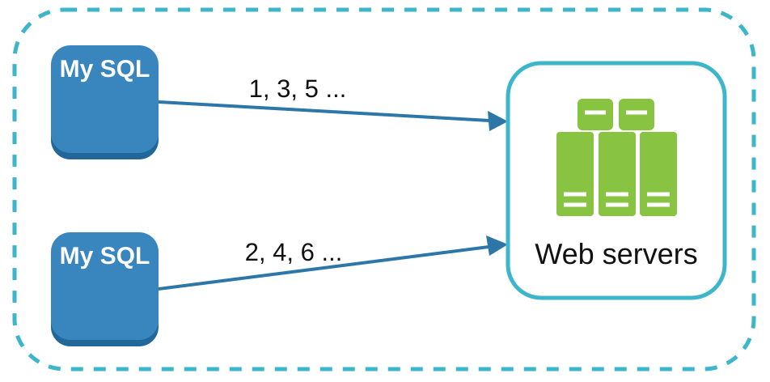
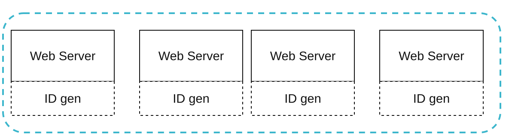
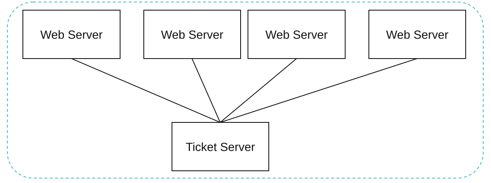
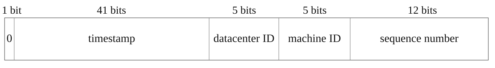
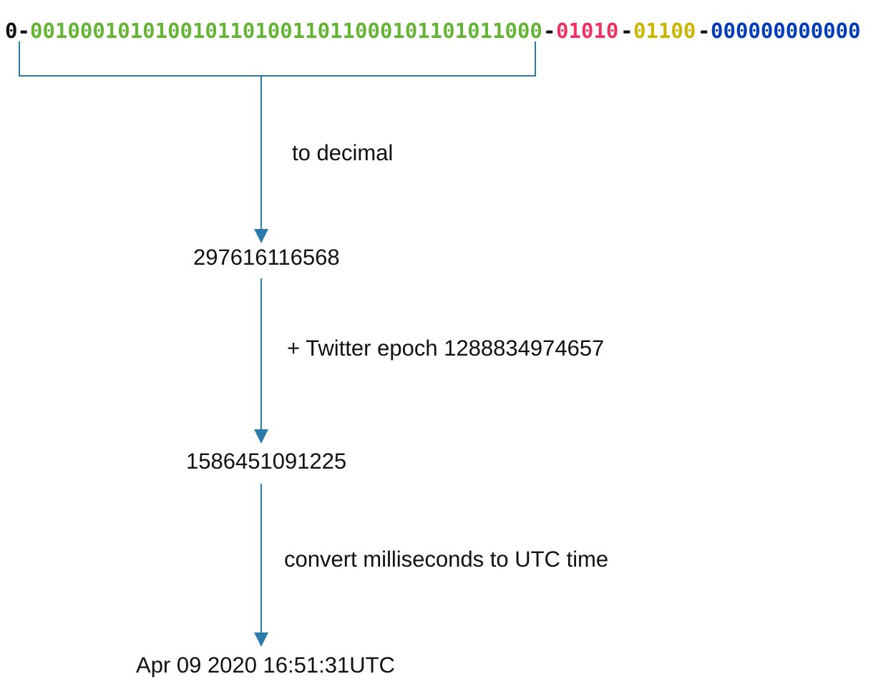

# Chapter 7: Design a Unique ID Generator in Distributed Systems
[Back to System Design](../Readme.md#content)

## Introduction

This chapter addresses the challenge of designing a **unique ID generator** for distributed systems. Traditional auto-increment keys are unsuitable in distributed environments due to scalability and synchronization challenges. The focus is on creating unique, sortable, 64-bit numerical IDs that meet the following requirements:
- IDs must be **unique** and **ordered by date**.
- IDs must fit within **64 bits**.
- The system should generate **over 10,000 IDs per second**.

## Step 1: Understand the Problem and Establish Design Scope

### Basic Requirements

- IDs must be unique and numerical and should fit in 64 bits.
- IDs increment with time but not strictly by `+1`.
- IDs should be sortable by date.
- The system must handle high throughput (10,000 IDs/sec).

## Step 2: Propose a High-Level Design and Get Buy-In

### **Multi-master replication**

  

This approach uses the database's `auto_increment` feature. Instead of increasing the next ID by 1, we increase it by `k`, where `k` is the number of database servers in use.

**Drawbacks:**
- Hard to scale across data centers.
- IDs do not always increase with time.
- Scaling issues when servers are added/removed.

### **UUID**

A **Universally Unique Identifier (UUID)** [[1]](#ref-1) is another easy way to obtain unique IDs. A UUID is a 128-bit number used to identify information in computer systems. UUIDs have a very low probability of collision.

The image below presents the UUID design.

  

**Advantages:**
- Generating a UUID is simple. No coordination is needed between servers.
- Scales easily with web servers.

**Drawbacks:**
- Exceeds the 64-bit requirement.
- IDs are not sortable by time and may be non-numeric.

### **Ticket Server**

Ticket servers are another interesting way to generate unique IDs. Flickr developed ticket servers to generate distributed primary keys [[2]](#ref-2).

The core idea is to centralize the `auto_increment` feature in a single database server (Ticket Server).

  

**Advantages:**
- Simple to implement for small-scale systems.
- Generates numeric IDs.

**Drawbacks:**
- Single point of failure.
- Synchronization challenges in multi-server setups.

### **Twitter Snowflake approach**

Twitter's unique ID generation system called "Snowflake" [[3]](#ref-3) is inspiring and can satisfy our requirements.

  

Divide IDs into sections to ensure uniqueness and scalability. Each section is explained below:
- **Sign Bit (1 bit):** Always `0`, potentially distinguishing signed and unsigned numbers.
- **Timestamp (41 bits):** Milliseconds since a custom epoch (Twitter's default is `1288834974657`, equivalent to Nov 04, 2010, 01:42:54 UTC). Ensures IDs are time-ordered.
- **Data Center ID (5 bits):** Identifies up to `2^5 = 32` data centers.
- **Machine ID (5 bits):** Identifies up to `2^5 = 32` machines within each data center.
- **Sequence Number (12 bits):** Tracks IDs generated on a machine within the same millisecond, supporting up to `2^12 = 4096` IDs per millisecond. The sequence resets to `0` every millisecond.

**Advantages:**
- **Scalability:** Handles 10,000+ IDs per second across multiple servers.
- **Time-Order:** Ensures IDs are sortable by time.
- **Decentralization:** No single point of failure.

## Step 3: Design Deep Dive

We are going to use Twitter's Snowflake ID generator.

  

Data center IDs and machine IDs are chosen at startup and generally remain fixed once the system is up and running.

### **Timestamp**

The most important 41 bits make up the timestamp section. As timestamps grow with time, IDs are sortable by time. The image below shows an example of how a binary representation is converted to UTC. You can also convert UTC back to a binary representation using a similar method.

  

The maximum timestamp that can be represented in 41 bits is 2^41 = 2199023255551 milliseconds (ms), which gives us ~69 years.

### **Sequence number**

The sequence number is 12 bits long, which gives us 2^12 = 4096 combinations. This field is 0 unless more than one ID is generated in a millisecond on the same server. In theory, a machine can support a maximum of 4096 new IDs per millisecond.

## Step 4: Wrap up

Additional talking points:
* **Clock Synchronization.**
  - Challenge: ID generation assumes synchronized clocks across servers.
  - Solution: **Network Time Protocol (NTP)** [[4]](#ref-4) is the most popular solution to this problem.
* **Section length tuning.**
  - Adjust section sizes (e.g., fewer sequence bits, more timestamp bits) based on the use case.
* **High availability.**
  - Since an ID generator is a mission-critical system, it must be highly available.

## Reference materials

1. [Universally unique identifier](https://en.wikipedia.org/wiki/Universally_unique_identifier)
2. [Ticket Servers: Distributed Unique Primary Keys on the Cheap](https://code.flickr.net/2010/02/08/ticket-servers-distributed-unique-primary-keys-on-the-cheap/)
3. [Announcing Snowflake](https://blog.twitter.com/engineering/en_us/a/2010/announcing-snowflake.html)
4. [Network time protocol](https://en.wikipedia.org/wiki/Network_Time_Protocol)
