# Chapter 14: Design YouTube
[Back to System Design](../Readme.md#content)

## Introduction
YouTube is a massive video streaming platform supporting video uploads, playback, and various interactions. This chapter focuses on designing a scalable video streaming system with the following core features:
- **Fast video uploads**
- **Smooth video streaming**
- **Ability to change video quality**
- **Low infrastructure cost**
- **High availability and reliability**

### Key Statistics (2020)
- **2 billion monthly active users**
- **5 billion videos watched per day**
- **37% of mobile internet traffic comes from YouTube**
- Available in **80 languages**
- **$15.1 billion in ad revenue** in 2019

## Step 1: Understand the Problem and Scope

### Core Functionalities
1. Upload videos
2. Watch videos

### Supported Platforms
- Mobile apps, web browsers, and smart TVs

### Assumptions
- **Daily Active Users (DAU):** 5 million
- **Average Video Size:** 300 MB
- **Upload Limits:** Max 1 GB per video
- **Daily Storage Need:** 150 TB
- **CDN Costs:** 5 million * 5 videos * 0.3 GB * $0.02 = $150,000/day (using Amazon CloudFront)

## Step 2: High-Level Design

At a high level, the system comprises three components.

    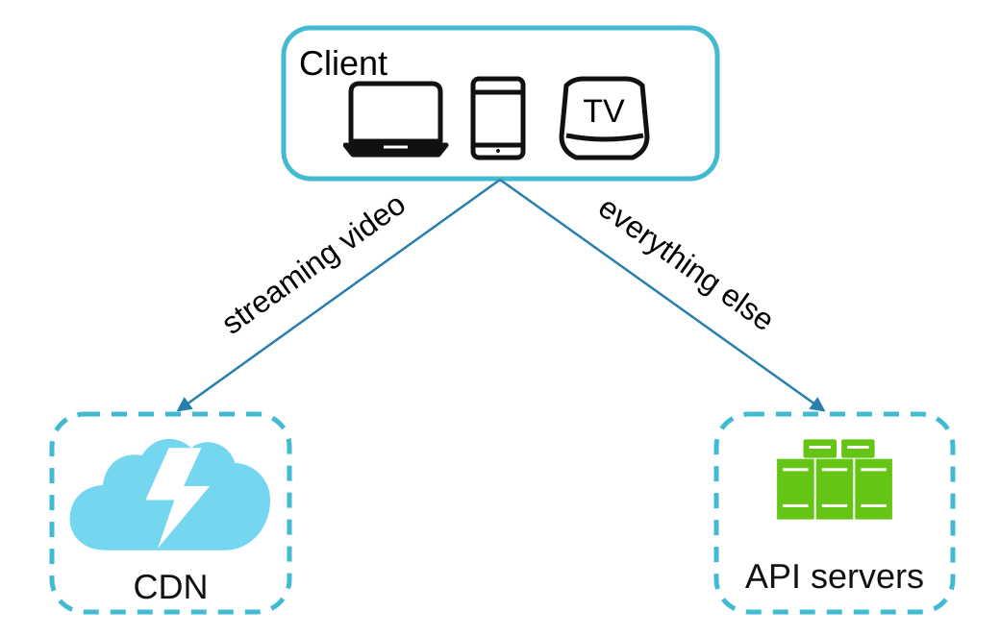

**Client**: You can watch YouTube on your computer, mobile phone, and smart TV.

**CDN**: Videos are stored in the CDN. When you press play, a video is streamed from the CDN.

**API servers**: Everything except video streaming goes through API servers. This includes feed recommendations, generating video upload URLs, updating the metadata database and cache, user signup, etc.

### Video Uploading Flow

The image below consists of the following components:
* **User**: A user watches YouTube on devices such as a computer, mobile phone, or smart TV.
* **Load balancer**: A load balancer evenly distributes requests among API servers.
* **API servers**: All user requests go through API servers except video streaming.
* **Metadata DB**: Video metadata are stored in the Metadata DB. It is sharded and replicated to meet performance and high-availability requirements.
* **Metadata cache**: For better performance, video metadata and user objects are cached.
* **Original storage**: A blob storage system is used to store original videos. A quotation from Wikipedia regarding blob storage states: “A Binary Large Object (BLOB) is a collection of binary data stored as a single entity in a database management system” [[6]](#ref-6).
* **Transcoding servers**: Video transcoding is also called video encoding. It is the process of converting a video from one format to other formats (MPEG, HLS, etc.), which provide the best video streams possible for different devices and bandwidth capabilities.
* **Transcoded storage**: It is a blob storage system that stores transcoded video files.
* **CDN**: Videos are cached in the CDN. When you click the play button, a video is streamed from the CDN.
* **Completion queue**: It is a message queue that stores information about video transcoding completion events.
* **Completion handler**: This consists of a list of workers that pull event data from the completion queue and update the metadata cache and database.

Now that we understand each component individually, let us examine how the video uploading flow works. The flow is broken down into two processes running in parallel:
* Upload the actual video.
* Upload video metadata.

#### **Upload the actual video**

    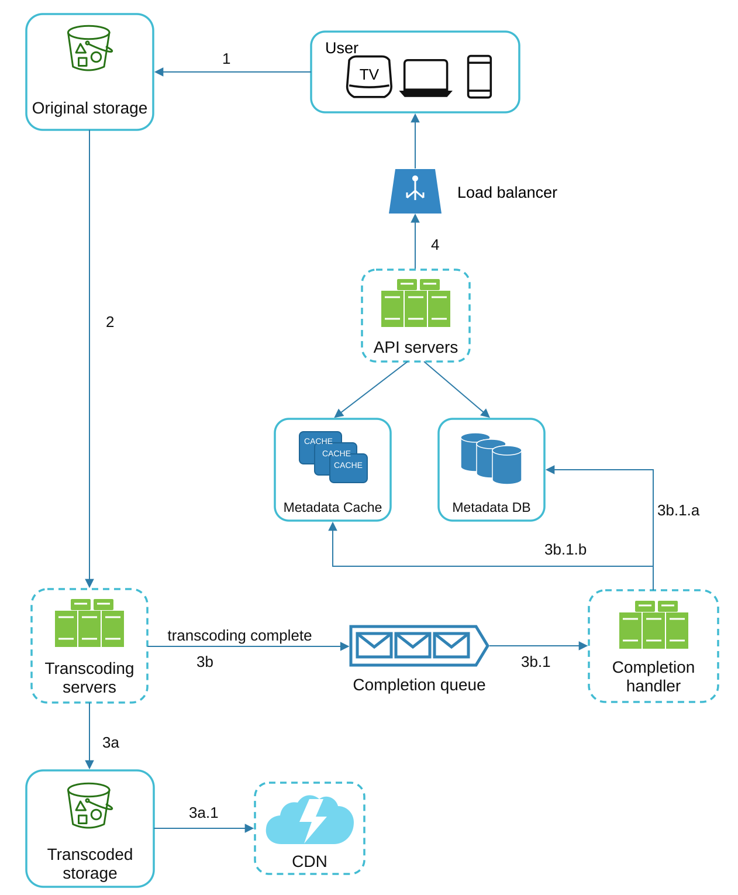

- [1] Videos are uploaded to the original storage.
- [2] Transcoding servers fetch videos from the original storage and start transcoding.
- [3] Once transcoding is complete, the following two steps are executed in parallel:
    - [3a] Transcoded videos are sent to transcoded storage.
    - [3b] Transcoding completion events are queued in the completion queue.
- [3a.1] Transcoded videos are distributed to the CDN.
- [3b.1] The completion handler contains a bunch of workers that continuously pull event data from the queue.
- [3b.1.a] and [3b.1.b] The completion handler updates the metadata database and cache when video transcoding is complete.
- [4] API servers inform the client that the video has been successfully uploaded and is ready for streaming.

#### **Update the metadata**

While a file is being uploaded to the original storage, the client in parallel sends a request to update the video metadata as shown in the image below. The request contains video metadata, including file name, size, format, etc. API servers update the metadata cache and database.

    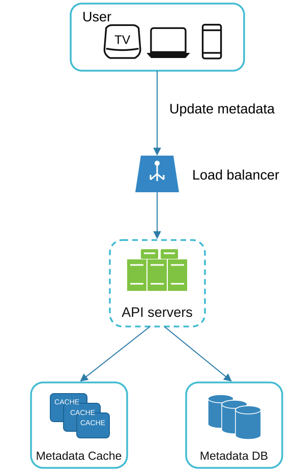

### Video Streaming Flow

  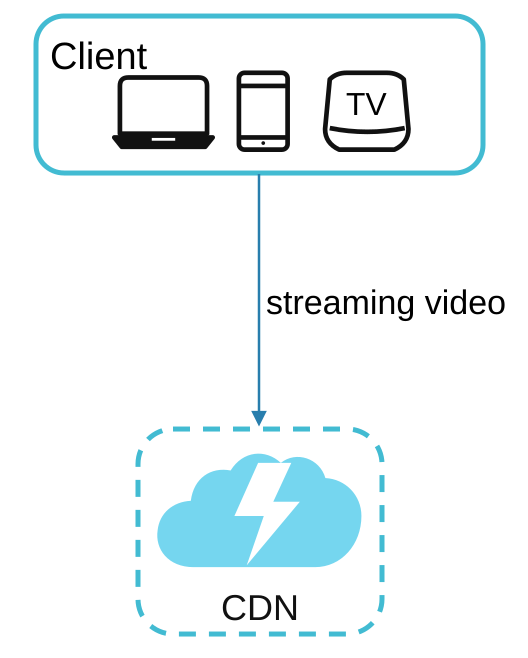

- Videos are streamed directly from the CDN using edge servers to minimize latency.
- Some popular streaming protocols are MPEG-DASH, Apple HLS, and Adobe HDS.
- Different streaming protocols support different video encodings and playback players.

## Step 3: Design Deep Dive

### Video Transcoding

#### **Importance**
1. Video transcoding reduces the large amount of storage space consumed by raw video.
2. It ensures compatibility across devices and browsers.
3. It adapts video quality to network conditions.

#### **Components**
- **Container:** Encapsulates video, audio, and metadata (e.g., MP4, AVI).
- **Codecs:** Compression and decompression algorithms (e.g., H.264, VP9).

#### **Directed Acyclic Graph (DAG) Model**

    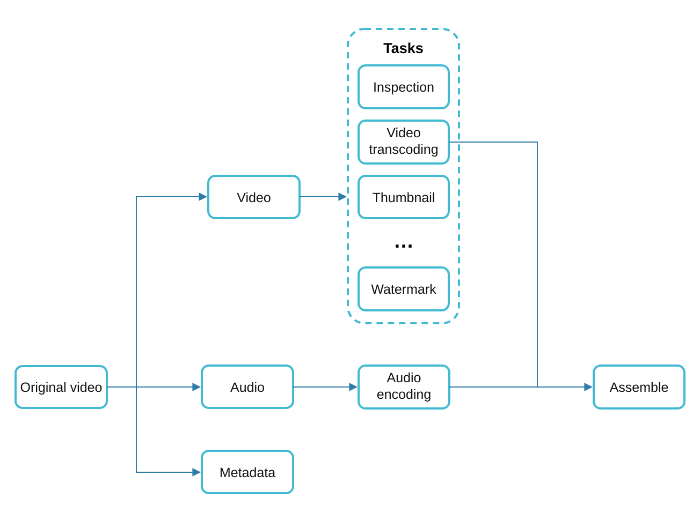

- Transcoding a video is computationally expensive and time-consuming.
- The DAG model defines tasks like encoding, thumbnail generation, and watermarking.
- It allows high parallelism in video processing.
- The original video is split into video, audio, and metadata.
    - Inspection: Make sure videos are of good quality and are not malformed.
    - Video encodings: Videos are converted to support different resolutions, codecs, and bitrates.
    - Thumbnail: It can either be uploaded by a user or automatically generated by the system.
    - Watermark: An image overlay on top of a video contains identifying information about the video.

The image below shows an example of encoded video files.

    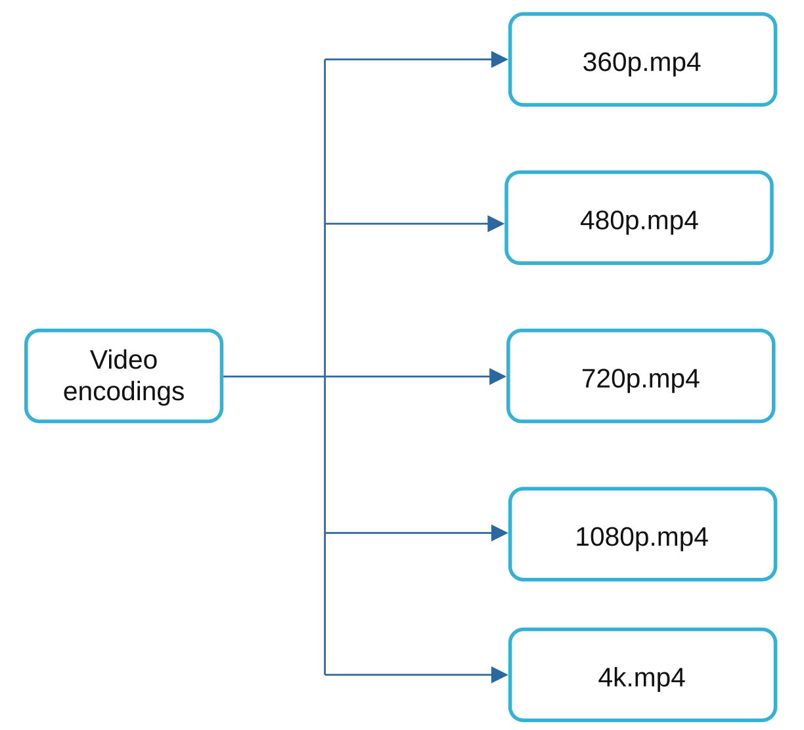

### Video Transcoding Architecture

The architecture has six main components: preprocessor, DAG scheduler, resource manager, task workers, temporary storage, and encoded video as the output.

    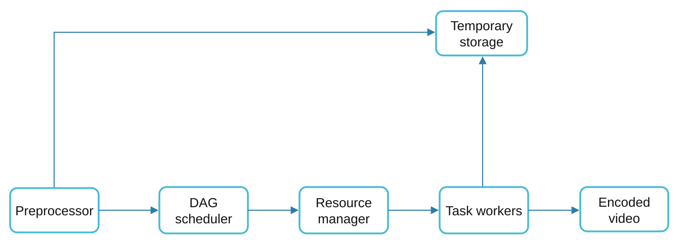

1. **Preprocessor**

    The preprocessor has 4 responsibilities:
    1. Video splitting. The video stream is split or further split into smaller segments aligned with Group of Pictures (GOP) boundaries. A GOP is a group / chunk of frames arranged in a specific order. Each chunk is an independently playable unit, usually a few seconds in length.
    2. Some old mobile devices or browsers might not support video splitting. The preprocessor splits videos by GOP alignment for old clients.
    3. DAG generation. The preprocessor generates a DAG based on configuration files client programmers write. The image below shows two configuration files which can create a DAG representation.
        

            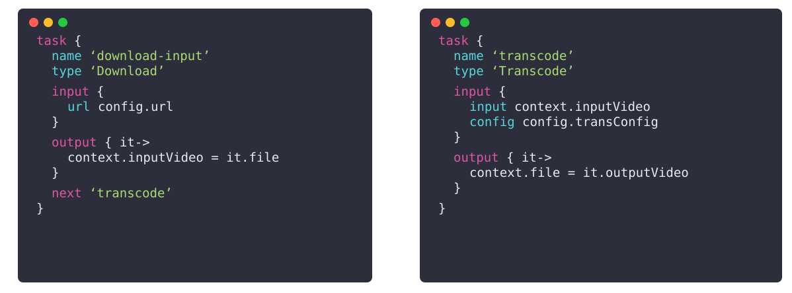
        

    4. Cache data. The preprocessor is a cache for segmented videos. For better reliability, the preprocessor stores GOPs and metadata in temporary storage. If video encoding fails, the system could use persisted data for retry operations.

2. **DAG Scheduler**

    The DAG scheduler splits a DAG graph into stages of tasks and puts them in the task queue in the resource manager. The image below shows an example of how the DAG scheduler works.

    

        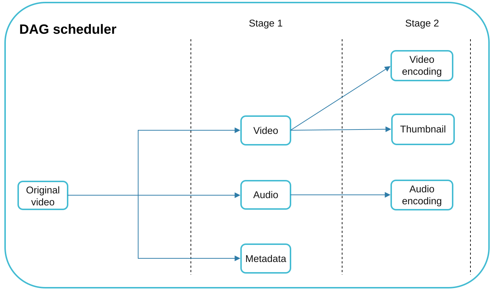
    

    The original video is split into 2 stages:
    - Stage 1: video, audio, and metadata.
    - Stage 2: video encoding, thumbnail, and audio encoding.

3. **Resource Manager**

    The resource manager is responsible for managing the efficiency of resource allocation. It contains 3 queues and a task scheduler as shown in the image below.

    

        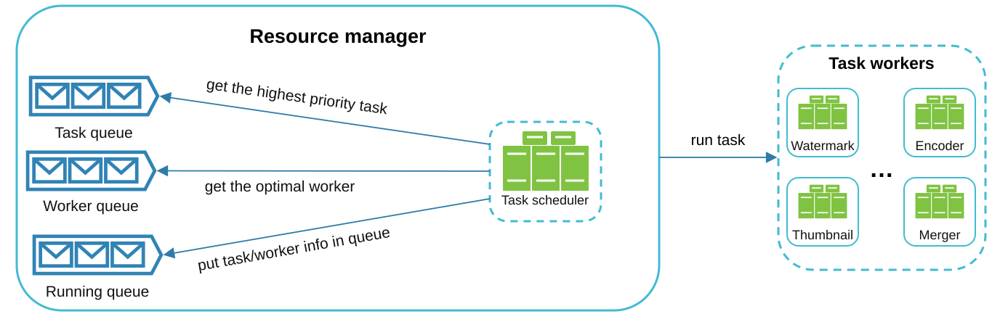
    

    - Task queue: a priority queue that contains tasks to be executed.
    - Worker queue: a priority queue that contains worker utilization info.
    - Running queue: contains info about the currently running tasks and workers running the tasks.
    - Task scheduler: picks the optimal task/worker and instructs the chosen task worker to execute the job.

4. **Task Workers**

    Task workers run the tasks which are defined in the DAG. Different task workers may run different tasks as shown in the image below.

    

        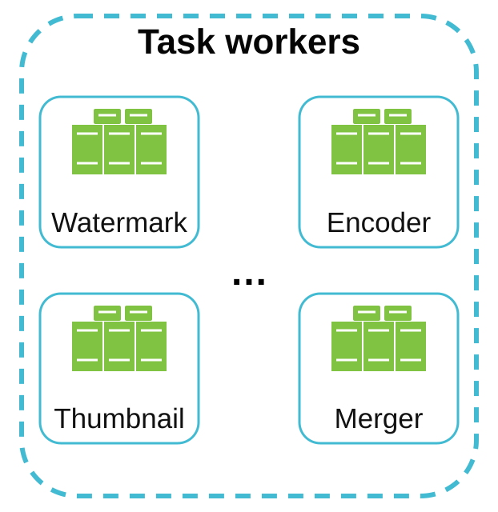
    

5. **Temporary Storage**

    Multiple storage systems are used here.
    * For instance, metadata is frequently accessed by workers, and the data size is usually small. Thus, caching metadata in memory is a good idea.
    * For video or audio data, we put them in blob storage.
    The choice of storage system depends on factors like data type, data size, access frequency, data life span, etc.
    * Data in temporary storage is freed up once the corresponding video processing is complete.

6. **Output**

    Encoded video is the final output of the encoding pipeline. Here is an example of the output: `funny_720p.mp4`

## System Optimizations

### Speed Optimizations

#### **Parallelize video uploading**

Split videos into smaller chunks for faster, resumable uploads.

#### **Place upload data centers close to users**

Use CDNs as upload centers.

#### **Parallelism everywhere**

Decouple modules using message queues for high parallelism.

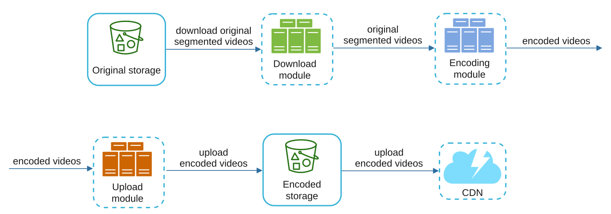

To make the system more loosely coupled, we introduced message queues as shown in the image below.

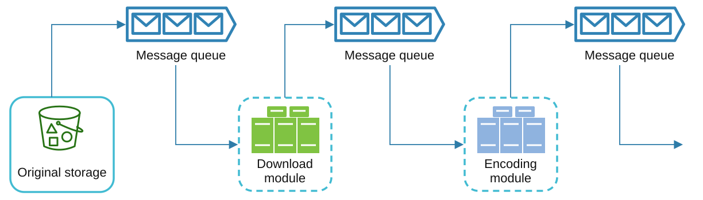

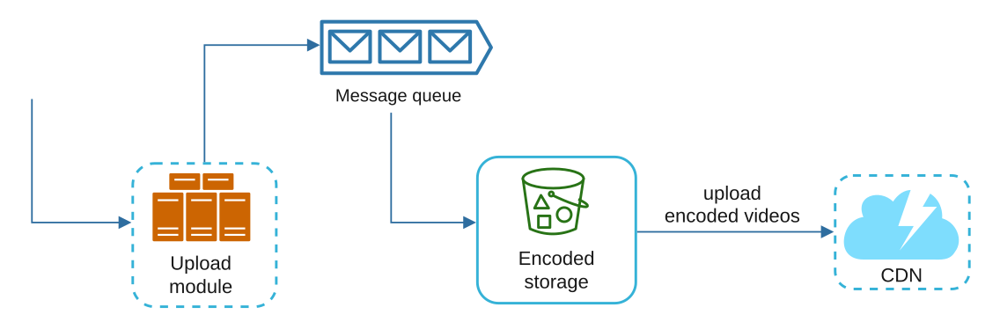

### Safety Optimizations

#### **Pre-Signed URLs**

Restrict video uploads to authorized users using pre-signed URLs as shown below.

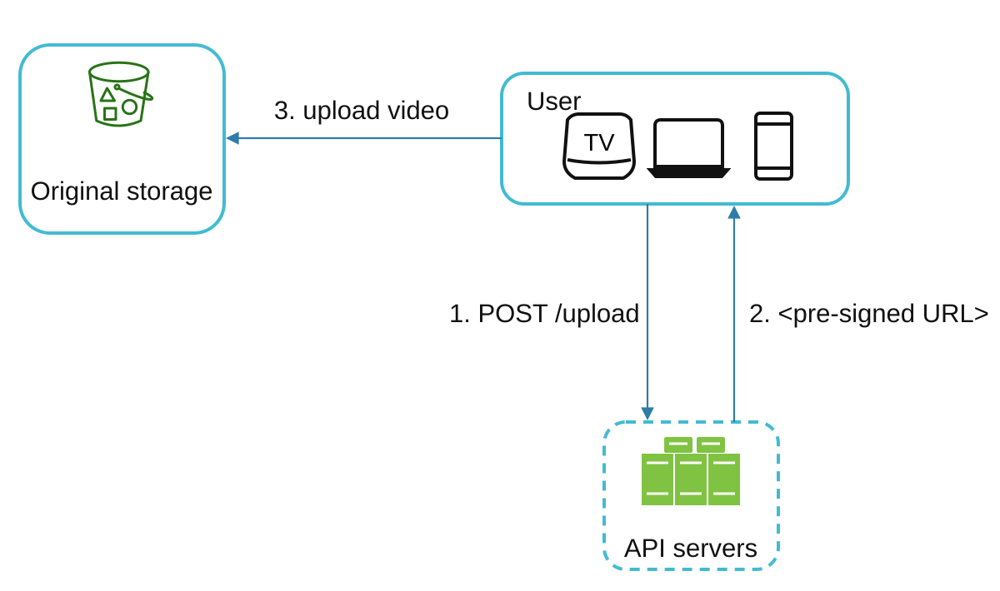

The upload flow is updated as follows:
1. The client makes an HTTP request to API servers to fetch the pre-signed URL, which gives access permission to the object identified in the URL. The term pre-signed URL is used when uploading files to Amazon S3. Other cloud service providers might use a different name. For instance, Microsoft Azure blob storage supports the same feature, but calls it “Shared Access Signature” [[10]](#ref-10).
2. API servers respond with a pre-signed URL.
3. Once the client receives the response, it uploads the video using the pre-signed URL.

#### **Protect your videos**

- **DRM Systems** - Major DRM systems include Apple FairPlay and Google Widevine.
- **AES Encryption** - You can encrypt a video and configure an authorization policy.
- **Watermarking** - Add a watermark to help identify this video. It could be a logo or a company name.

### Cost-Saving Optimizations

The CDN is a crucial component of our system. It ensures fast video delivery on a global scale. However, from the back-of-the-envelope calculation, we know the CDN is expensive, especially when the data size is large. How can we reduce the cost?

1. Serve only popular videos via the CDN; serve less popular ones from high-capacity servers.
2. Encode on demand for rarely accessed videos.
3. Regionalize video distribution based on popularity.
4. Build custom CDNs and partner with ISPs to reduce bandwidth costs.

## Error Handling

### Recoverable Errors
- Retry failed uploads, transcoding, or resource allocation tasks.

### Non-Recoverable Errors
- Stop malformed video processing and return error codes.

## Step 4: Wrap-up

In this chapter, we presented the architecture design for video streaming services like YouTube. If there is extra time at the end of the interview, here are a few additional points:
* Scale the API tier: Because API servers are stateless, it is easy to scale the API tier horizontally.
* Scale the database: You can talk about database replication and sharding.
* Live streaming: It refers to the process by which a video is recorded and broadcast in real time. Although our system is not designed specifically for live streaming, live streaming and non-live streaming have some similarities: both require uploading, encoding, and streaming.
* Video takedowns: Videos that violate copyright, contain pornography, or involve other illegal acts shall be removed. Some can be discovered by the system during the upload process, while others might be discovered through user flagging.

## Reference materials

1. [YouTube by the numbers](https://www.omnicoreagency.com/youtube-statistics/)
2. [2019 YouTube Demographics](https://blog.hubspot.com/marketing/youtube-demographics)
3. [CloudFront Pricing](https://aws.amazon.com/cloudfront/pricing/)
4. [Netflix on AWS](https://aws.amazon.com/solutions/case-studies/netflix/)
5. [Akamai homepage](https://www.akamai.com/)
6. [Binary large object](https://en.wikipedia.org/wiki/Binary_large_object)
7. [Here’s What You Need to Know About Streaming Protocols](https://www.dacast.com/blog/streaming-protocols/)
8. [SVE: Distributed Video Processing at Facebook Scale](https://www.cs.princeton.edu/~wlloyd/papers/sve-sosp17.pdf)
9. [Video-on-Demand Transcoding Architecture Best Practices (in Chinese)](https://developer.volcengine.com/resource/7272947763787071544/)
10. [Delegate access with a shared access signature](https://docs.microsoft.com/en-us/rest/api/storageservices/delegate-access-with-shared-access-signature)
11. [YouTube scalability talk by early YouTube employee](https://www.youtube.com/watch?v=w5WVu624fY8)
12. [Understanding the characteristics of internet short video sharing: A YouTube-based measurement study](https://arxiv.org/pdf/0707.3670.pdf)
13. [Content Popularity for Open Connect](https://netflixtechblog.com/content-popularity-for-open-connect-b86d56f613b)
