# Chapter 16: Proximity Service

<sub>[Back to System Design](../Readme.md#content)</sub>

## Introduction

A **proximity service** is designed to find nearby locations, such as restaurants, hotels, gas stations, and other businesses. This functionality is used in applications like **Google Maps** and **Yelp** to help users discover places within a defined radius.

## Step 1: Understanding the Problem and Establishing Scope

### **Functional Requirements**

1. **Search for businesses** based on user location (latitude, longitude) and search radius.
2. **Allow business owners** to add, update, or delete businesses (not in real time).
3. **Provide detailed business information** when requested.

### **Non-Functional Requirements**

- **Low latency**: Users should get quick responses.
- **Data privacy**: Compliance with GDPR and CCPA regulations.
- **High availability**: Handle peak-hour spikes in busy locations.

### **Back-of-the-Envelope Estimation**

- **100 million daily active users**.
- **200 million businesses** in the system.
- **Search QPS Calculation**:
  - Users make **5 searches per day**.
  - **Search QPS** = (100M × 5) / 86,400 ≈ **5,000 QPS**.

## Step 2: High-Level Design

### **API Design**

#### **Search for Nearby Businesses**
GET /v1/search/nearby

- **Request Parameters**:
  - `latitude`: User’s location latitude.
  - `longitude`: User’s location longitude.
  - `radius`: Search radius (default: 5000 m).

#### **Business APIs**

| API Endpoint                     | Description                                      |
|-----------------------------------|--------------------------------------------------|
| `GET /v1/businesses/{id}`         | Fetch detailed business info                    |
| `POST /v1/businesses`             | Add a new business                              |
| `PUT /v1/businesses/{id}`         | Update business details                         |
| `DELETE /v1/businesses/{id}`      | Remove a business from the system               |

### **Data Model**

- Since the read volume is high because two features are very commonly used, a relational database such as MySQL is a good fit.
  - Search for nearby businesses
  - View the detailed information about a business

### **Data Schema**

- Key database tables are the business table and the geospatial index table.
- The business table contains detailed information about a business.

### **High-Level System Architecture**

The system comprises two parts: a location-based service (LBS) and a business-related service.

<div style="margin-left:3rem">
  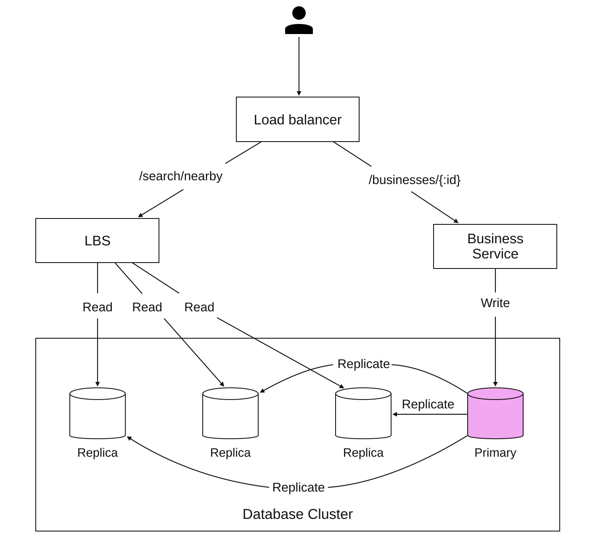
</div>

#### **Load Balancer**

Routes traffic to the LBS and business service.

#### **Location-Based Service (LBS)**

- Processes location-based search queries.
- Read-heavy service with no write requests.
- QPS is high, especially during peak hours in dense areas, and the system is stateless.
- This service is stateless, so it's easy to scale horizontally.

#### **Business Service**

Deals with two types of requests:
- Business owners create, update, or delete businesses.
- Customers view detailed information about a business.

#### **Database Cluster**

- Uses a **primary-replica architecture** for read-heavy workloads.
- There might be some discrepancy between data read by LBS and data written by the primary database.
- This inconsistency is not an issue because the business information is not updated in real time.

#### **Scalability**

Both the business service and LBS are stateless services, so it's easy to automatically add or remove servers.

### Algorithms for Fetching Nearby Businesses

### **Option 1: Two-Dimensional Search (Naive Approach)**

<div style="margin-left:3rem">
  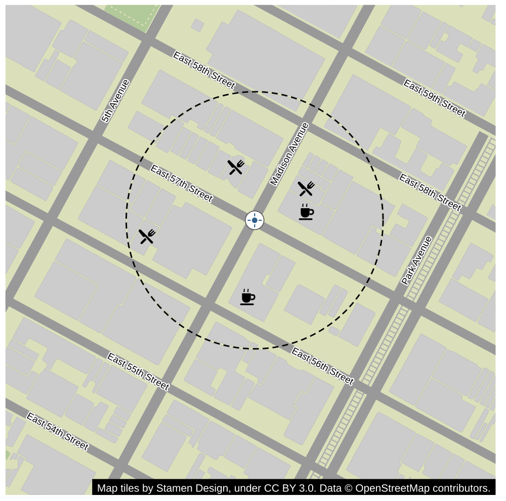
</div>

The most intuitive way is to draw a circle with a predefined radius and find all the businesses within the circle.

**SQL Query:**

```sql
SELECT business_id, latitude, longitude
FROM business
WHERE (latitude BETWEEN :lat - radius AND :lat + radius)
AND (longitude BETWEEN :long - radius AND :long + radius);
```
**Problems:**
- **Inefficient**: Requires scanning the entire database.
- **Limited by one-dimensional indexes** (latitude/longitude).

A potential improvement is to build indexes on the longitude and latitude columns. Although this is slightly better, it is still very slow.

For example, we can quickly retrieve `dataset 1` and `dataset 2`, thanks to indexes on longitude and latitude columns, but to fetch businesses within the radius, we need to perform an intersection operation on those two datasets. This is not efficient because each dataset contains a lot of data.

<div style="margin-left:3rem">
  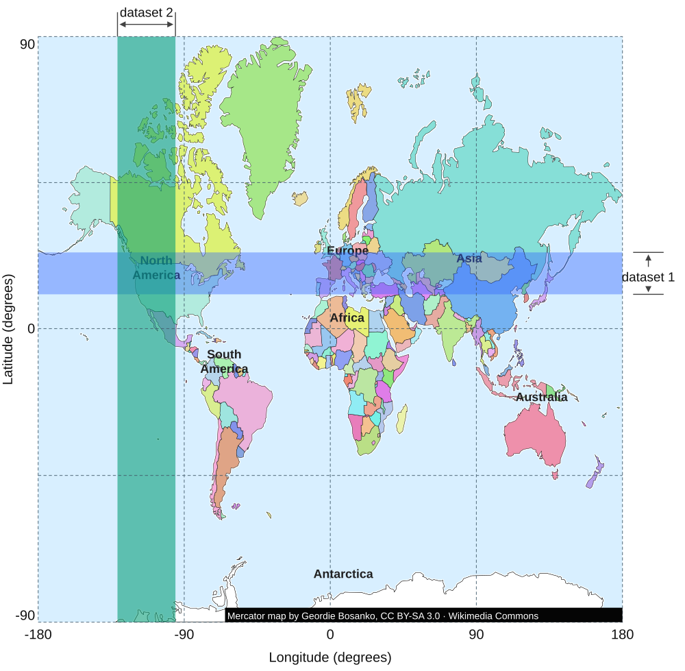
</div>

#### **Better Approach**

- The problem with the previous approach is that the database index can only increase search speed in one dimension.
- An optimal approach is to represent the two-dimensional data in one dimension using geospatial indexing.
  - Hash: Even grid, Geohash, Cartesian Tiers [[12]](#ref-12), etc.
  - Tree: Quadtree, Google S2, R-tree [[13]](#ref-13), etc.

<div style="margin-left:3rem">
  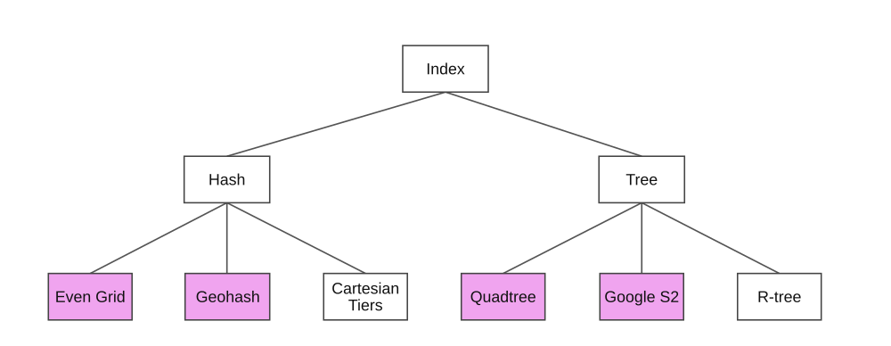
</div>

### **Option 2: Evenly Divided Grid**

<div style="margin-left:3rem">
  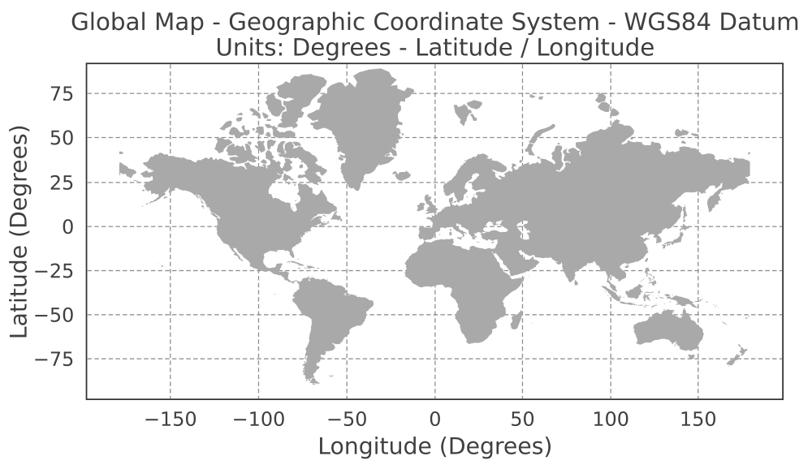
</div>

- **Divides the world into fixed-size grids**.
- **Issue**: Uneven business distribution (high density in cities, low density in rural areas).

### **Option 3: Geohash**

Geohash is better than the evenly divided grid option. It works by reducing the two-dimensional longitude and latitude data into a one-dimensional string of letters and digits. Geohash algorithms work by recursively dividing the world into smaller and smaller grids with each additional bit.

Algorithm steps:
1. Divide the planet into four quadrants along the prime meridian and equator.
2. Divide each grid into four smaller grids. Each grid can be represented by alternating between longitude and latitude bits.
3. Repeat this subdivision.

<div style="margin-left:3rem">
  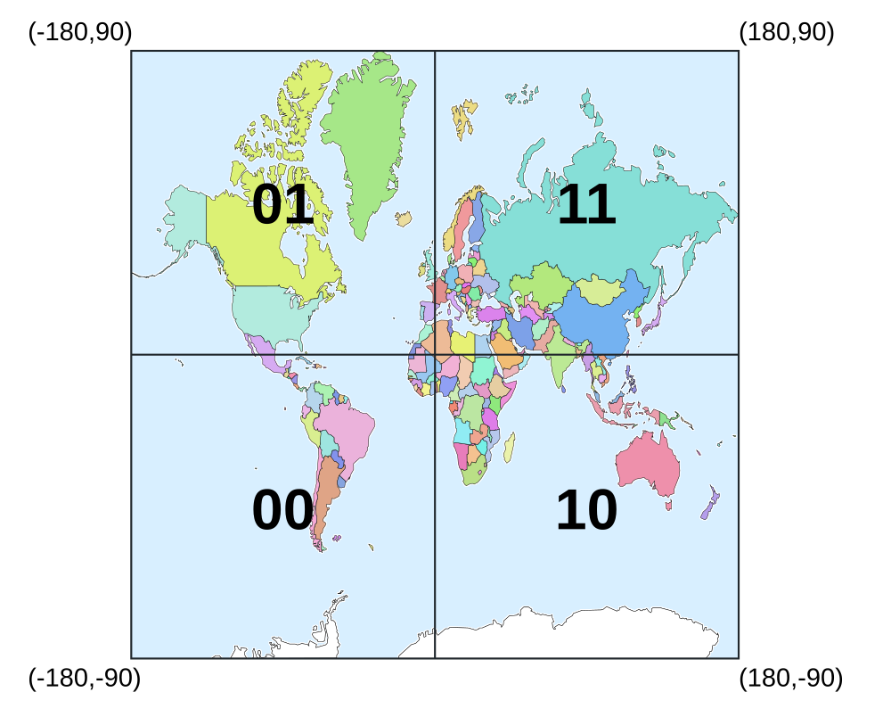
  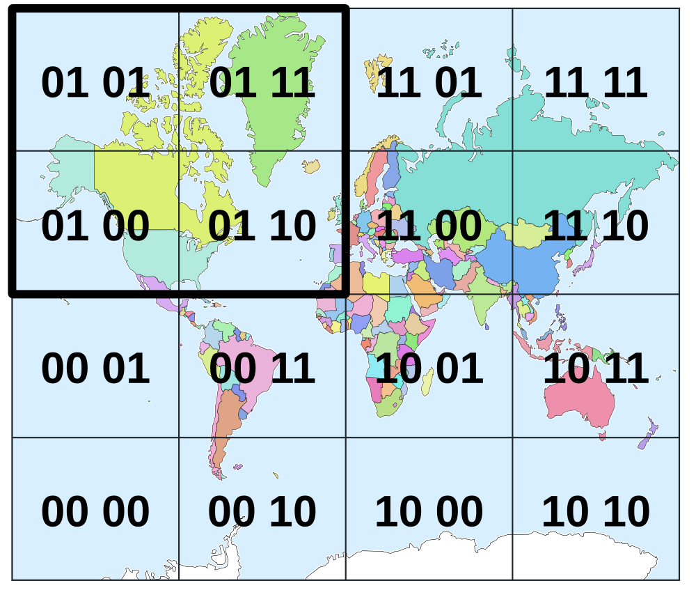
</div>

- **Encodes latitude and longitude into a single alphanumeric string**. It has 12 precision levels.
- **Hierarchical grid structure** allows for efficient searching.
- The right precision is chosen by using the minimal geohash length according to the table.

<div style="margin-left:3rem">
  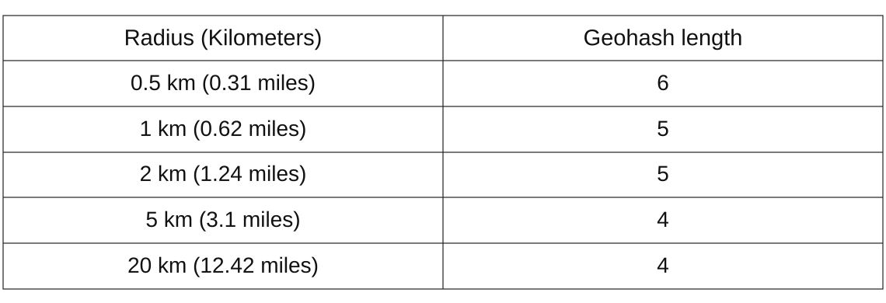
</div>

- Geohash guarantees that the longer a shared prefix is between two geohashes, the closer they are.

#### **Boundary issues**

Geohashing guarantees that the longer a shared prefix is between two geohashes, the closer they are. As shown in the image below, all the grids have a shared prefix: `9q8zn`.

<div style="margin-left:3rem">
  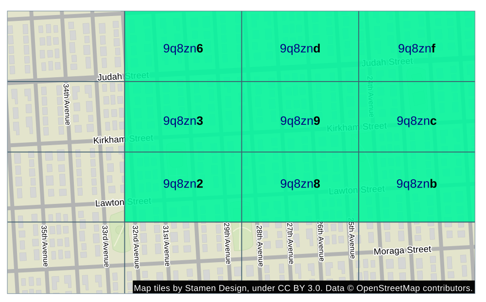
</div>

#### **Boundary issue - 1**

However, the reverse is not true: two locations can be very close but have no shared prefix at all. For example, equator locations belong to different 'halves' of the world.

#### **Boundary issue - 2**

Two locations can have a long shared prefix but belong to different geohashes.

#### **Not enough businesses**

What should we do if there are not enough businesses returned from the current grid and all the neighbors combined?

Two options:
1. Only return businesses within the radius. Easy to implement, but not good enough for users.
2. Increase the search radius. It could be done by removing a digit.

<div style="margin-left:3rem">
  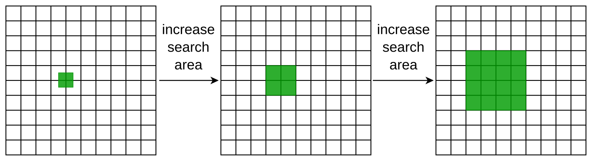
</div>

### **Option 4: Quadtree**

A **quadtree** [[18]](#ref-18) is a tree data structure that recursively divides a two-dimensional space into four quadrants, with each internal node having exactly four children, representing the four sub-regions of the space.
- The quadtree is an in-memory data structure that runs on each LBS server and is built when the server starts.

<div style="margin-left:3rem">
  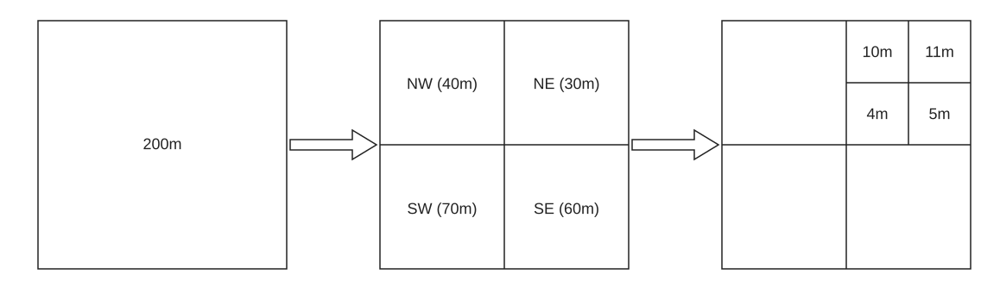
</div>

- The root node is recursively broken down into 4 quadrants until no nodes are left with more than x businesses (100 in this case).

<div style="margin-left:3rem">
  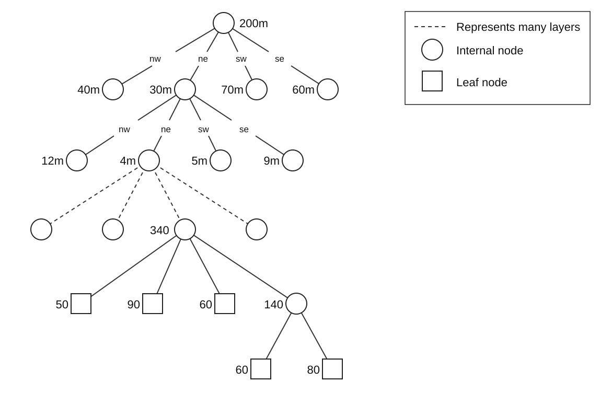
</div>

- The quadtree index doesn't take too much memory (typically in GBs) and can easily fit on one server.
- Since the time complexity to build the tree is `O(n log n)`, it might take a few minutes to build the tree.
- **Efficient for k-nearest search queries** (e.g., find the closest gas station).

#### **Real-world quadtree example**

<div style="margin-left:3rem">
  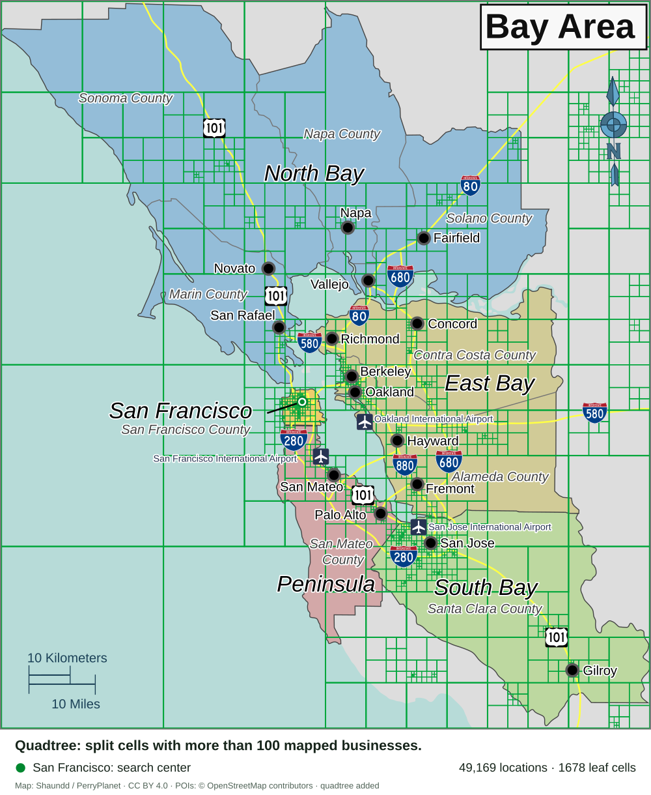
</div>

#### **Operational considerations**

- For around 200 million businesses, it might take a few minutes to build a quadtree when the server starts.
- While the quadtree is being built, it cannot serve traffic; therefore, a new release should be rolled out incrementally to a subset of servers.
- When updating a business or adding a new one, the easiest approach is to incrementally rebuild the quadtree. (This leads to a lot of cache invalidation.)
- It is also possible to update the quadtree on the fly, but it is more complex to implement. (It needs a locking mechanism.)

### **Option 5: Google S2**

The Google S2 geometry library [[22]](#ref-22) is another big player in this field. It is an in-memory solution too. It maps a sphere to a 1D index based on a Hilbert curve [[23]](#ref-23). The Hilbert curve has an important property: two points that are close to each other on the Hilbert curve are close in 1D space.

<div style="margin-left:3rem">
  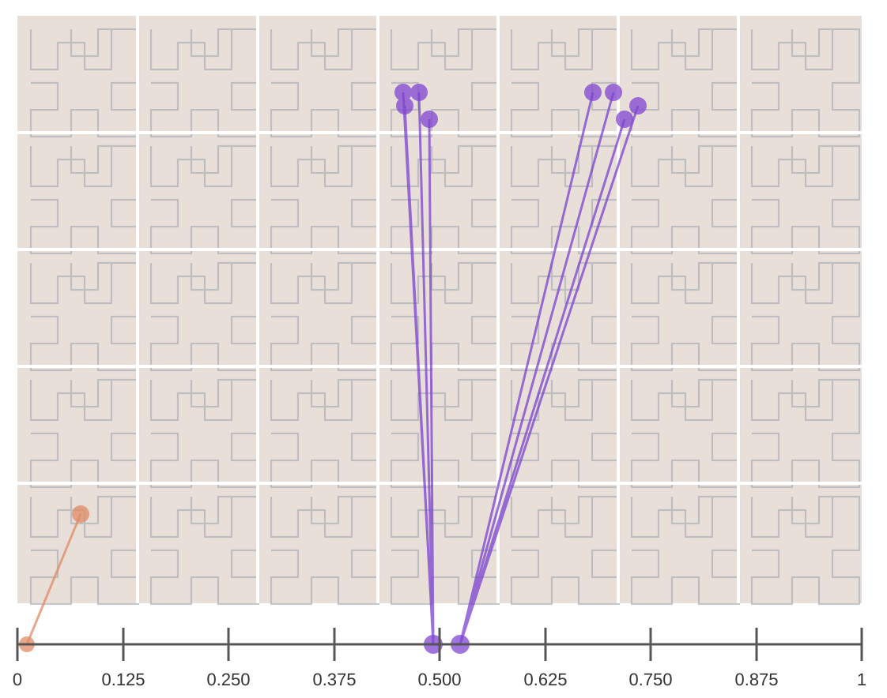
  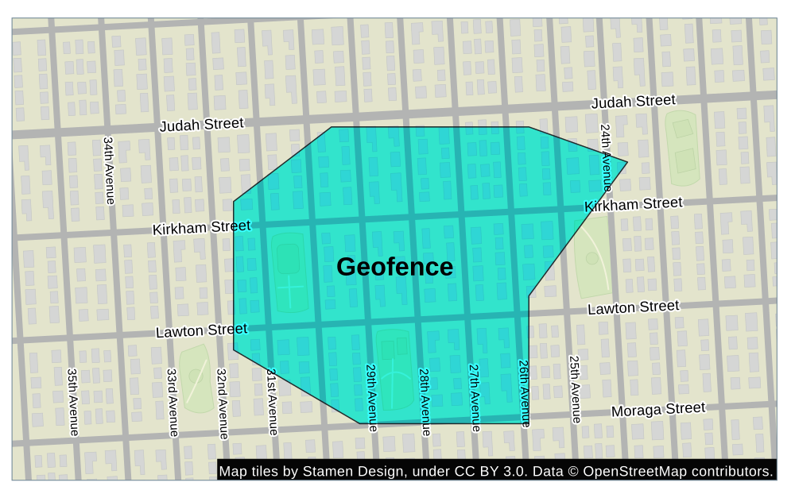
</div>

- **Divides the Earth into small cells using a Hilbert curve**.
- Great for geofencing because it can cover arbitrary areas with varying levels.
- Geofencing also allows us to define perimeters that surround the area of interest.
- Another advantage is that, instead of having a fixed level of precision, we can specify minimum and maximum levels and a maximum number of cells in S2.

### **Recommendation**

Different companies or technologies adopt different options:

* **Geohash** - Bing Maps [[27]](#ref-27), Redis [[10]](#ref-10), MongoDB [[28]](#ref-28), Lyft [[29]](#ref-29).
* **Quadtree** - Yext [[21]](#ref-21).
* **Both Geohash and Quadtree** - Elasticsearch [[30]](#ref-30).
* **S2** - Google Maps, Tinder [[31]](#ref-31).

### **Tradeoff comparison**

#### **Geohash**

- Easy to use and implement — no need to build/rebuild a tree.
- Supports fixed-radius results.
- Updating the index is easy.
- Cannot dynamically adjust the grid size based on population density.

#### **Quadtree**

- Slightly harder to implement.
- Supports fetching k-nearest businesses.
- Can dynamically adjust the grid size based on population density.
- Updating the index is more complicated, as we might need to rebuild the whole tree.

## Step 3: Design Deep Dive

### **Business Table**

The data for the business table may not all fit on one server, so it is a good candidate for sharding. The easiest approach is to **shard everything by business ID**. That would ensure that load is evenly distributed.

### **Geospatial index table**

There are two ways to structure the table:
* Option 1: For each geohash key, there is a JSON array of business IDs in a single row. This means all business IDs within a geohash are stored in one row.
* Option 2: If there are multiple businesses in the same geohash, there will be multiple rows, one for each business. This means different business IDs within a geohash are stored in different rows.

| Geohash | Business ID |
|---------|------------|
| 9q9hvu  | 343        |
| 9q9hvu  | 347        |
| 9q9hvu  | 112        |

It's recommended to use Option 2.

### **Scaling the Geospatial Index**

- Sharding might not be a good fit for the geohash table. In this case, everything can fit on a single server, so there's no technical reason for sharding.
- A better approach is to have read replicas to help with read loads.

### **Cache Strategy**

The most obvious cache key choice is the location coordinate; however, it has a few issues:
- Location coordinates from GPS are not accurate.
- A user can move, causing the location coordinate to change.
- A better key is the geohash.

| Cache Key  | Cache Value |
|------------|------------|
| `geohash`  | List of business IDs in that grid |
| `business_id` | Business details (name, address, reviews, etc.) |

#### **List of business IDs in a grid**

Since business data is relatively stable, we precompute the list of business IDs for a given geohash and store it in a key-value store such as Redis.

### **Regions and Availability Zones**

Deploy the LBS and business service **across multiple regions**.

### **Final System Architecture**

<div style="margin-left:3rem">
  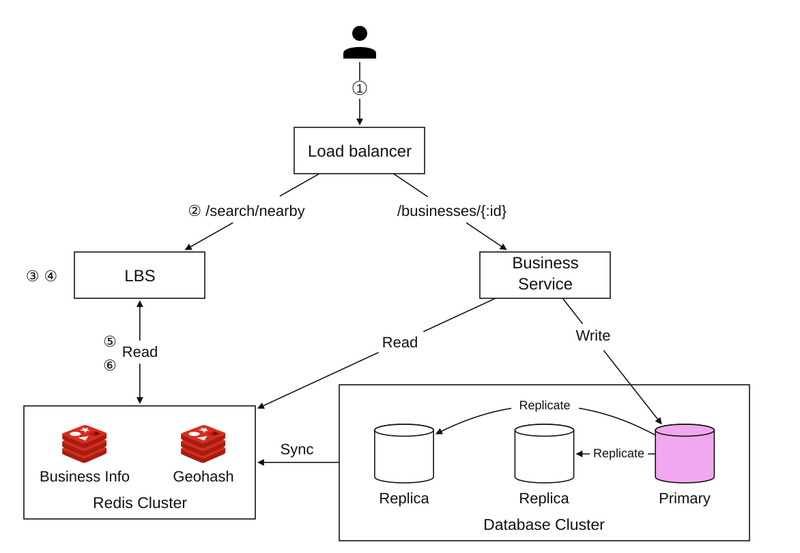
</div>

**Get Nearby Businesses**:

1. You try to find restaurants within 500 meters on Yelp. The client sends the user location (latitude = 37.776720, longitude = -122.416730) and radius (500m) to the **Load Balancer (LB)**.
2. The LB forwards the request to the **Location-Based Service (LBS)**.
3. Based on the user location and radius info, the LBS finds the geohash length that matches the search.
4. LBS calculates neighboring geohashes and adds them to the list. The result looks like this:
    ```text
     list_of_geohashes = [my_geohash, neighbor1_geohash, neighbor2_geohash, …, neighbor8_geohash]
     ```
5. For each geohash in `list_of_geohashes`, LBS calls the **Geohash Redis server** to fetch corresponding business IDs. Calls to fetch business IDs for each geohash can be made in parallel to reduce latency.
6. Based on the list of business IDs returned, LBS fetches fully hydrated business information from the **Business Info Redis server**, then calculates distances between a user and businesses, ranks them, and returns the result to the client.

### Key Optimizations

- **Parallel Redis Calls**: Reduce response time.
- **Geohash Indexing**: Ensures efficient spatial queries.
- **Caching**: Speeds up lookup and retrieval of business data.

This method ensures **low-latency, scalable** retrieval of businesses near a user’s location.

## Step 4: Wrap Up

| Indexing Method | Pros | Cons |
|----------------|------|------|
| **Geohash** | Easy to implement, efficient for proximity search | Boundary issues, fixed grid size |
| **Quadtree** | Dynamically adjusts to density, supports k-nearest queries | More complex, requires tree rebalancing |
| **Google S2** | Advanced geofencing, used in Google Maps | Harder to implement |

## Reference materials

1. <a id="ref-1"></a>[Yelp](https://www.yelp.com/)
2. <a id="ref-2"></a>[Map tiles by Stamen Design](http://maps.stamen.com/)
3. <a id="ref-3"></a>[OpenStreetMap](https://www.openstreetmap.org)
4. <a id="ref-4"></a>[GDPR](https://en.wikipedia.org/wiki/General_Data_Protection_Regulation)
5. <a id="ref-5"></a>[CCPA](https://en.wikipedia.org/wiki/California_Consumer_Privacy_Act)
6. <a id="ref-6"></a>[Pagination in the REST API](https://developer.atlassian.com/server/confluence/pagination-in-the-rest-api/)
7. <a id="ref-7"></a>[Google Places API](https://developers.google.com/maps/documentation/places/web-service/search)
8. <a id="ref-8"></a>[Yelp Places API — Business Search](https://docs.developer.yelp.com/reference/v3_business_search)
9. <a id="ref-9"></a>[Regions and Zones](https://docs.aws.amazon.com/AWSEC2/latest/UserGuide/using-regions-availability-zones.html)
10. <a id="ref-10"></a>[Redis GEOHASH](https://redis.io/commands/GEOHASH)
11. <a id="ref-11"></a>[PostGIS](https://postgis.net/)
12. <a id="ref-12"></a>[Apache SpatialLucene and Cartesian tiers](https://cwiki.apache.org/confluence/spaces/LUCENEJAVA/pages/120735316/SpatialLucene)
13. <a id="ref-13"></a>[R-tree](https://en.wikipedia.org/wiki/R-tree)
14. <a id="ref-14"></a>[Global map in a Geographic Coordinate Reference System](https://bit.ly/3DsjAwg)
15. <a id="ref-15"></a>[Base32](https://en.wikipedia.org/wiki/Base32)
16. <a id="ref-16"></a>[Geohash grid aggregation](https://bit.ly/3kKl4e6)
17. <a id="ref-17"></a>[Geohash](https://www.movable-type.co.uk/scripts/geohash.html)
18. <a id="ref-18"></a>[Quadtree](https://en.wikipedia.org/wiki/Quadtree)
19. <a id="ref-19"></a>[How many leaves has a quadtree](https://stackoverflow.com/questions/35976444/how-many-leaves-has-a-quadtree)
20. <a id="ref-20"></a>[Blue-green deployment](https://martinfowler.com/bliki/BlueGreenDeployment.html)
21. <a id="ref-21"></a>[Bing Maps Tile System and quadkeys](https://learn.microsoft.com/en-us/bingmaps/articles/bing-maps-tile-system)
22. <a id="ref-22"></a>[S2](https://s2geometry.io/)
23. <a id="ref-23"></a>[Hilbert curve](https://en.wikipedia.org/wiki/Hilbert_curve)
24. <a id="ref-24"></a>[Hilbert mapping](http://bit-player.org/extras/hilbert/hilbert-mapping.html)
25. <a id="ref-25"></a>[Geo-fence](https://en.wikipedia.org/wiki/Geo-fence)
26. <a id="ref-26"></a>[S2RegionCoverer implementation](https://github.com/google/s2geometry/blob/master/src/s2/s2region_coverer.h)
27. <a id="ref-27"></a>[Bing Maps](https://bit.ly/30ytSfG)
28. <a id="ref-28"></a>[MongoDB](https://docs.mongodb.com/manual/tutorial/build-a-2d-index/)
29. <a id="ref-29"></a>[Geospatial Indexing: The 10 Million QPS Redis Architecture Powering Lyft](https://www.youtube.com/watch?v=cSFWlF96Sds&t=2155s)
30. <a id="ref-30"></a>[Geo Shape Type](https://www.elastic.co/guide/en/elasticsearch/reference/1.6/mapping-geo-shape-type.html)
31. <a id="ref-31"></a>[Geosharded Recommendations Part 1: Sharding Approach](https://medium.com/tinder-engineering/geosharded-recommendations-part-1-sharding-approach-d5d54e0ec77a)
32. <a id="ref-32"></a>[Get the last known location](https://developer.android.com/training/location/retrieve-current#Challenges)
