# Chapter 20: Metrics Monitoring and Alerting System
<sub>[Back to System Design](../Readme.md#content)</sub>

## Introduction
This chapter focuses on designing a highly scalable **metrics monitoring and alerting system**, which is critical for ensuring high availability and reliability.

## Step 1: Understand the Problem and Establish Design Scope

A metrics monitoring system can mean many different things - e.g., you don't want to design a log-aggregation system when the interviewer is interested in infrastructure metrics only.

Let's try to understand the problem first:
- C: Who are we building the system for? An in-house monitoring system for a big tech company or a SaaS product like Datadog?
- I: We are building it for internal use only.
- C: Which metrics do we want to collect?
- I: Operational system metrics - CPU load, memory, and data disk space - but also high-level metrics like requests per second. Business metrics are not in scope.
- C: What is the scale of the infrastructure we're monitoring?
- I: 100 million daily active users, 1,000 server pools, 100 machines per pool.
- C: How long should we keep the data?
- I: Let's assume 1y retention.
- C: May we reduce metrics data resolution for long-term storage?
- I: Keep newly received metrics for 7 days. Roll them up to 1m resolution for the next 30 days. Further roll them up to 1h resolution after 30 days.
- C: What are the supported alert channels?
- I: Email, phone, PagerDuty or webhooks.
- C: Do we need to collect logs such as error or access logs?
- I: No.
- C: Do we need to support distributed system tracing?
- I: No.

### **High-level requirements and assumptions**

The infrastructure being monitored is large-scale:
- 100 million DAU
- 1,000 server pools * 100 machines * ~100 metrics per machine -> ~10 million metrics
- 1-year data retention
- Data retention policy - raw for 7d, 1-minute resolution for 30d, 1h resolution for 1y

A variety of metrics can be monitored:
 - CPU load
 - Request count
 - Memory usage
 - Message count in message queues

### **Non-functional requirements**

- **Scalability**: The system should be scalable to accommodate more metrics and alerts.
- **Low latency**: The system needs to have low query latency for dashboards and alerts.
- **Reliability**: The system should be highly reliable to avoid missing critical alerts.
- **Flexibility**: The system should be able to easily integrate new technologies in the future.

What requirements are out of scope?
- **Log monitoring**: the ELK stack is very popular for this use case.
- **Distributed system tracing**: this refers to collecting data about a request's lifecycle as it flows through multiple services within the system.

## Step 2: Propose High-Level Design and Get Buy-In

### **Fundamentals**

There are five core components involved in a metrics monitoring and alerting system:

<div style="margin-left:3rem">
    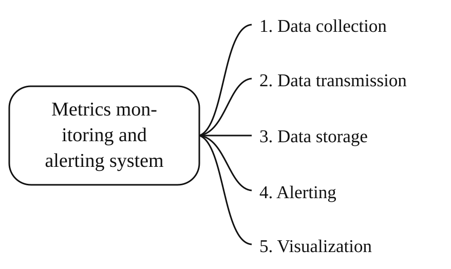
</div>

- **Data collection**: collect metrics data from different sources
- **Data transmission**: transfer data from sources to the metrics monitoring system
- **Data storage**: organize and store incoming data
- **Alerting**: Analyze incoming data, detect anomalies and generate alerts
- **Visualization**: Present data in graphs, charts, etc.

### **Data model**

Metrics data is usually recorded as a time series, which contains a set of values with timestamps.
The series can be identified by name and an optional set of tags.

Example 1 - What is the CPU load on production server instance i631 at 20:00?

<div style="margin-left:3rem">
    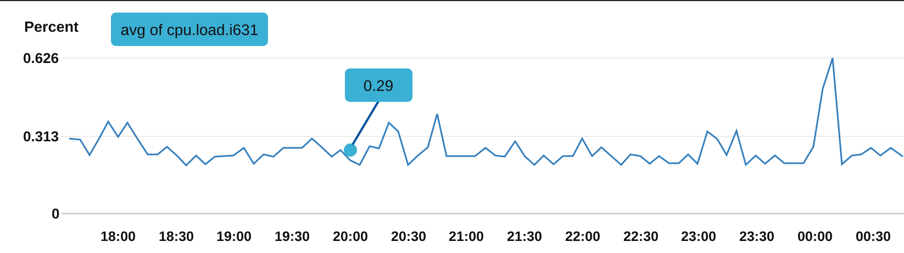
</div>

The data can be identified by the following table:

<div style="margin-left:3rem">
    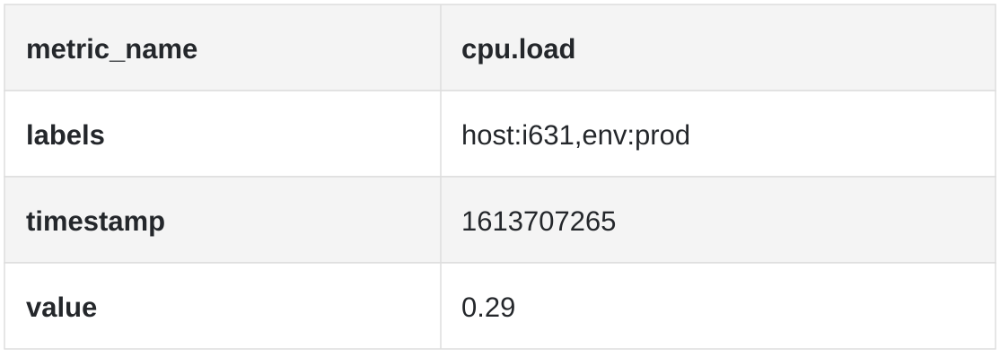
</div>

The time series is identified by the metric name, labels, and a single point at a specific time.

Example 2 - What is the average CPU load across all web servers in the us-west region for the last 10min?

```text
CPU.load host=webserver01,region=us-west 1613707265 50

CPU.load host=webserver01,region=us-west 1613707265 62

CPU.load host=webserver02,region=us-west 1613707265 43

CPU.load host=webserver02,region=us-west 1613707265 53

...

CPU.load host=webserver01,region=us-west 1613707265 76

CPU.load host=webserver01,region=us-west 1613707265 83
```

This is example data we might pull from storage to answer that question.
The average CPU load can be calculated by averaging the values in the last column of the rows.

The format shown above is called the line protocol and is used by many popular monitoring products on the market, e.g., Prometheus [[7]](#ref-7) and OpenTSDB [[8]](#ref-8).

What every time series consists of:

<div style="margin-left:3rem">
    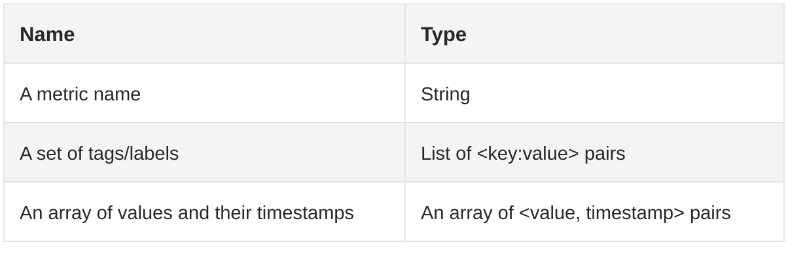
</div>

#### **Data access pattern**

A good way to visualize what data looks like:

<div style="margin-left:3rem">
    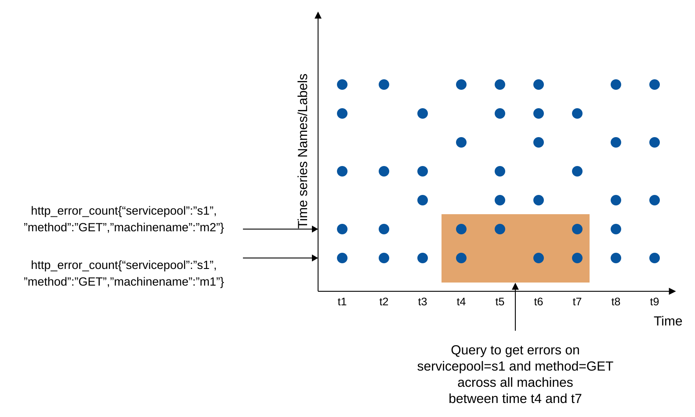
</div>

- The x-axis is time.
- The y-axis is the dimension you're querying, e.g., metric name, tag, etc.

The data-access pattern is write-heavy with spiky reads, as we collect many metrics, but they are accessed infrequently except in bursts, e.g., during ongoing incidents.

#### **Data storage system**

The data storage system is the heart of this design.
- It is not recommended to use a general-purpose database for this problem, although you could achieve good scale with expert-level tuning.
- Using a NoSQL database can work in theory, but it is hard to devise a scalable schema for effectively storing and querying time-series data.

There are many databases specifically tailored for storing time-series data. Many of them support custom query interfaces which allow for effective querying of time-series data.
- OpenTSDB is a distributed time-series database, but it is based on Hadoop and HBase. If you don't have that infrastructure provisioned, it would be hard to use this tech.
- Twitter uses MetricsDB [[12]](#ref-12), while Amazon offers Timestream [[13]](#ref-13).
- The two most popular time-series databases [[14]](#ref-14) are InfluxDB [[15]](#ref-15) and Prometheus.
- They are designed to store large volumes of time-series data. Both of them are based on an in-memory cache + on-disk storage.

Example scale of InfluxDB - more than 250k writes per second when provisioned with 8 cores and 32 GB of RAM:

<div style="margin-left:3rem">
    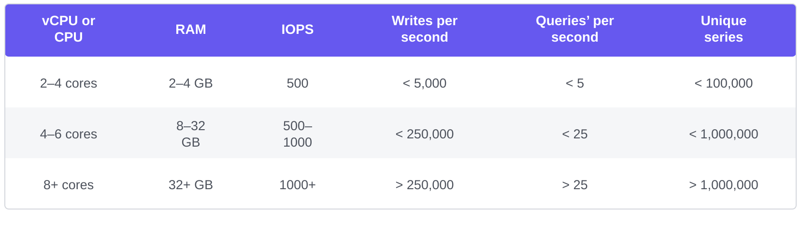
</div>

You are not expected to understand the internals of a metrics database as it is niche knowledge. You might be asked only if you've mentioned it on your resume.

For the purposes of the interview, it is sufficient to understand that metrics are time-series data and to be aware of popular time-series databases, like InfluxDB.

One nice feature of time-series databases is the efficient aggregation and analysis of large amounts of time-series data by labels.
InfluxDB, for example, builds indexes for each label.

It is critical, however, to keep the cardinality of labels low - i.e., not to use too many unique labels.

### **High-level Design**

<div style="margin-left:3rem">
    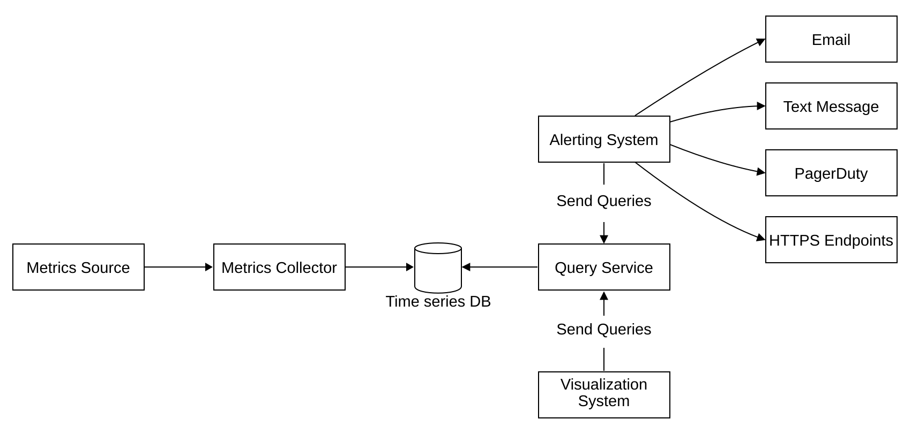
</div>

- **Metrics source**: can be application servers, SQL databases, message queues, etc.
- **Metrics collector**: Gathers metrics data and writes it to the time-series database.
- **Time-series database**: stores metrics as time series. Provides a custom query interface for analyzing large numbers of metrics.
- **Query service**: Makes it easy to query and retrieve data from the time-series DB. Could be replaced entirely by the DB's interface if it's sufficiently powerful.
- **Alerting system**: Sends alert notifications to various alerting destinations.
- **Visualization system**: Shows metrics in the form of graphs/charts.

## Step 3: Design Deep Dive
Let's dive deep into several of the more interesting parts of the system.

### **Metrics collection**
For metrics collection, occasional data loss is not critical. It's acceptable for clients to fire and forget.

<div style="margin-left:3rem">
    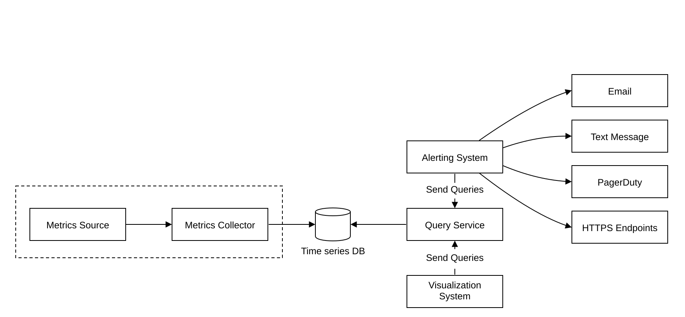
</div>

There are two ways to implement metrics collection:
* pull
* push

#### **Pull model**

Here's what the pull model might look like:

<div style="margin-left:3rem">
    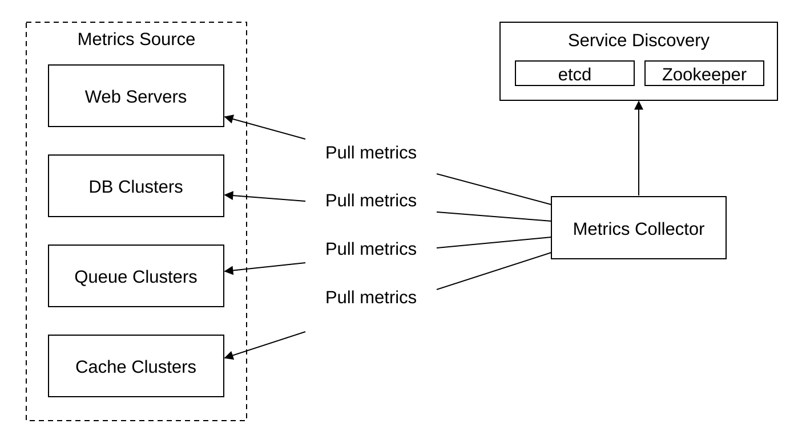
</div>

For this solution, the metrics collector needs to maintain an up-to-date list of services and metrics endpoints.
We can use ZooKeeper or etcd for that purpose - service discovery.

Service discovery contains configuration rules about when and where to collect metrics:

<div style="margin-left:3rem">
    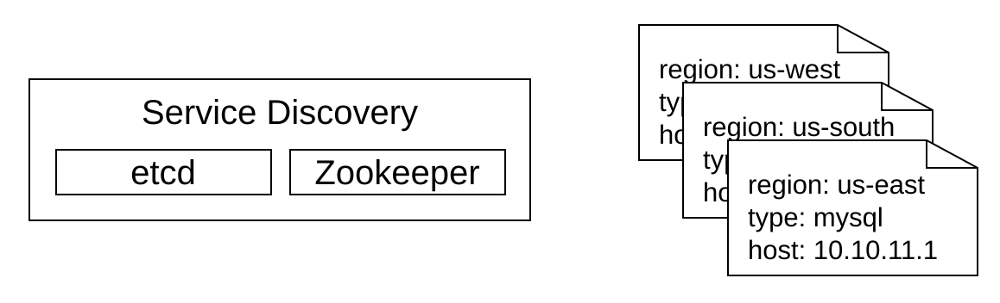
</div>

Here's a detailed explanation of the metrics collection flow:

<div style="margin-left:3rem">
    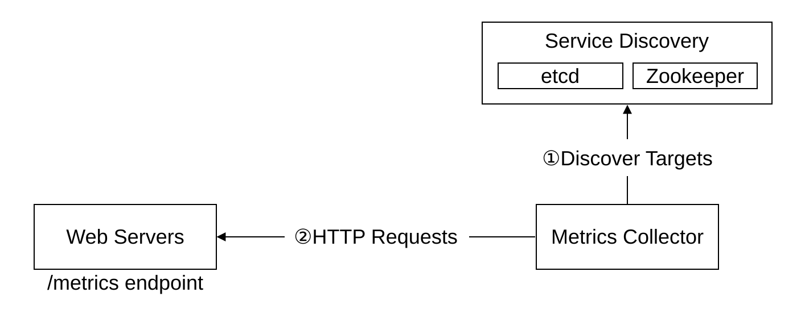
</div>

1. The metrics collector fetches configuration metadata of service endpoints from Service Discovery. Metadata include the pulling interval, IP addresses, timeout and retry parameters, etc.
2. The metrics collector pulls metrics data via a pre-defined HTTP endpoint (for example, `/metrics`). To expose the endpoint, a client library usually needs to be added to the service. In the image above, the service is labeled Web Servers.
3. Optionally, the metrics collector registers a change event notification with Service Discovery to receive an update whenever the service endpoints change. Alternatively, the metrics collector can poll for endpoint changes periodically.

At our scale, a single metrics collector is not enough. There must be multiple instances.
However, there must also be some kind of synchronization among them so that two collectors don't collect the same metrics twice.

One solution for this is to position collectors and servers on a consistent hash ring and associate a set of servers with a single collector only:

<div style="margin-left:3rem">
    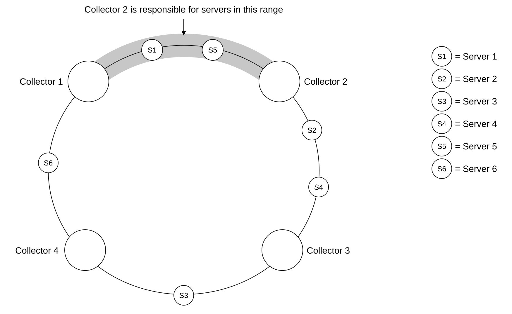
</div>

#### **Push model**

With the push model, on the other hand, services push their metrics to the metrics collector proactively:

<div style="margin-left:3rem">
    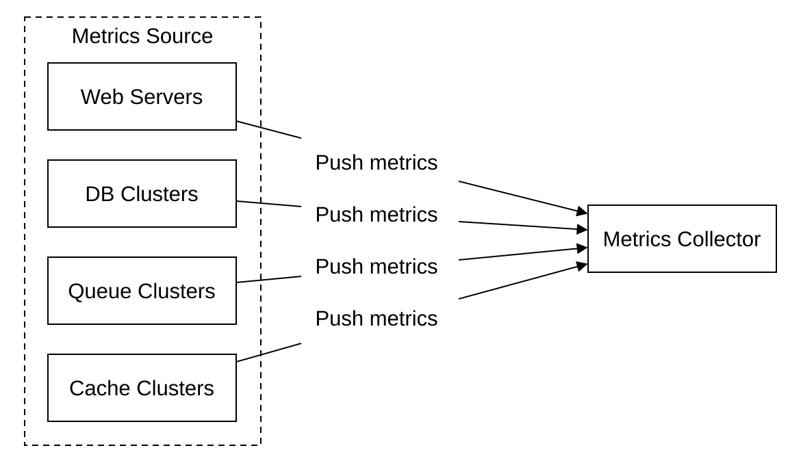
</div>

In this approach, a collection agent is installed on every server being monitored.
The agent collects metrics from the server and pushes them to the metrics collector.

<div style="margin-left:3rem">
    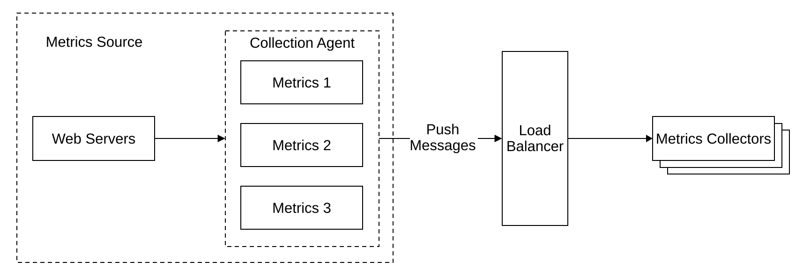
</div>

With this model, we can potentially aggregate metrics before sending them to the collector, which reduces the volume of data processed by the collector.

On the flip side, the metrics collector can reject push requests as it can't handle the load.
It is important, hence, to add the metrics collector to an auto-scaling group behind a load balancer.

#### **Pull or push?**

So which one is better? There are trade-offs between the two approaches, and different systems use different approaches:
 - Prometheus uses a pull architecture.
 - Amazon CloudWatch [[18]](#ref-18) and Graphite [[19]](#ref-19) use a push architecture.

Here are some of the main differences between push and pull:
|                                        | Pull                                                                                                                                                                                                    | Push                                                                                                                                                                                                                                    |
|----------------------------------------|---------------------------------------------------------------------------------------------------------------------------------------------------------------------------------------------------------|-----------------------------------------------------------------------------------------------------------------------------------------------------------------------------------------------------------------------------------------|
| Easy debugging                         | The /metrics endpoint on application servers used for pulling metrics can be used to view metrics at any time. You can even do this on your laptop. Pull wins.                                          | If the metrics collector doesn't receive metrics, the problem might be caused by network issues.                                                                                                                                        |
| Health check                           | If an application server doesn't respond to the pull, you can quickly figure out if an application server is down. Pull wins.                                                                           | If the metrics collector doesn't receive metrics, the problem might be caused by network issues.                                                                                                                                        |
| Short-lived jobs                       |                                                                                                                                                                                                         | Some of the batch jobs might be short-lived and don't last long enough to be pulled. Push wins. This can be fixed by introducing push gateways for the pull model [[24]](#ref-24).                                                                 |
| Firewall or complicated network setups | Having servers pulling metrics requires all metric endpoints to be reachable. This is potentially problematic in multiple data center setups. It might require a more elaborate network infrastructure. | If the metrics collector is set up with a load balancer and an auto-scaling group, it is possible to receive data from anywhere. Push wins.                                                                                             |
| Performance                            | Pull methods typically use TCP.                                                                                                                                                                         | Push methods typically use UDP. This means the push method provides lower-latency transports of metrics. The counterargument here is that the effort of establishing a TCP connection is small compared to sending the metrics payload. |
| Data authenticity                      | Application servers to collect metrics from are defined in config files in advance. Metrics gathered from those servers are guaranteed to be authentic.                                                 | Any kind of client can push metrics to the metrics collector. This can be fixed by whitelisting servers from which to accept metrics, or by requiring authentication.                                                                   |

There is no clear winner. A large organization probably needs to support both. There might not be a way to install a push agent in the first place.

### **Scale the metrics transmission pipeline**

<div style="margin-left:3rem">
    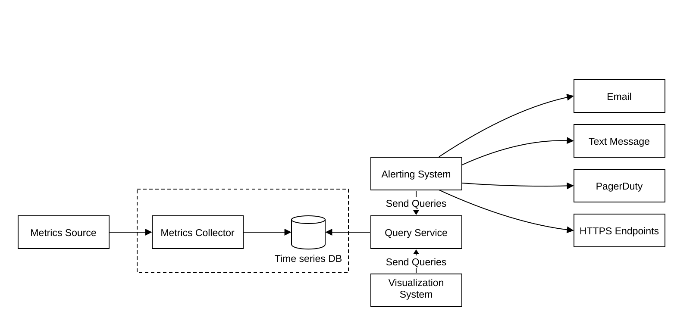
</div>

The metrics collector is provisioned in an auto-scaling group, regardless of whether we use the push or pull model.

There is a chance of data loss if the time-series DB is down, however. To mitigate this, we'll provision a queuing mechanism:

<div style="margin-left:3rem">
    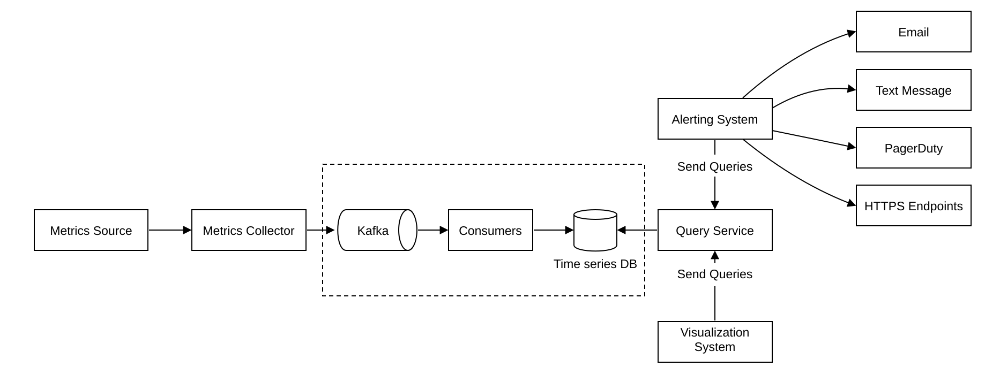
</div>

- Metrics collectors push metrics data into Kafka.
- Consumers or stream processing services such as Apache Storm, Flink or Spark process the data and push it to the time-series DB.

This approach has several advantages:
- Kafka is used as a highly reliable and scalable distributed messaging platform.
- It decouples data collection and data processing from one another.
- It can prevent data loss by retaining the data in Kafka.

#### **Scale through Kafka**

Kafka can be configured with one partition per metric name, so that consumers can aggregate data by metric names.
To scale this, we can further partition by tags/labels and categorize/prioritize metrics to be collected first.

<div style="margin-left:3rem">
    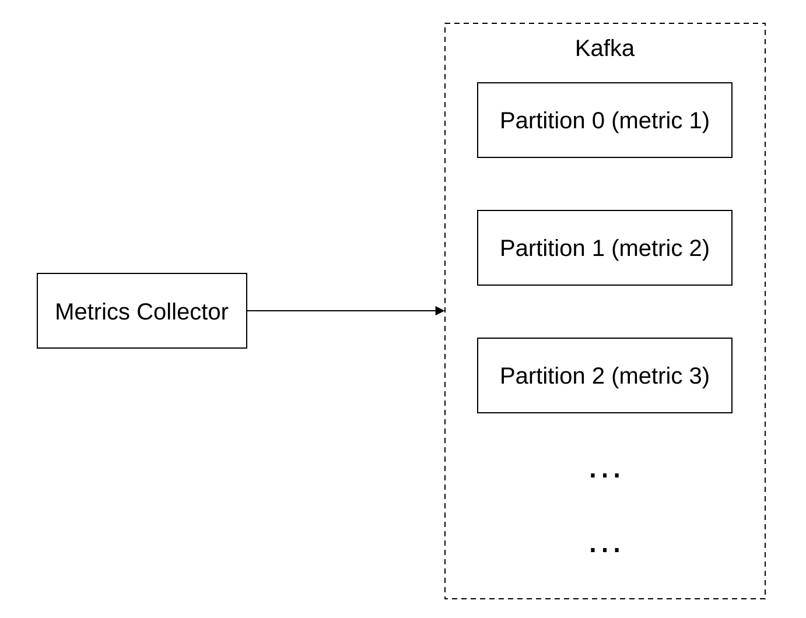
</div>

The main downside of using Kafka for this problem is the maintenance/operation overhead.

#### **Alternative to Kafka**

There are large-scale monitoring ingestion systems in use without using an intermediate queue. Facebook's Gorilla [[26]](#ref-26) in-memory time-series database is a prime example. It can be argued that using that would be as scalable as using Kafka for queuing.

### **Where aggregations can happen**

Metrics can be aggregated at several places. There are trade-offs between different choices:
- **Collection agent**: the client-side collection agent only supports simple aggregation logic. For example, it can collect a counter for one minute and send it to the metrics collector.
- **Ingestion pipeline**: To aggregate data before writing to the DB, we need a stream processing engine like Flink. This reduces write volume, but we lose data precision as we don't store raw data.
- **Query side**: We can aggregate data when we run queries via our visualization system. There is no data loss, but queries can be slow due to a lot of data processing.

### **Query Service**

Having a query service separate from the time-series DB decouples the visualization and alerting systems from the database, which enables us to decouple the DB from clients and change it at will.

#### **Cache layer**

We can add a cache layer here to reduce the load on the time-series database and make the query service more performant:

<div style="margin-left:3rem">
    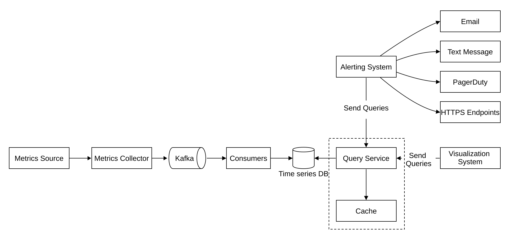
</div>

#### **The case against a query service**

We can also avoid adding a query service altogether as most visualization and alerting systems have powerful plugins to integrate with most time-series databases.
With a well-chosen time-series DB, we might not need to introduce our own caching layer either.

#### **Time-series database query language**

Most time-series DBs don't support SQL simply because it is ineffective for querying time-series data. Here's an example SQL query for computing an exponential moving average:

```sql
select id,
       temp,
       avg(temp) over (partition by group_nr order by time_read) as rolling_avg
from (
    select id,
        temp,
        time_read,
        interval_group,
        id - row_number() over (partition by interval_group order by time_read) as group_nr
    from (
        select id,
            time_read,
            "epoch"::timestamp + "900 seconds"::interval *
            (extract(epoch from time_read)::int4 / 900) as interval_group,
            temp
        from readings
    ) t1
) t2
order by time_read;
```

Here's the same query in Flux - the query language used in InfluxDB:

```flux
from(db:"telegraf")
  |> range(start:-1h)
  |> filter(fn: (r) => r._measurement == "foo")
  |> exponentialMovingAverage(size:-10s)
```

### **Storage layer**

It is important to choose the time-series database carefully.

According to research published by Facebook, ~85% of queries to the operational store were for data from the past 26 hours.

If we choose a database which harnesses this property, it could have a significant impact on system performance. InfluxDB is one such option.

#### **Space optimization**

Regardless of the database we choose, there are some optimizations we might employ.

#### **Data encoding and compression**

Data encoding and compression can significantly reduce the size of data. Those features are usually built into a good time-series database.

<div style="margin-left:3rem">
    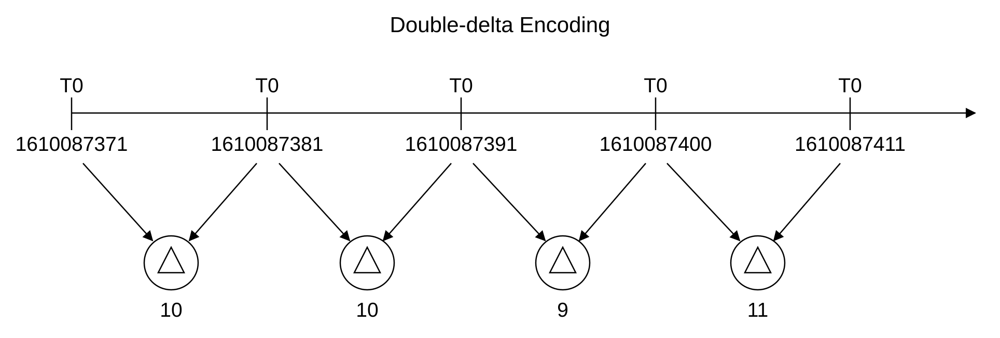
</div>

In the above example, instead of storing full timestamps, we can store timestamp deltas.

#### **Downsampling**

Another technique we can employ is down-sampling - converting high-resolution data to low-resolution data in order to reduce disk usage.

We can use that for old data and make the rules configurable by data scientists, e.g.:
- 7d - no down-sampling
- 30d - down-sample to 1min
- 1y - down-sample to 1h

For example, here's a metrics table with 10-second resolution:
| metric | timestamp            | hostname | Metric_value |
|--------|----------------------|----------|--------------|
| cpu    | 2021-10-24T19:00:00Z | host-a   | 10           |
| cpu    | 2021-10-24T19:00:10Z | host-a   | 16           |
| cpu    | 2021-10-24T19:00:20Z | host-a   | 20           |
| cpu    | 2021-10-24T19:00:30Z | host-a   | 30           |
| cpu    | 2021-10-24T19:00:40Z | host-a   | 20           |
| cpu    | 2021-10-24T19:00:50Z | host-a   | 30           |

down-sampled to 30-second resolution:
| metric | timestamp            | hostname | Metric_value (avg) |
|--------|----------------------|----------|--------------------|
| cpu    | 2021-10-24T19:00:00Z | host-a   | 19                 |
| cpu    | 2021-10-24T19:00:30Z | host-a   | 25                 |

#### **Cold storage**

Finally, we can use cold storage for old data that is no longer used. The financial cost of cold storage is much lower.

### **Alerting system**

<div style="margin-left:3rem">
    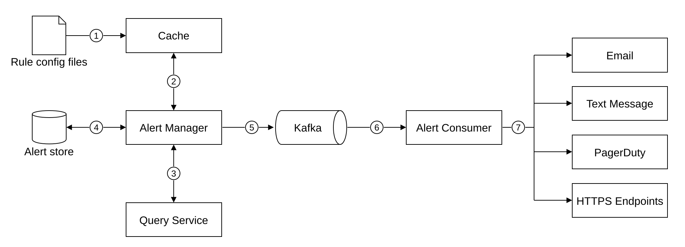
</div>

The alert flow works as follows:

1. Load config files to cache servers. Rules are defined as config files on the disk. YAML [[29]](#ref-29) is a commonly used format to define rules. Here's an example of alert rules:
    ```yaml
    - name: instance_down
    rules:

    # Alert for any instance that is unreachable for >5 minutes.
    - alert: instance_down
        expr: up == 0
        for: 5m
        labels:
        severity: page
    ```
2. The alert manager fetches alert configurations from cache.
3. Based on configuration rules, it also calls the query service at a predefined interval. If a rule is met, an alert event is created.
4. The alert store is a key-value database, such as Cassandra, that keeps the state (inactive, pending, firing, resolved) of all alerts. It ensures a notification is sent at least once.
5. Eligible alerts are inserted into Kafka.
6. Alert consumers pull alert events from Kafka.
7. Alert consumers process alert events from Kafka and send notifications over to different channels such as email, text message, PagerDuty, or HTTP endpoints.

Other responsibilities of the alert manager are:
- Filtering, merging, and deduplicating alerts. For example, if an alert for a single instance is triggered multiple times, only one alert event is generated.
- Access control - it is important to restrict alert-management operations to certain individuals only.
- Retry - the manager ensures that the alert is propagated at least once.

In the real world, there are many off-the-shelf solutions for alerting systems. It is difficult to justify building your own system in-house.

### **Visualization system**

The visualization system shows metrics and alerts over a time period. Here's a dashboard built with Grafana:

<div style="margin-left:3rem">
    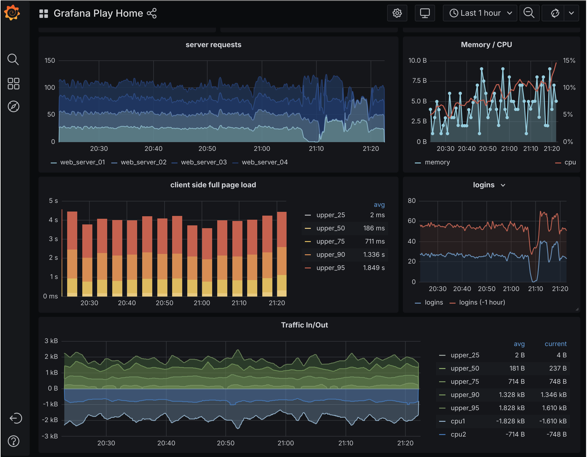
</div>

A high-quality visualization system is very hard to build. It is hard to justify not using an off-the-shelf solution like Grafana.

## Step 4: Wrap up

Here's our final design:

<div style="margin-left:3rem">
    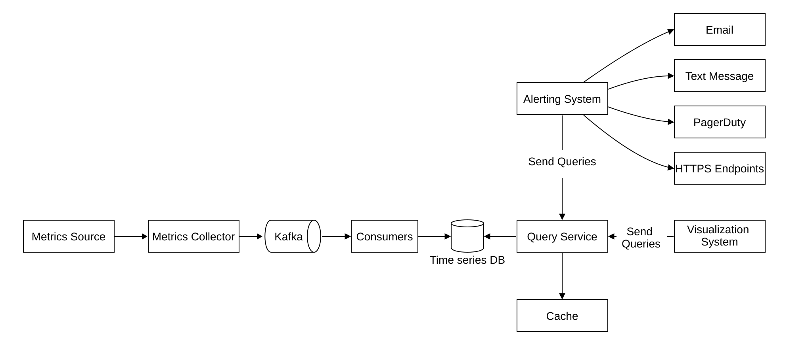
</div>

## Reference materials

1. <a id="ref-1"></a>[Datadog](https://www.datadoghq.com/)
2. <a id="ref-2"></a>[Splunk](https://www.splunk.com/)
3. <a id="ref-3"></a>[PagerDuty](https://www.pagerduty.com/)
4. <a id="ref-4"></a>[Elastic stack](https://www.elastic.co/elastic-stack)
5. <a id="ref-5"></a>[Dapper, a Large-Scale Distributed Systems Tracing Infrastructure](https://research.google/pubs/pub36356/)
6. <a id="ref-6"></a>[Distributed Systems Tracing with Zipkin](https://blog.twitter.com/engineering/en_us/a/2012/distributed-systems-tracing-with-zipkin.html)
7. <a id="ref-7"></a>[Prometheus](https://prometheus.io/docs/introduction/overview/)
8. <a id="ref-8"></a>[OpenTSDB - A Distributed, Scalable Monitoring System](http://opentsdb.net/)
9. <a id="ref-9"></a>[Data model](https://prometheus.io/docs/concepts/data_model/)
10. <a id="ref-10"></a>[MySQL](https://www.mysql.com/)
11. <a id="ref-11"></a>[Schema design for time-series data | Cloud Bigtable Documentation](https://cloud.google.com/bigtable/docs/schema-design-time-series)
12. <a id="ref-12"></a>[MetricsDB. Time Series Database for Storing Metrics at Twitter](https://blog.twitter.com/engineering/en_us/topics/infrastructure/2019/metricsdb.html)
13. <a id="ref-13"></a>[Amazon Timestream](https://aws.amazon.com/timestream/)
14. <a id="ref-14"></a>[DB-Engines Ranking of time-series DBMS](https://db-engines.com/en/ranking/time+series+dbms)
15. <a id="ref-15"></a>[InfluxDB](https://www.influxdata.com/)
16. <a id="ref-16"></a>[etcd](https://etcd.io/)
17. <a id="ref-17"></a>[Service Discovery with ZooKeeper](https://cloud.spring.io/spring-cloud-zookeeper/1.2.x/multi/multi_spring-cloud-zookeeper-discovery.html)
18. <a id="ref-18"></a>[Amazon CloudWatch](https://aws.amazon.com/cloudwatch/)
19. <a id="ref-19"></a>[Graphite](https://graphiteapp.org/)
20. <a id="ref-20"></a>[Push vs Pull](http://bit.ly/3aJEPxE)
21. <a id="ref-21"></a>[Pull doesn’t scale - or does it?](https://prometheus.io/blog/2016/07/23/pull-does-not-scale-or-does-it/)
22. <a id="ref-22"></a>[Monitoring Architecture](https://developer.lightbend.com/guides/monitoring-at-scale/monitoring-architecture/architecture.html)
23. <a id="ref-23"></a>[Push vs Pull in Monitoring Systems](https://giedrius.blog/2019/05/11/push-vs-pull-in-monitoring-systems/)
24. <a id="ref-24"></a>[Pushgateway](https://github.com/prometheus/pushgateway)
25. <a id="ref-25"></a>[Building Applications with Serverless Architectures](https://aws.amazon.com/lambda/serverless-architectures-learn-more/)
26. <a id="ref-26"></a>[Gorilla. A Fast, Scalable, In-Memory Time Series Database](http://www.vldb.org/pvldb/vol8/p1816-teller.pdf)
27. <a id="ref-27"></a>[Why We’re Building Flux, a New Data Scripting and Query Language](https://www.influxdata.com/blog/why-were-building-flux-a-new-data-scripting-and-query-language/)
28. <a id="ref-28"></a>[InfluxDB storage engine](https://docs.influxdata.com/influxdb/v2.0/reference/internals/storage-engine/)
29. <a id="ref-29"></a>[YAML](https://en.wikipedia.org/wiki/YAML)
30. <a id="ref-30"></a>[Grafana Demo](https://play.grafana.org/)
