# Chapter 21: Ad Click Event Aggregation
<sub>[Back to System Design](../Readme.md#content)</sub>

## Introduction

**Digital advertising** is a big industry with the rise of Facebook, YouTube, TikTok, etc.

Hence, tracking ad click events is important. In this chapter, we explore how to design an **ad click event aggregation** system at Facebook/Google scale.

Digital advertising has a process called **real-time bidding (RTB)**, where digital advertising inventory is bought and sold:

<div style="margin-left:1rem">
    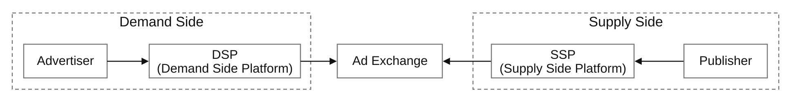
</div>

The speed of RTB is important, as it usually occurs within a second.
Data accuracy is also very important as it impacts how much money advertisers pay.

Based on ad-click event aggregations, advertisers can make decisions such as adjusting target audiences and keywords.

## Step 1: Understand the Problem and Establish Design Scope
- C: What is the format of the input data?
- I: 1 billion ad clicks per day and 2 million ads in total. The number of ad-click events grows by 30% year-over-year.
- C: What are some of the most important queries our system needs to support?
- I: Top queries to take into consideration:
    - Return the number of click events for ad X in the last Y minutes.
    - Return the top 100 most-clicked ads in the past minute. Both parameters should be configurable. Aggregation occurs every minute.
    - Support data filtering by `ip`, `user_id`, and `country` for the above queries
- C: Do we need to worry about edge cases? Some of the ones I can think of:
    - There might be events that arrive later than expected
    - There might be duplicate events
    - Different parts of the system might be down, so we need to consider system recovery
- I: That's a good list; take those into consideration
- C: What is the latency requirement?
- I: A few minutes of end-to-end latency for ad-click aggregation. For RTB, it is less than a second. It is okay to have that latency for ad-click aggregation, as those results are usually used for billing and reporting.

### **Functional requirements**

- Aggregate the number of clicks of `ad_id` in the last *M* minutes
- Return the top 100 most-clicked `ad_id`s every minute
- Support aggregation filtering by different attributes
- Dataset volume is at Facebook or Google scale

### **Non-functional requirements**

- Correctness of the aggregation result is important as it's used for RTB and ad billing
- Properly handle delayed or duplicate events
- Robustness - the system should be resilient to partial failures
- Latency - a few minutes of e2e latency at most

### **Back-of-the-envelope estimation**

- 1 billion DAU
- Assuming a user clicks 1 ad per day -> 1 billion ad clicks per day
- Ad click QPS = 10,000
- Peak QPS is 5 times that number = 50,000
- A single ad click occupies 0.1 KB of storage. The daily storage requirement is 100 GB.
- Monthly storage = 3 TB.

## Step 2: Propose High-Level Design and Get Buy-In

In this section, we discuss the query API design, data model and high-level design.

### **Query API Design**
The API is a contract between the client and the server. In our case, the client is the dashboard user - a data scientist/analyst, advertiser, etc.

Here are our functional requirements:
- Aggregate the number of clicks of `ad_id` in the last *M* minutes
- Return the top *N* most-clicked `ad_id`s in the last *M* minutes
- Support aggregation filtering by different attributes

We need two endpoints to achieve those requirements. Filtering can be done via query parameters on one of them.

**API 1: Aggregate the number of clicks of ad_id in the last *M* minutes:**

```http
GET /v1/ads/{:ad_id}/aggregated_count
```

Query parameters:
- from - start minute. The default is now - 1 min
- to - end minute. The default is now
- filter - identifier for different filtering strategies. For example, 001 means "non-US clicks."

Response:
- ad_id - ad identifier
- count - aggregated count between start and end minutes

**API 2: Return the top *N* most-clicked ad_ids in the last *M* minutes**

```http
GET /v1/ads/popular_ads
```

Query parameters:
- count - top *N* most-clicked ads
- window - aggregation window size in minutes
- filter - identifier for different filtering strategies

Response:
- list of ad_ids

### **Data model**

In our system, we have raw and aggregated data.

#### **Raw data**

Raw data looks like this:

```text
[AdClickEvent] ad001, 2021-01-01 00:00:01, user 1, 207.148.22.22, USA
```

Here's an example in a structured format:

| ad_id | click_timestamp     | user  | ip            | country |
|-------|---------------------|-------|---------------|---------|
| ad001 | 2021-01-01 00:00:01 | user1 | 207.148.22.22 | USA     |
| ad001 | 2021-01-01 00:00:02 | user1 | 207.148.22.22 | USA     |
| ad002 | 2021-01-01 00:00:02 | user2 | 209.153.56.11 | USA     |

#### **Aggregated data**

Assume that ad click events are aggregated every minute. The table below shows the aggregated result.

| ad_id | click_minute | count |
|-------|--------------|-------|
| ad001 | 202101010000 | 5     |
| ad001 | 202101010001 | 6     |

To support ad filtering, we add a `filter_id` column to the table. Records with the same `ad_id` and `click_minute` are grouped by `filter_id` as shown in the table below.

| ad_id | click_minute | filter_id | count |
|-------|--------------|-----------|-------|
| ad001 | 202101010000 | 0012      | 2     |
| ad001 | 202101010000 | 0023      | 3     |
| ad001 | 202101010001 | 0012      | 1     |
| ad001 | 202101010001 | 0023      | 6     |

Filters are defined in the table below.

| filter_id | region | IP        | user_id |
|-----------|--------|-----------|---------|
| 0012      | US     | *         | *       |
| 0013      | *      | 123.1.2.3 | *       |

To support quickly returning the top *N* most-clicked ads in the last *M* minutes, we'll also maintain this structure:
| most_clicked_ads   |           |                                                  |
|--------------------|-----------|--------------------------------------------------|
| window_size        | integer   | The aggregation window size (M) in minutes       |
| update_time_minute | timestamp | Last updated timestamp (in 1-minute granularity) |
| most_clicked_ads   | array     | List of ad IDs in JSON format.                   |

#### **Comparison**

What are some pros and cons of storing raw data and storing aggregated data?

**Raw data**:
- Full data set. Supports data filtering and recalculation.
- Huge data storage. Slow queries.

**Aggregated data**:
- Smaller data set. Fast query.
- Data loss. This is derived data.

In our design, we'll use a combination of both approaches:
- It's a good idea to keep the raw data around for debugging. If there is some bug in aggregation, we can discover the bug and backfill.
- Aggregated data should be stored as well for faster query performance.
- Raw data can be stored in cold storage to avoid extra storage costs.

#### **Choose the right database**

When it comes to the database, there are several factors to take into consideration:
- What does the data look like? Is it relational, document or blob?
- Is the workload read-heavy, write-heavy or both?
- Are transactions needed?
- Do the queries rely on OLAP functions [[3]](#ref-3) like SUM and COUNT?

For the raw data, we can see that the average QPS is 10k and the peak QPS is 50k, so the system is write-heavy.
On the other hand, read traffic is low as raw data is mostly used as backup if anything goes wrong.

Relational databases can do the job, but it can be challenging to scale the writes.
Alternatively, we can use Cassandra or InfluxDB, which have better native support for heavy write loads.

Another option is to use Amazon S3 with a columnar data format like ORC, Parquet or Avro. Since this setup is unfamiliar, we'll stick to Cassandra.

For aggregated data, the workload is both read- and write-heavy, as aggregated data is constantly queried for dashboards and alerts.
It is also write-heavy as data is aggregated and written every minute by the aggregation service.
Hence, we'll use the same data store (Cassandra) here as well.

### **High-level design**

In real-time big data [[8]](#ref-8) processing, data usually flows into and out of the processing system as unbounded data streams. The aggregation service works in the same way; the input is the raw data (unbounded data streams), and the output is the aggregated results.

<div style="margin-left:1rem">
    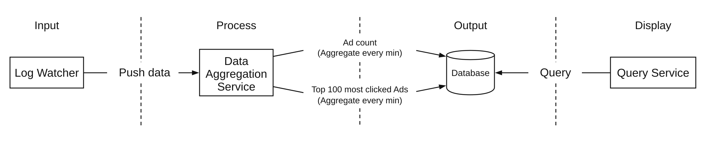
</div>

#### **Asynchronous processing**

In order to avoid having a synchronous sink, where a consumer crashing can cause the whole system to stall,
we'll leverage asynchronous processing using message queues (Kafka) to decouple consumers and producers.

<div style="margin-left:1rem">
    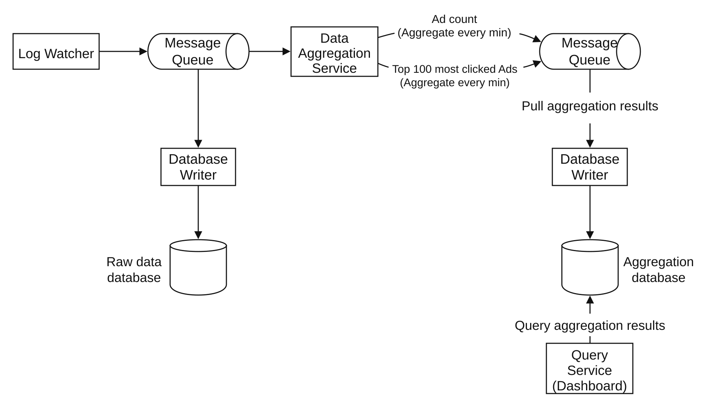
</div>

The first message queue stores ad click event data:

| ad_id | click_timestamp | user_id | ip | country |
|-------|-----------------|---------|----|---------|

The second message queue contains two types of data:

Ad click counts aggregated at per-minute granularity.

| ad_id | click_minute | count |
|-------|--------------|-------|

Top *N* most clicked ads aggregated at per-minute granularity.

| update_time_minute | most_clicked_ads |
|--------------------|------------------|

The second message queue is there to achieve end-to-end, exactly-once atomic-commit semantics [[9]](#ref-9):

<div style="margin-left:1rem">
    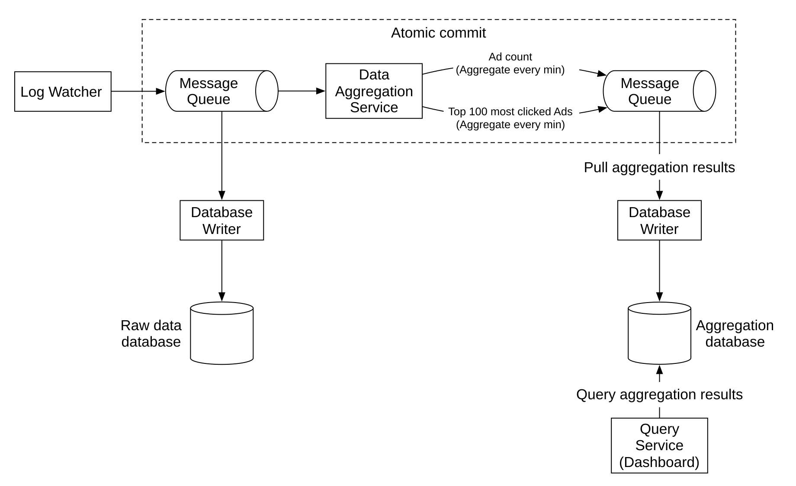
</div>

#### **Aggregation service**

For the aggregation service, using the MapReduce framework is a good option:

<div style="margin-left:1rem">
    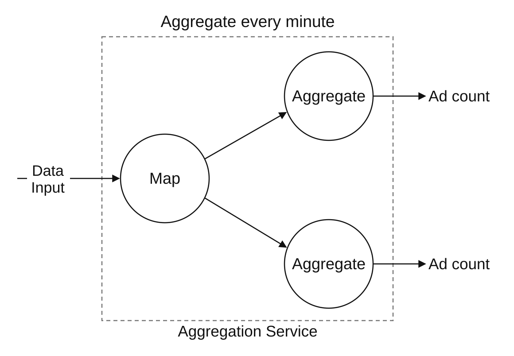
</div>

<div style="margin-left:1rem">
    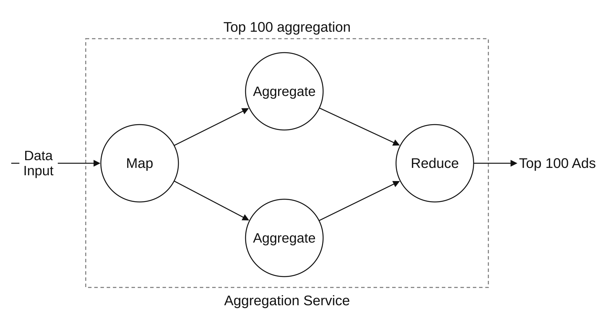
</div>

Each node is responsible for one single task and it sends the processing result to the downstream node.

#### **Map node**

The map node is responsible for reading from the data source, then filtering and transforming the data.

For example, the map node can allocate data across different aggregation nodes based on the `ad_id`:

<div style="margin-left:1rem">
    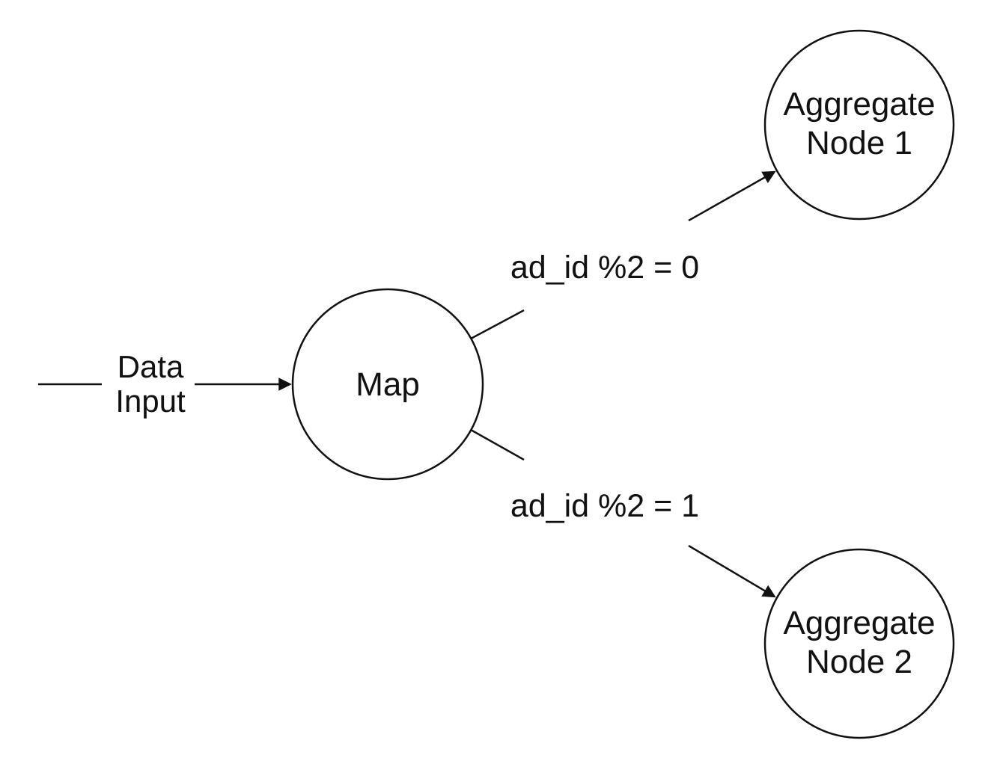
</div>

Alternatively, we can distribute ads across Kafka partitions and let the aggregation nodes subscribe directly within a consumer group.
However, the mapping node enables us to sanitize or transform the data before subsequent processing.

Another reason might be that we don't have control over how data is produced,
so events related to the same `ad_id` might go on different partitions.

#### **Aggregate node**

The aggregate node counts ad click events by `ad_id` in memory every minute.

#### **Reduce node**

The reduce node collects aggregated results from aggregate nodes and produces the final result:

<div style="margin-left:1rem">
    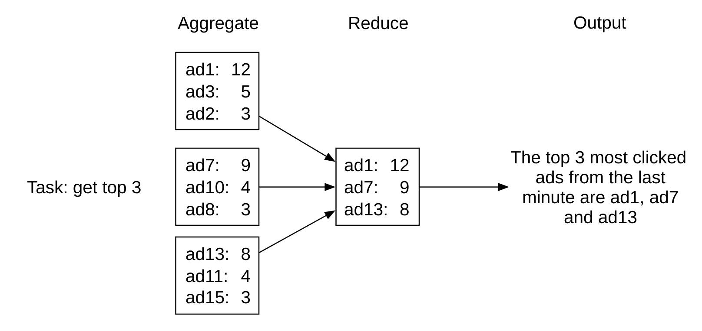
</div>

This DAG model uses the MapReduce paradigm. It takes big data and leverages parallel distributed computing to turn it into regular-sized data.

In the DAG model, intermediate data is stored in memory and different nodes communicate with each other using TCP or shared memory.

Let's explore how this model can now help us achieve our various use cases.

### **Main use cases**

#### **Use case 1 - aggregate the number of clicks**:

<div style="margin-left:1rem">
    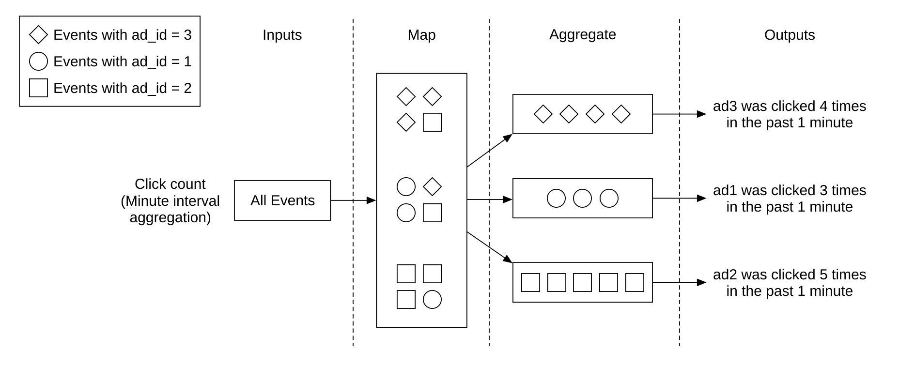
</div>

- Ads are partitioned using `ad_id % 3`

#### **Use case 2 - return the top *N* most-clicked ads**:

<div style="margin-left:1rem">
    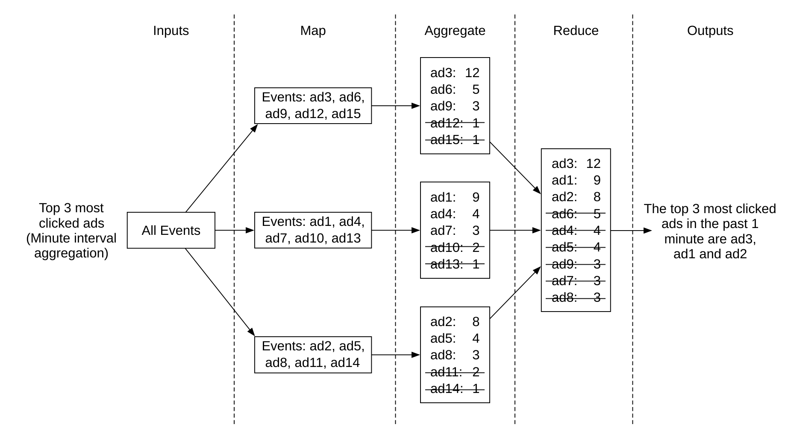
</div>

- In this case, we're aggregating the top 3 ads, but this can be extended to the top *N* ads easily
- Each node maintains a heap data structure for fast retrieval of the top *N* ads

#### **Use case 3 - data filtering**:

To support fast data filtering, we can predefine filtering criteria and pre-aggregate based on them:

| ad_id | click_minute | country | count |
|-------|--------------|---------|-------|
| ad001 | 202101010001 | USA     | 100   |
| ad001 | 202101010001 | GBP     | 200   |
| ad001 | 202101010001 | others  | 3000  |
| ad002 | 202101010001 | USA     | 10    |
| ad002 | 202101010001 | GBP     | 25    |
| ad002 | 202101010001 | others  | 12    |

This technique is called the **star schema** [[11]](#ref-11) and is widely used in data warehouses.
The filtering fields are called **dimensions**.

This approach has the following benefits:
- Simple to understand and build.
- The current aggregation service can be reused to create more dimensions in the star schema.
- Accessing data based on filtering criteria is fast as results are pre-calculated

A limitation of this approach is that it creates many more buckets and records, especially when we have many filtering criteria.

## Step 3: Design Deep Dive

Let's dive deeper into some of the more interesting topics.

### **Streaming vs. Batching**

The high-level architecture we proposed is a type of stream processing system.
Here's a comparison between three types of systems [[12]](#ref-12):

|                         | Services (Online system)      | Batch system (offline system)                          | Streaming system (near real-time system)     |
|-------------------------|-------------------------------|--------------------------------------------------------|----------------------------------------------|
| Responsiveness          | Respond to the client quickly | No response to the client needed                       | No response to the client needed             |
| Input                   | User requests                 | Bounded input with finite size. A large amount of data | Input has no boundary (infinite streams)     |
| Output                  | Responses to clients          | Materialized views, aggregated metrics, etc.           | Materialized views, aggregated metrics, etc. |
| Performance measurement | Availability, latency         | Throughput                                             | Throughput, latency                          |
| Example                 | Online shopping               | MapReduce                                              | Flink [[13]](#ref-13)                                   |

In our design, both stream processing and batch processing are used. We utilized stream processing to process data as it arrives and generate aggregated results in a near real-time fashion. We utilized batch processing for historical data backup.

A system that simultaneously contains two processing paths, batch and streaming, uses an architecture called Lambda [[14]](#ref-14). A disadvantage is that you have two processing paths with two different codebases to maintain.

Kappa [[15]](#ref-15) is an alternative architecture, which combines batch and stream processing in one processing path. The key idea is to use a single stream processing engine.

Lambda architecture:

<div style="margin-left:1rem">
    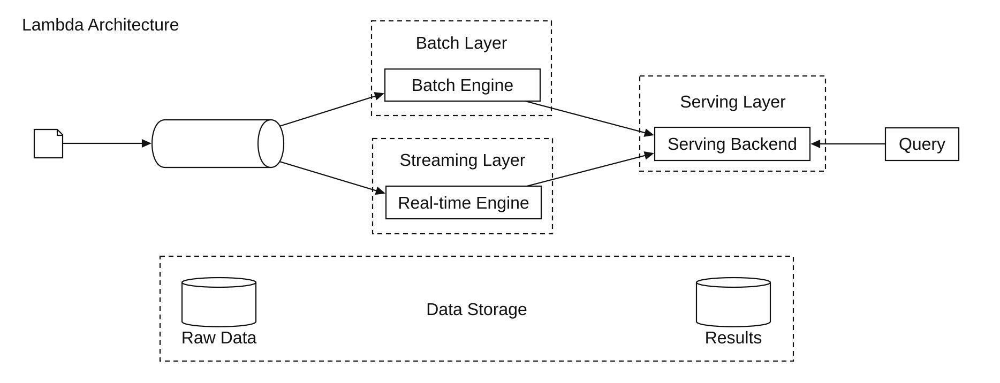
</div>

Kappa architecture:

<div style="margin-left:1rem">
    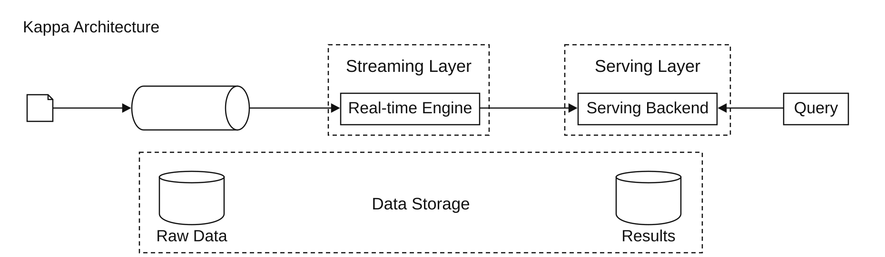
</div>

Our high-level design uses the Kappa architecture as reprocessing of historical data also goes through the aggregation service.

### **Data recalculation**

Whenever we have to recalculate aggregated data due to, e.g., a major bug in aggregation logic, we can recalculate the aggregation from the raw data we store.
1. The recalculation service retrieves data from raw data storage. This is a batched job.
2. Retrieved data is sent to a dedicated aggregation service so that the real-time processing is not impacted by historical data replay.
3. Aggregated results are sent to the second message queue, then updated in the aggregation database.

<div style="margin-left:1rem">
    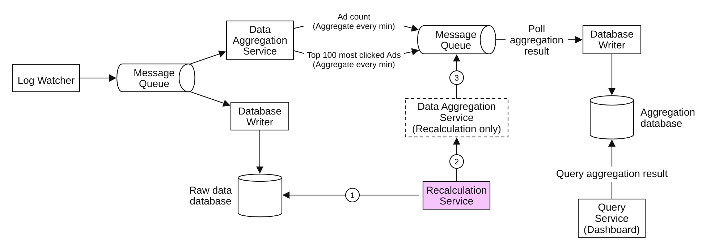
</div>

The recalculation process reuses the data aggregation service but uses a different data source (raw data).

### **Time**

We need a timestamp to perform aggregation. It can be generated in two places:
- Event time - when an ad click occurs.
- Processing time - system time when the server processes the event.

Due to the use of asynchronous processing (message queues) and network delays, there can be a significant difference between event time and processing time.
- If we use processing time, aggregation results can be inaccurate
- If we use event time, we have to deal with delayed events

There is no perfect solution; we need to consider trade-offs:
|                 | Pros                                  | Cons                                                                                 |
|-----------------|---------------------------------------|--------------------------------------------------------------------------------------|
| Event time      | Aggregation results are more accurate | Clients might have the wrong time or timestamps might be generated by malicious users |
| Processing time | The server timestamp is more reliable     | The timestamp is not accurate if the event is late                                   |

Since data accuracy is important, we'll use the event time for aggregation.

To mitigate the issue of delayed events, a technique called "watermark" can be leveraged.

In the example below, event 2 misses the window where it needs to be aggregated:

<div style="margin-left:1rem">
    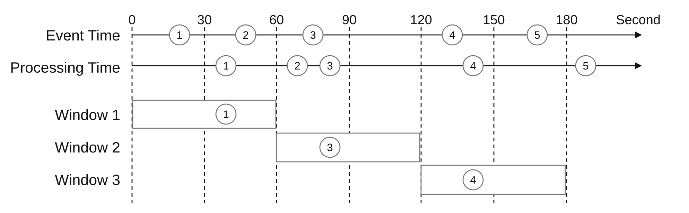
</div>

However, if we purposefully extend the aggregation window, we can reduce the likelihood of missed events.
The extended part of a window is called a "watermark":

<div style="margin-left:1rem">
    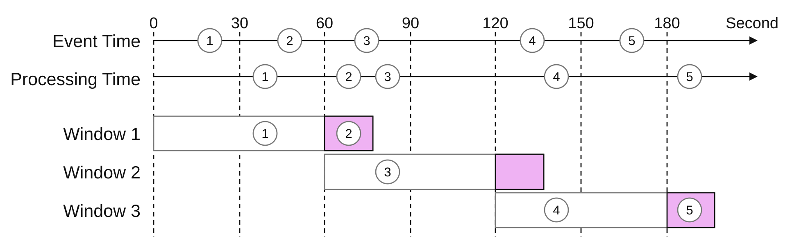
</div>

- A shorter watermark increases the likelihood of missed events but reduces latency.
- A longer watermark reduces the likelihood of missed events but increases latency.

There is always a likelihood of missed events, regardless of the watermark's size. But there is no use in optimizing for such low-probability events.

We can instead resolve such inconsistencies by doing end-of-day reconciliation.

### **Aggregation window**

There are four types of window functions:
- Tumbling (fixed) window
- Hopping window
- Sliding window
- Session window

In our design, we leverage a tumbling window for ad click aggregations:

<div style="margin-left:1rem">
    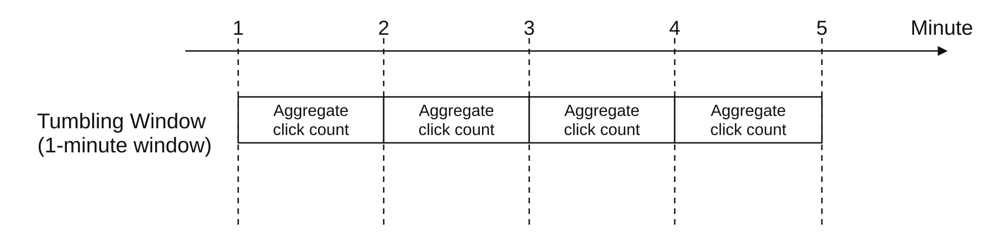
</div>

We also use a sliding window to aggregate the top *N* clicked ads in *M* minutes:

<div style="margin-left:1rem">
    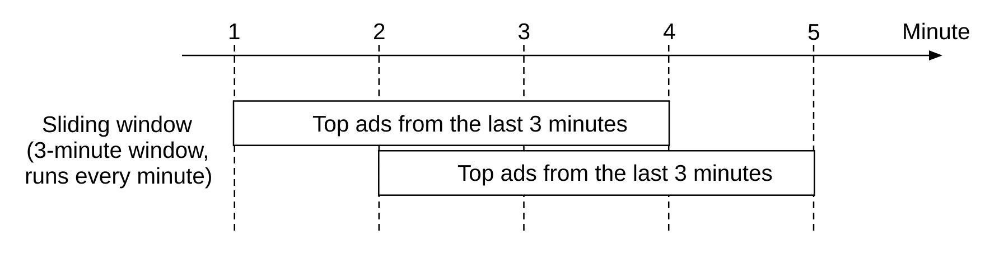
</div>

### **Delivery guarantees**

Since the data we're aggregating is going to be used for billing, data accuracy is a priority.

Hence, we need to discuss:
- How to avoid processing duplicate events
- How to ensure all events are processed

There are three delivery guarantees we can use - `at-most-once`, `at-least-once` and `exactly-once`.

In most circumstances, `at-least-once` is sufficient when a small number of duplicates is acceptable.
This is not the case for our system, though, as a small percentage difference can result in a discrepancy of millions of dollars.
Hence, we'll need to use `exactly-once` delivery semantics.

### **Data deduplication**

One of the most common data quality issues is duplicated data.

It can come from a wide range of sources:
- Client-side - a client might resend the same event multiple times. Duplicated events sent with malicious intent are best handled by a risk engine.
- Server outage - An aggregation service node goes down in the middle of aggregation, and the upstream service hasn't received an acknowledgment, so the event is resent.

Here's an example of data duplication occurring due to failure to acknowledge an event on the last hop:

<div style="margin-left:1rem">
    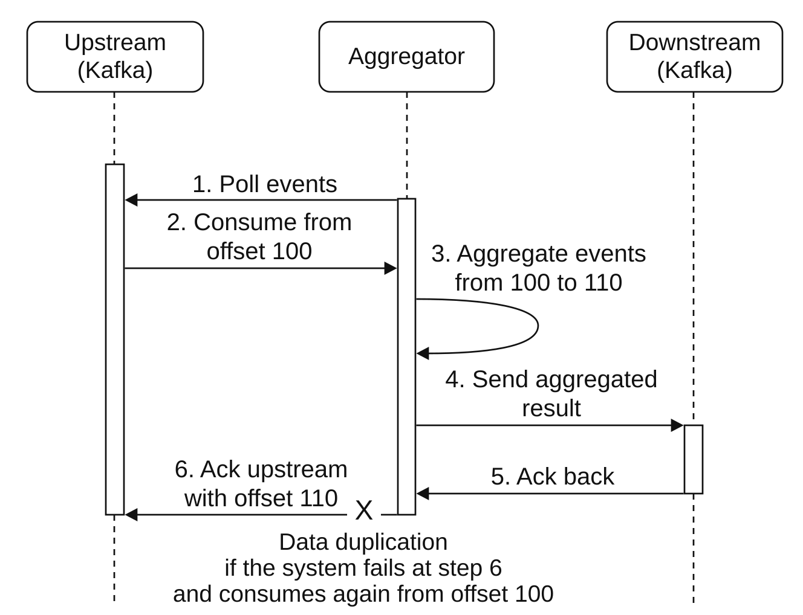
</div>

If step 6 fails, perhaps due to an aggregator outage, events from 100 to 110 have already been sent downstream, but the new offset 110 is not persisted in upstream Kafka. In this case, a new aggregator would consume again from offset 100, even if those events have already been processed, causing duplicate data.

The most straightforward solution is to use external file storage, such as HDFS or S3, to record the offset.

<div style="margin-left:1rem">
    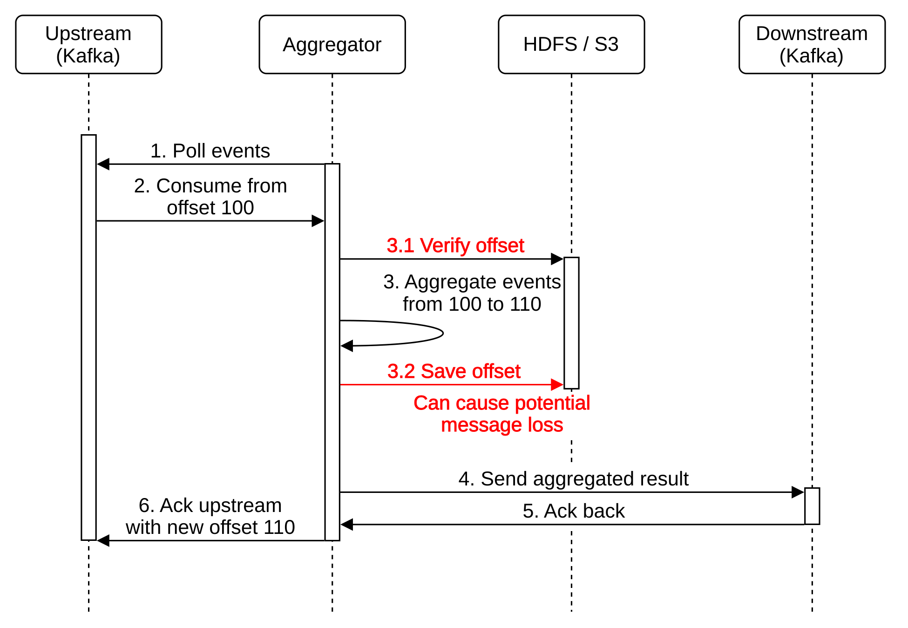
</div>

But this solution has issues as well. In step 3, the aggregator will process events from offset 100 to 110 only if the last offset in external storage is 100. If the offset stored in the storage is 110, the aggregator will ignore events before offset 110.

If step 4 fails due to an aggregator outage, events from 100 to 110 will never be processed by a newly started aggregator node, since the offset stored in external storage is 110.

To avoid data loss, we need to save the offset once we get an acknowledgment back from downstream. The updated design is shown in the image below.

<div style="margin-left:1rem">
    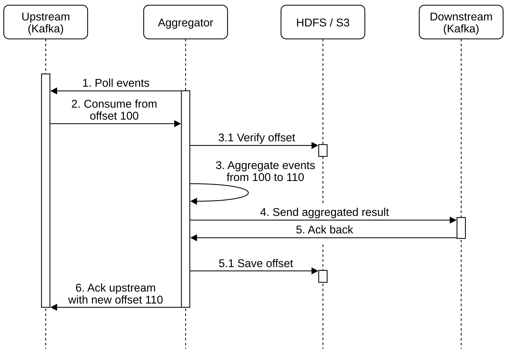
</div>

In this design, if the aggregator is down before step 5.1 is executed, events from 100 to 110 will be sent downstream again. To achieve 'exactly-once' processing, we need to put operations from step 4 to step 6 in one distributed transaction.

<div style="margin-left:1rem">
    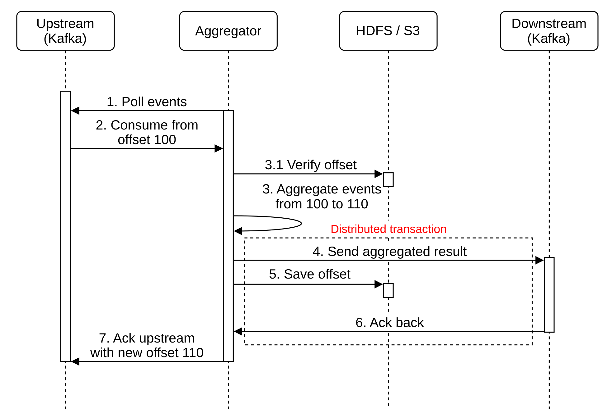
</div>

> NOTE: Alternatively, if the downstream system handles the aggregation result idempotently, there is no need for a distributed transaction.

### **Scale the system**

Let's discuss how we scale the system as it grows.

We have three independent components:
* message queue.
* aggregation service.
* database.

Since they are decoupled, we can scale them independently.

#### **Scale the message queue**

- We don't put a limit on producers, so they can be scaled easily.
- Consumers can be scaled by assigning them to consumer groups and increasing the number of consumers. As shown in the image below, by adding two more consumers, each consumer only processes events from one partition.

<div style="margin-left:1rem">
    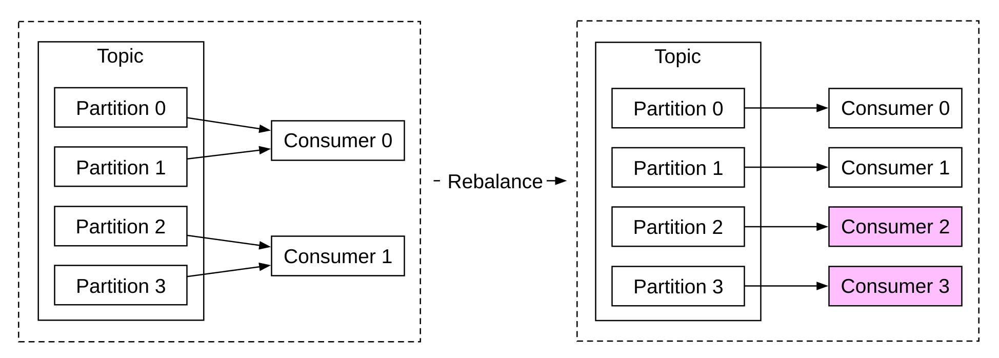
</div>

**Brokers**:
- Use `ad_id` as a hashing key for a Kafka partition to store events from the same `ad_id` in the same Kafka partition. In this case, a consumer would get all events with the same `ad_id` from a single partition.
- We should avoid consumer group rebalancing, as in such a case events with the same `ad_id` might be mapped to a different partition. Therefore, it's recommended to pre-allocate enough partitions in advance.
- A single topic is not enough. We could also consider partitioning the topic by geography (`topic_na`, `topic_eu`, `topic_asia`, etc.) or by business type (`topic_web_ads`, `topic_mobile_ads`, etc.).

#### **Scale the aggregation service**

The aggregation service is a map/reduce operation. The image below shows how things are wired together.

<div style="margin-left:1rem">
    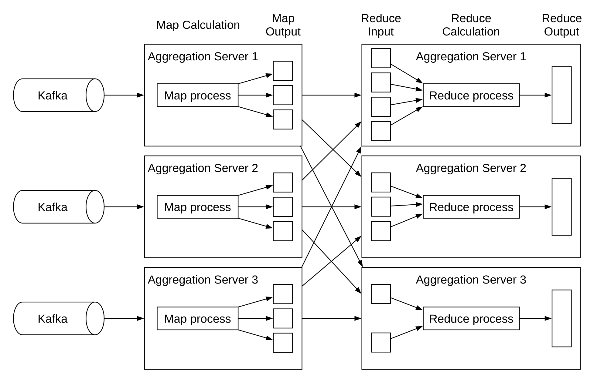
</div>

The map-reduce nodes can easily be scaled by adding more nodes.

There are two options to increase throughput:
* `Option 1`: Allocate events with different ad_ids to different threads, as shown in the image below.
* `Option 2`: Deploy aggregation service nodes on resource providers like Apache Hadoop YARN [[20]](#ref-20).

<div style="margin-left:1rem">
    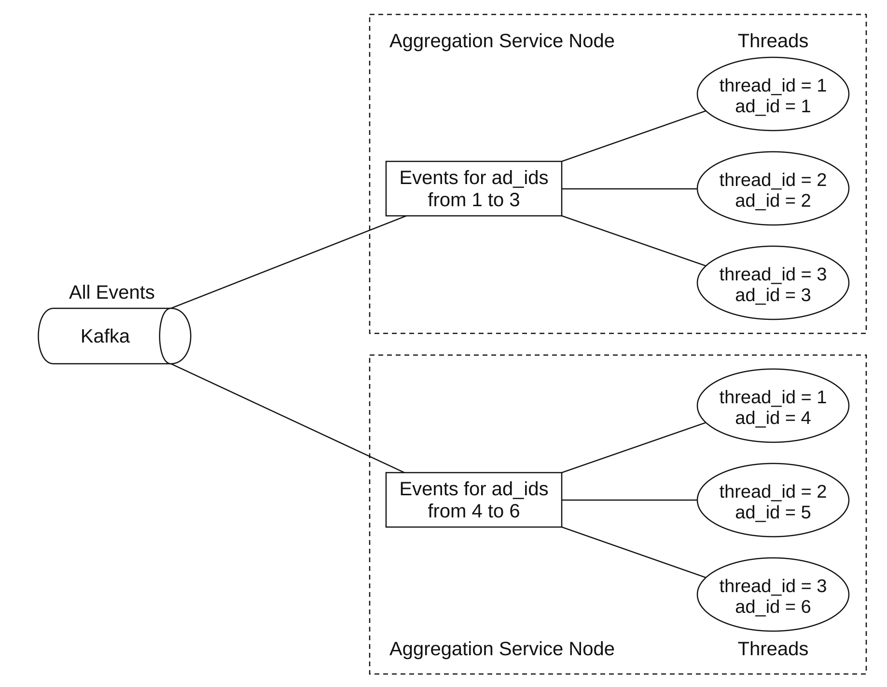
</div>

`Option 1` is easier, but `Option 2` is more widely used in practice as it's more scalable.

#### **Scale the database**

- If we use Cassandra, it natively supports horizontal scaling utilizing consistent hashing.
- If a new node is added to the cluster, data automatically gets rebalanced across all (virtual) nodes.
- With this approach, no manual (re)sharding is required.

<div style="margin-left:1rem">
    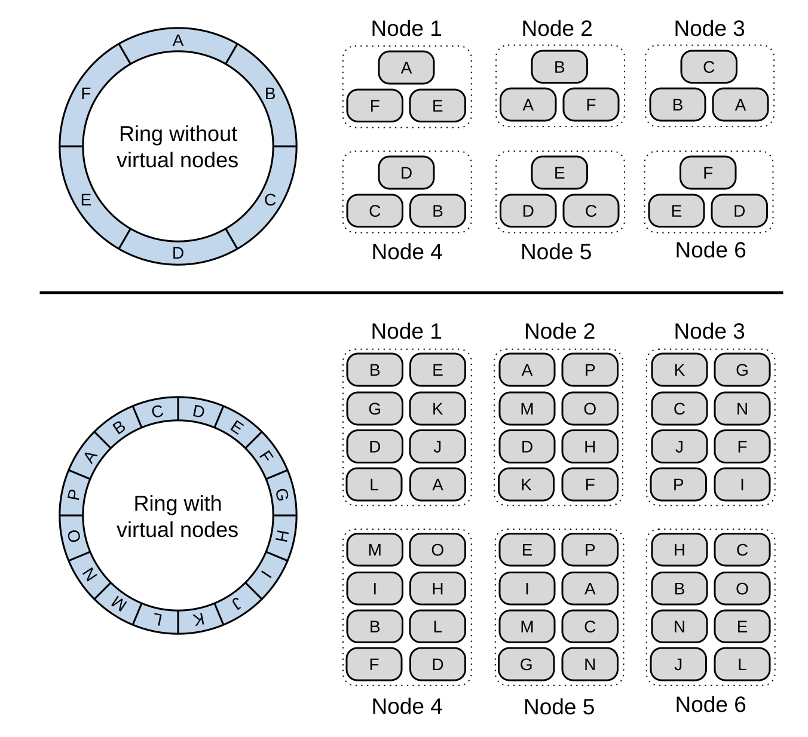
</div>

#### **Hotspot issue**

Another scalability issue to consider is the hotspot issue - what if an ad is more popular and gets more attention than others?

This problem can be mitigated by allocating more aggregation nodes to process popular ads. Assume each aggregation node can handle only 100 events.

<div style="margin-left:1rem">
    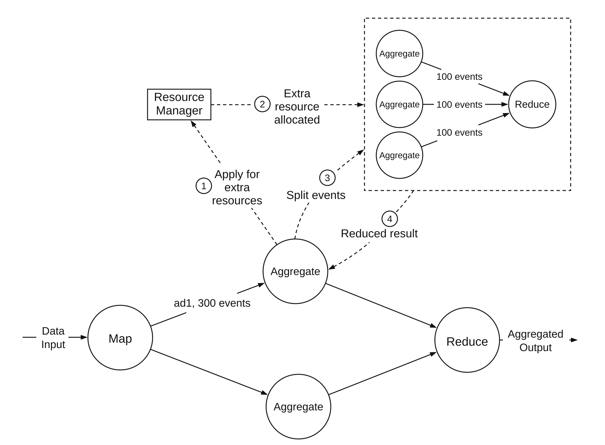
</div>

1. Since there are 300 events in the aggregation node (beyond the capacity a node can handle), it applies for extra resources through the resource manager.
2. The resource manager allocates more resources (for example, adding two more aggregation nodes) so the original aggregation node isn't overloaded.
3. The original aggregation node splits events into 3 groups, and each aggregation node handles 100 events.
4. The result is written back to the original aggregate node.

Alternative, more sophisticated ways to handle the hotspot problem:
- Global-Local Aggregation
- Split Distinct Aggregation

### **Fault Tolerance**

Within the aggregation nodes, we are processing data in memory. If an aggregation node goes down, the processed data is lost.

We can leverage consumer offsets in Kafka to continue from where we left off once another node picks up the slack.

However, there is additional intermediary state we need to maintain, as we're aggregating the top *N* ads in *M* minutes.

We can make snapshots at a particular minute for the ongoing aggregation:

<div style="margin-left:1rem">
    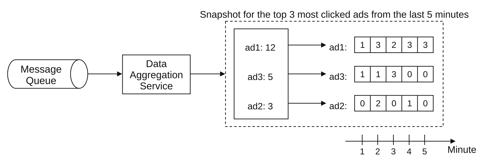
</div>

If a node goes down, the new node can read the latest committed consumer offset, as well as the latest snapshot to continue the job:

<div style="margin-left:1rem">
    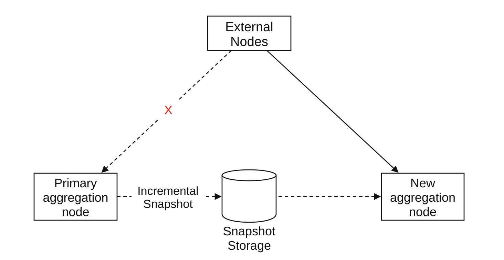
</div>

### **Data monitoring and correctness**

Because the data we're aggregating is used for billing, it is critical to have rigorous monitoring in place to ensure correctness.

#### **Continuous monitoring**

Some metrics we might want to monitor:
- **Latency**: Timestamps of different events can be tracked in order to understand the e2e latency of the system
- **Message queue size**: If there is a sudden increase in queue size, we need to add more aggregation nodes. As Kafka is implemented via a distributed commit log, we need to keep track of records-lag metrics instead.
- **System resources on aggregation nodes**: CPU, disk, JVM, etc.

#### **Reconciliation**

We also need to implement a reconciliation flow, which is a batch job running at the end of the day.
It calculates the aggregated results from the raw data and compares them against the actual data stored in the aggregation database:

<div style="margin-left:1rem">
    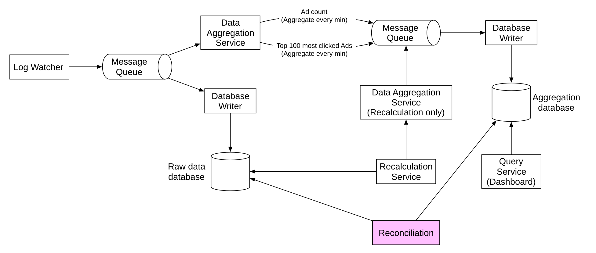
</div>

### **Alternative design**

In a generalist system design interview, you are not expected to know the internals of specialized software used in big data processing.

Explaining the thought process and discussing trade-offs are more important than knowing specific tools, which is why the chapter covers a generic solution.

An alternative design, which leverages off-the-shelf tooling, is to store ad-click data in Hive with an Elasticsearch layer on top for faster queries.

Aggregation is typically done in OLAP databases such as ClickHouse [[23]](#ref-23) or Druid [[24]](#ref-24).

<div style="margin-left:1rem">
    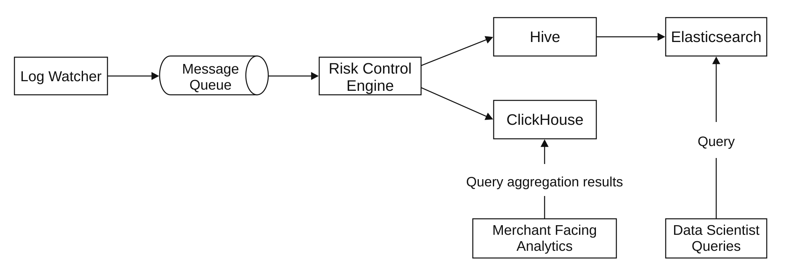
</div>

## Step 4: Wrap up

Things we covered:
- Data model and API design
- Using MapReduce to aggregate ad click events
- Scaling the message queue, aggregation service and database
- Mitigating the hotspot issue
- Monitoring the system continuously
- Using reconciliation to ensure correctness
- Fault tolerance

Ad click event aggregation is a typical big data processing system.

It would be easier to understand and design if you had prior knowledge of related technologies:
- Apache Kafka
- Apache Spark
- Apache Flink

## Reference materials

1. <a id="ref-1"></a>[Clickthrough rate (CTR): Definition](https://support.google.com/google-ads/answer/2615875?hl=en)
2. <a id="ref-2"></a>[Conversion rate: Definition](https://support.google.com/google-ads/answer/2684489?hl=en)
3. <a id="ref-3"></a>[OLAP functions](https://docs.oracle.com/database/121/OLAXS/olap_functions.htm#OLAXS169)
4. <a id="ref-4"></a>[Display Advertising with Real-Time Bidding (RTB) and Behavioural Targeting](https://arxiv.org/pdf/1610.03013.pdf)
5. <a id="ref-5"></a>[LanguageManual ORC](https://cwiki.apache.org/confluence/display/hive/languagemanual+orc)
6. <a id="ref-6"></a>[Parquet](https://databricks.com/glossary/what-is-parquet)
7. <a id="ref-7"></a>[What is Avro](https://www.ibm.com/topics/avro)
8. <a id="ref-8"></a>[Big Data](https://www.datakwery.com/techniques/big-data/)
9. <a id="ref-9"></a>[An Overview of End-to-End Exactly-Once Processing in Apache Flink](https://flink.apache.org/features/2018/03/01/end-to-end-exactly-once-apache-flink.html)
10. <a id="ref-10"></a>[DAG model](https://en.wikipedia.org/wiki/Directed_acyclic_graph)
11. <a id="ref-11"></a>[Understand star schema and the importance for Power BI](https://docs.microsoft.com/en-us/power-bi/guidance/star-schema)
12. <a id="ref-12"></a>[Martin Kleppmann. Designing Data-Intensive Applications. O’Reilly Media, 2017.](https://www.oreilly.com/library/view/designing-data-intensive-applications/9781491903063/)
13. <a id="ref-13"></a>[Apache Flink](https://flink.apache.org/)
14. <a id="ref-14"></a>[Lambda architecture](https://databricks.com/glossary/lambda-architecture)
15. <a id="ref-15"></a>[Kappa architecture](https://hazelcast.com/glossary/kappa-architecture)
16. <a id="ref-16"></a>[Martin Kleppmann. Stream Processing. In Designing Data-Intensive Applications. O’Reilly Media, 2017.](https://www.oreilly.com/library/view/designing-data-intensive-applications/9781491903063/ch11.html)
17. <a id="ref-17"></a>[End-to-end Exactly-once Aggregation Over Ad Streams](https://www.youtube.com/watch?v=hzxytnPcAUM)
18. <a id="ref-18"></a>[Ad traffic quality](https://www.google.com/ads/adtrafficquality/)
19. <a id="ref-19"></a>[Understanding MapReduce in Hadoop](https://www.section.io/engineering-education/understanding-map-reduce-in-hadoop/)
20. <a id="ref-20"></a>[Apache Flink on YARN](https://nightlies.apache.org/flink/flink-docs-stable/docs/deployment/resource-providers/yarn/)
21. <a id="ref-21"></a>[How data is distributed across a cluster (using virtual nodes)](https://docs.datastax.com/en/cassandra-oss/3.0/cassandra/architecture/archDataDistributeDistribute.html)
22. <a id="ref-22"></a>[Flink performance tuning](https://nightlies.apache.org/flink/flink-docs-master/docs/dev/table/tuning/)
23. <a id="ref-23"></a>[ClickHouse](https://clickhouse.com/)
24. <a id="ref-24"></a>[Druid](https://druid.apache.org/)
25. <a id="ref-25"></a>[Real-Time Exactly-Once Ad Event Processing with Apache Flink, Kafka, and Pinot](https://www.uber.com/us/en/blog/real-time-exactly-once-ad-event-processing/)
