# Chapter 25: Real-time Gaming Leaderboard

<sub>[Back to System Design](../Readme.md#content)</sub>

## Introduction

We are going to design a **leaderboard** for an online mobile game:

<div style="margin-left:3rem">
    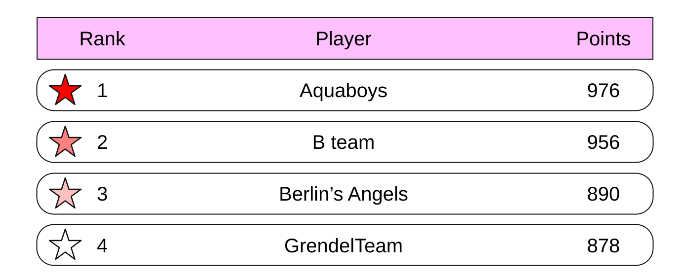
</div>

## Step 1: Understand the Problem and Establish Design Scope

- C: How is the score calculated for the leaderboard?
- I: A user gets a point whenever they win a match.
- C: Are all players included in the leaderboard?
- I: Yes.
- C: Is there a time segment associated with the leaderboard?
- I: Each month, a new tournament starts with a new leaderboard.
- C: Can we assume we only care about the top 10 users?
- I: We want to display the top 10 users, along with the position of a specific user. If time permits, we can discuss showing users around a particular user on the leaderboard.
- C: How many users are in a tournament?
- I: 5 million daily active users (DAU) and 25 million monthly active users (MAU).
- C: How many matches are played on average during a tournament?
- I: Each player plays 10 matches per day on average.
- C: How do we determine the rank if two players have the same score?
- I: Their rank is the same in that case. If time permits, we can discuss breaking ties.
- C: Does the leaderboard need to be real-time?
- I: Yes, we want to present real-time results, or as close to real time as possible. It is not okay to present batched result history.

### **Functional requirements**

- Display the top 10 players on the leaderboard
- Show a user's specific rank
- Display users who are four places above and below a given user (bonus)

### **Non-functional requirements**

- Real-time updates to scores
- Score updates are reflected on the leaderboard in real time
- General scalability, availability, reliability

### **Back-of-the-envelope estimation**

With 5 million DAU, if activity is evenly distributed over a 24-hour period, we'd have 5 million / 86,400 ≈ 58 daily active users per second, rounded to 60 for estimation. This is an activity rate, not a concurrent user count.
However, since activity is typically uneven, we can assume a peak rate five times the average: 300 users per second.

Queries per second (QPS) for users scoring a point - given 10 games per day on average, an upper bound is 60 users/s * 10 = 600 QPS if every game produces a score update for that player. Peak QPS = 3000; actual score updates depend on the win rate.

QPS for fetching the top 10 leaderboard - assuming users open it once a day on average, QPS is about 60.

## Step 2: Propose High-Level Design and Get Buy-In

### **API Design**

#### **Update a user's position on the leaderboard**

The first API we need is one to update a user's score:

```http
POST /v1/scores
```

This API takes two parameters - `user_id` and `points` scored for winning a game.

This API should only be accessible to game servers, not end clients.

#### **Fetch the top 10 players from the leaderboard**

The next API is for getting the top 10 players on the leaderboard:

```http
GET /v1/scores
```

Example response (showing only two of the ten users):

```json
{
  "data": [
    {
      "user_id": "user_id1",
      "user_name": "alice",
      "rank": 1,
      "score": 12543
    },
    {
      "user_id": "user_id2",
      "user_name": "bob",
      "rank": 2,
      "score": 11500
    }
  ],
  "total": 10
}
```

#### **Fetch the rank of a specific user**

You can also get the rank and score of a particular user:

```http
GET /v1/scores/{user_id}
```

Example response:

```json
{
    "user_info": {
        "user_id": "user5",
        "score": 1000,
        "rank": 6
    }
}
```

### **High-level architecture**

<div style="margin-left:3rem">
    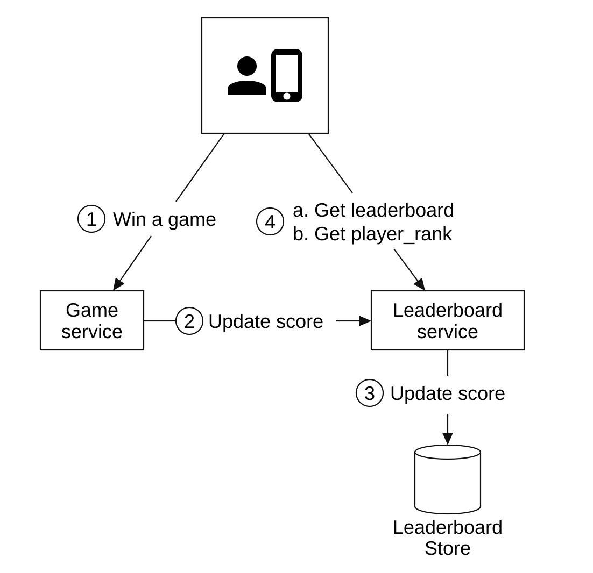
</div>

1. When a player wins a game, the client sends a request to the game service.
2. The game service ensures the win is valid and calls the leaderboard service to update the score.
3. The leaderboard service updates the user’s score in the leaderboard store.
4. A player makes a call to the leaderboard service directly to fetch leaderboard data, including:
    - [a] top 10 leaderboard.
    - [b] the rank of the player on the leaderboard.

An alternative design which was considered is the client updating their score directly within the leaderboard service:

<div style="margin-left:3rem">
    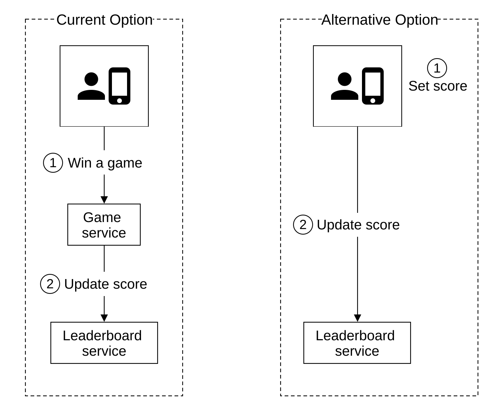
</div>

This option is not secure because it trusts client-provided scores. Players can use a proxy to modify their requests and submit arbitrary scores.

One additional caveat is that for games where the game logic is managed by the server, clients don't need to call the server explicitly to record their win.
Servers do it automatically for them based on the game logic.

One additional consideration is whether we should put a message queue between the game server and the leaderboard service. This would be useful if other services are interested in game results, but that is not an explicit requirement in the interview so far, hence it's not included in the design:

<div style="margin-left:3rem">
    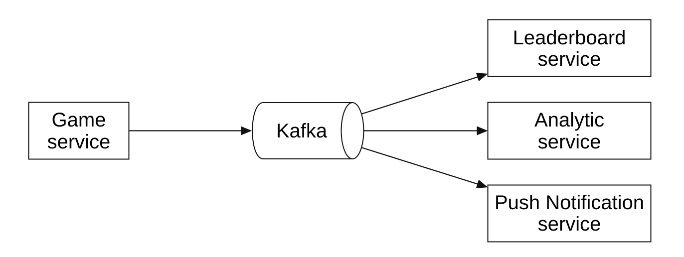
</div>

### **Data models**

Let's discuss the options we have for storing leaderboard data - relational DBs, Redis, NoSQL.

The NoSQL solution is discussed in the deep dive section.

### **Relational database solution**

If scale doesn't matter and we don't have that many users, a relational DB serves us quite well.

We can start from a simple leaderboard table, one for each month (personal note - this doesn't make sense. You can just add a `month` column and avoid the headache of maintaining new tables each month):

<div style="margin-left:3rem">
    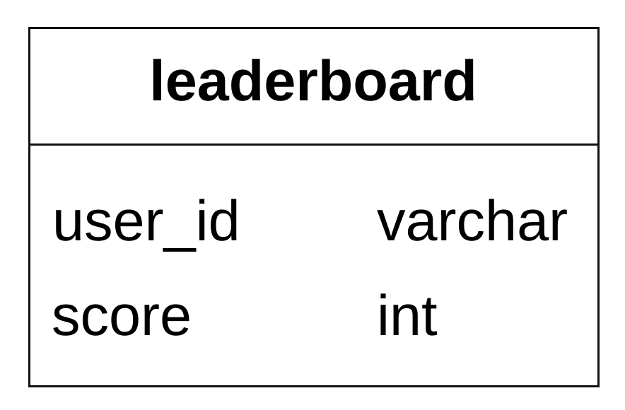
</div>

There is additional data to include in there, but that is irrelevant to the queries we'd run, so it's omitted.

#### **A user wins a point**

What happens when a user wins a point?

<div style="margin-left:3rem">
    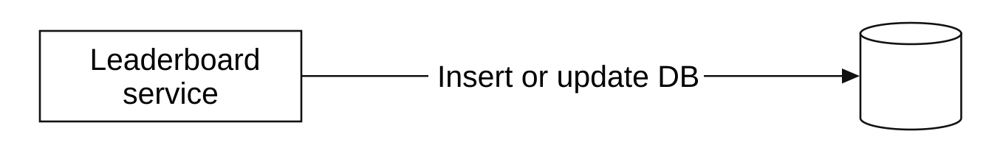
</div>

If a user doesn't exist in the table yet, we need to insert them first:

```sql
INSERT INTO leaderboard (user_id, score) VALUES ('mary1934', 1);
```

On subsequent calls, we'd just update their score:

```sql
UPDATE leaderboard set score=score + 1 where user_id='mary1934';
```

#### **Find a user's leaderboard position**

How do we find the top players of a leaderboard?

<div style="margin-left:3rem">
    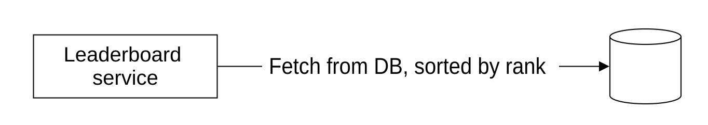
</div>

We can run the following query:

```sql
SELECT RANK() OVER (ORDER BY score DESC) AS player_rank, user_id, score
FROM leaderboard
ORDER BY score DESC;
```

This can be expensive, though, as it ranks all records and may require a full scan and sort.

We can optimize top-player retrieval by adding an index on `score` and using `LIMIT` to avoid scanning everything, then assigning ranks to the returned rows in the application:

```sql
SELECT user_id, score
FROM leaderboard
ORDER BY score DESC
LIMIT 10;
```

This approach, however, doesn't scale well if the user is not at the top of the leaderboard and you want to locate their rank.

### **Redis solution**

We want to find a solution that works well even for millions of players without having to fall back on complex database queries.

Redis is an in-memory data store, which is fast as it works in memory and has a suitable data structure to serve our needs - a sorted set.

#### **Sorted sets**

A sorted set is a data structure similar to sets in programming languages that allows you to keep data sorted by a given criterion.
For large sorted sets, Redis uses a hash table to maintain the mapping between members (`user_id`) and scores, and a skip list [[2]](#ref-2) to maintain sorted order:

<div style="margin-left:3rem">
    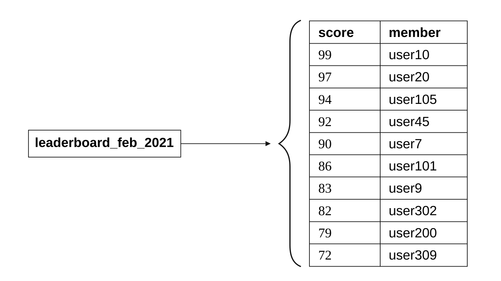
</div>

How does a skip list work?
- It is a linked list which allows for fast search
- It consists of a sorted linked list and multi-level indexes

<div style="margin-left:3rem">
    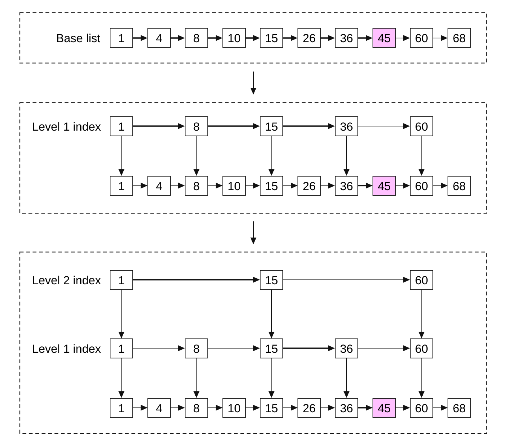
</div>

This structure enables us to quickly search for specific values when the data set is large enough.
In the example below (64 nodes), it requires traversing 62 nodes in a base linked list to find the given value and 11 nodes in the skip-list case:

<div style="margin-left:3rem">
    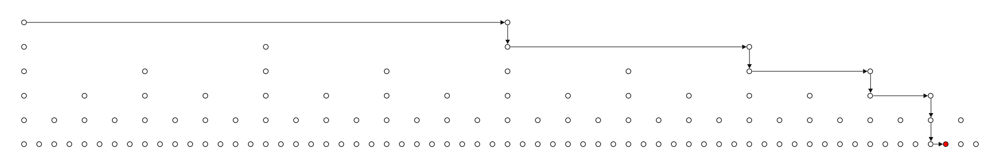
</div>

Redis sorted sets support score updates and rank lookups in `O(logN)` time. Relational databases can also index scores, but finding an arbitrary user’s rank may still require counting many rows.

In contrast, here's an example nested query we need to run to find the rank of a given user in a relational DB:

```sql
SELECT lb1.*, (SELECT COUNT(*) + 1 FROM leaderboard lb2
WHERE lb2.score > lb1.score) AS player_rank
FROM leaderboard lb1
WHERE lb1.user_id = 'mary1934';
```

#### **Implementation using Redis sorted sets**

What operations do we need to operate our leaderboard in Redis? [[4]](#ref-4) [[5]](#ref-5) [[6]](#ref-6) [[7]](#ref-7)
- **ZADD** - insert the user into the set if they don't exist. Otherwise, update the score. `O(logN)` time complexity.
- **ZINCRBY** - increment the score of a user by a given amount. If the user doesn't exist, their score starts at zero. `O(logN)` time complexity.
- **ZRANGE/ZREVRANGE** - fetch a range of users, sorted by their score. The command determines the order (ASC/DESC), and start and stop indexes specify the range. `O(logN+M)` time complexity where `M` is the result size.
- **ZRANK/ZREVRANK** - fetch the zero-based position of a given user in ASC/DESC order. `O(logN)` time complexity.

#### **Workflow with sorted sets**

**1. A user scores a point**

Every month we create a new leaderboard sorted set and the previous ones are moved to historical data storage. To include players with no wins, we add them with score 0 when they join the tournament. When a user wins a match, they score 1 point, so we call `ZINCRBY` to increment the user's score by 1 in that month's leaderboard, or add the user to the leaderboard set if they weren't already there. The syntax for `ZINCRBY` is:

```text
ZINCRBY <key> <increment> <user>
```

So the real command could look like this:

```text
ZINCRBY leaderboard_feb_2021 1 'mary1934'
```

**2. A user fetches the top 10 global leaderboard entries**

We will call `ZREVRANGE` to obtain the members in descending order because we want the highest scores, and pass the `WITHSCORES` option to ensure that it also returns the total score for each user, as well as the set of users with the highest scores.

```text
ZREVRANGE leaderboard_feb_2021 0 9 WITHSCORES
```

Example result:

```text
[(user2,score2),(user1,score1),(user5,score5)...]
```

**3. A user wants to fetch their leaderboard position**

A user's zero-based position can be fetched using `ZREVRANK <key> <user-id>`. Add 1 for a one-based position. Equal scores receive different positions, ordered by reverse lexicographic user ID; to give tied players the same rank, use 1 plus the number of players with a strictly higher score (`ZCOUNT <key> (<score> +inf`).

```text
ZREVRANK leaderboard_feb_2021 'mary1934'
```

**4. Fetch the relative position in the leaderboard for a user**

What about a user fetching nearby leaderboard entries?

<div style="margin-left:3rem">
    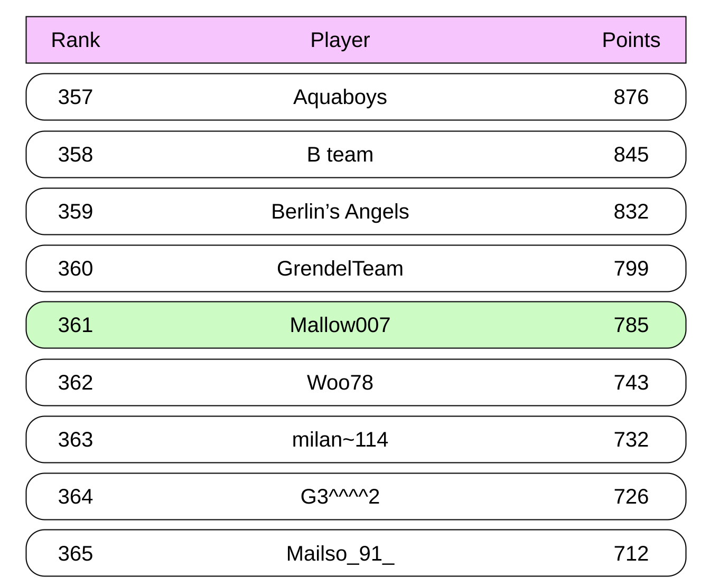
</div>

This can be achieved by the following query for a user at one-based rank 361 (zero-based position 360), returning four users above and below them in this example without ties. Clamp the start index to zero near the top:

```text
ZREVRANGE leaderboard_feb_2021 356 364
```

#### **Storage requirement**

Let's explore what our storage requirements are:
- Assume a worst-case scenario of all 25 million MAU participating in the game for a given month.
- Assuming a 24-byte ID and an 8-byte double-precision score, the raw payload is 32 bytes * 25 million = ~800 MB.
- Actual memory usage is substantially higher because of hash tables, skip lists, and allocation overhead; measure it with representative data before sizing the Redis instance.

Another non-functional requirement to consider is supporting up to 3000 updates per second. A suitably sized Redis server should handle this, but it should be verified with a benchmark.

Additional caveats:
- We can spin up a Redis replica for failover, but asynchronous replication can still lose recent writes.
- We can use Redis persistence to recover after a crash; possible data loss depends on the persistence settings.
- We'll need two supporting tables in MySQL to fetch user details such as username, display name, etc., as well as store when, e.g., a user won a game.
- The second table in MySQL can be used to reconstruct the leaderboard when there is an infrastructure failure.
- As a small performance optimization, we could cache the user details of the top 10 players as they'd be frequently accessed.

## Step 3: Design Deep Dive

### **To use a cloud provider or not**

We can either choose to deploy and manage our own services or use a cloud provider to manage them for us.

#### **Manage our own services**

If we choose to manage the services ourselves, we'll use Redis for leaderboard data, MySQL for user profiles, and potentially a cache for user profiles if we want to scale the database:

<div style="margin-left:3rem">
    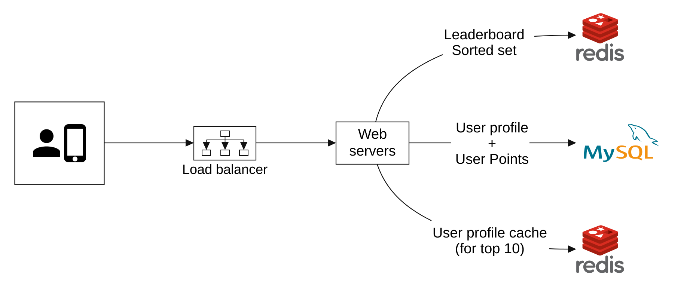
</div>

#### **Build on the cloud**

Alternatively, we could use cloud offerings to manage a lot of the services for us. For example, we can use AWS API Gateway to route API calls to AWS Lambda functions:

<div style="margin-left:3rem">
    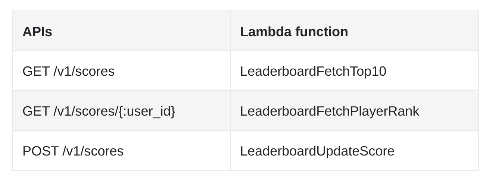
</div>

AWS Lambda enables us to run code without managing or provisioning servers ourselves. It runs only when needed and scales automatically.

Example of a user scoring a point:

<div style="margin-left:3rem">
    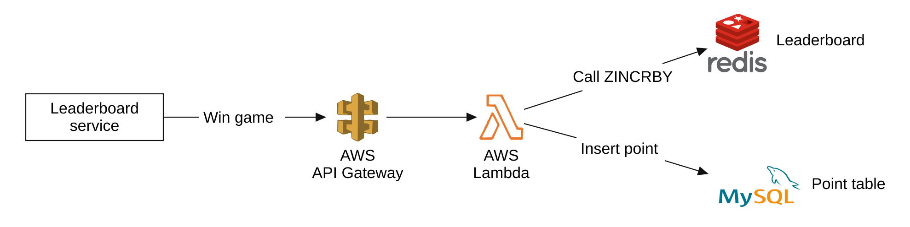
</div>

Example of a user retrieving the leaderboard:

<div style="margin-left:3rem">
    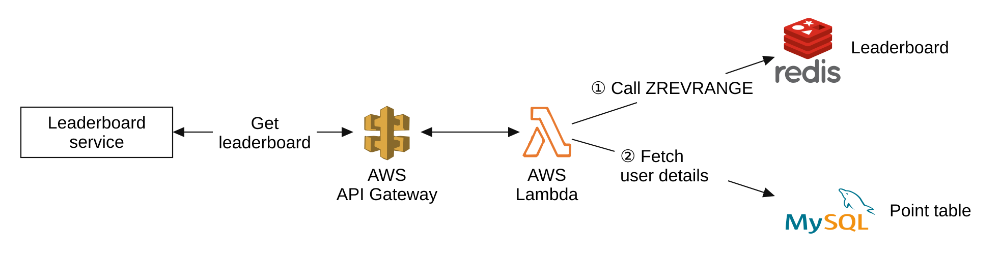
</div>

Lambda functions are an implementation of a serverless architecture. AWS manages server scaling and maintenance; we still configure the functions and their resources.

The author recommends going with this approach if we build the game from the ground up.

### **Scaling Redis**

With 5 million DAU, a suitably sized single Redis instance may be sufficient from both a storage and QPS perspective.

However, if the user base grows 100x to 500 million DAU, with MAU growing proportionally, the raw payload would reach about 80 GB before Redis overhead, and estimated peak update QPS would increase to 300k.

#### **Data sharding**

Such scale may require sharding in one of the following ways: fixed or hash partitions.

#### **Fixed partition**

One way to achieve it is by range-partitioning the data:

<div style="margin-left:3rem">
    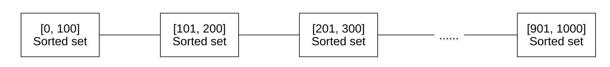
</div>

In this example, we'll shard based on the user's score. We'll maintain the mapping between `user_id` and shard in application code.
We can do that either via MySQL or another cache for the mapping itself. Users must move between shards when their scores cross a range boundary.

To fetch the top 10 players, we'd query the shard with the highest scores (`[901-1000]`), continuing to lower-score shards if it contains fewer than 10 players.

To fetch a user's rank, we'll need to calculate the rank within the user's shard and add up all users with higher scores in other shards.
The number of members in each shard’s sorted set can be fetched in `O(1)` time using `ZCARD`; summing across shards takes `O(S)` time for `S` shards. `INFO keyspace` [[11]](#ref-11) counts Redis keys, not sorted-set members.

#### **Hash partition**

Alternatively, we can hash user IDs into multiple leaderboard sorted-set keys and distribute those keys via Redis Cluster. Redis Cluster distributes keys across Redis nodes using 16,384 hash slots; it does not split a single sorted set across nodes. The proxy shown below is an optional routing layer, not Redis Cluster itself:

<div style="margin-left:3rem">
    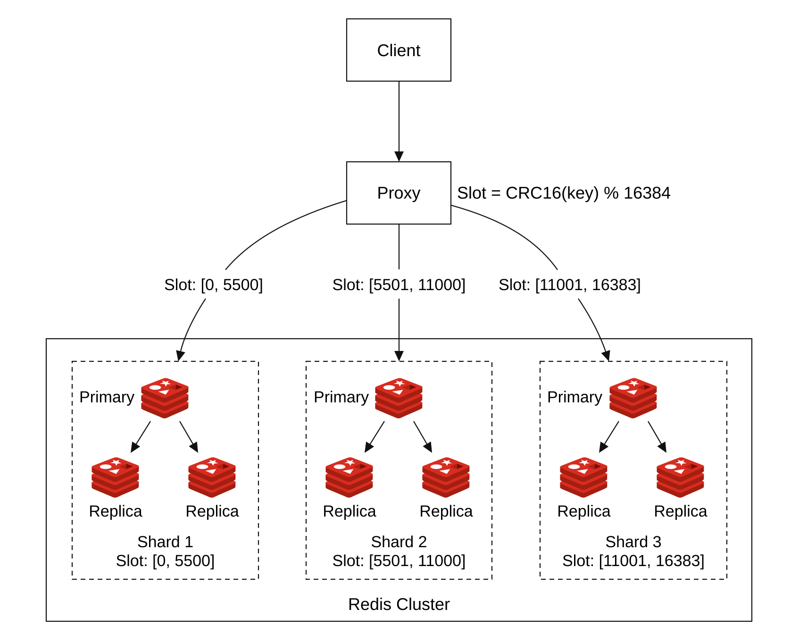
</div>

Calculating the top 10 players is challenging with this setup. We'll need to get the top 10 players of each shard and merge the results in the application:

<div style="margin-left:3rem">
    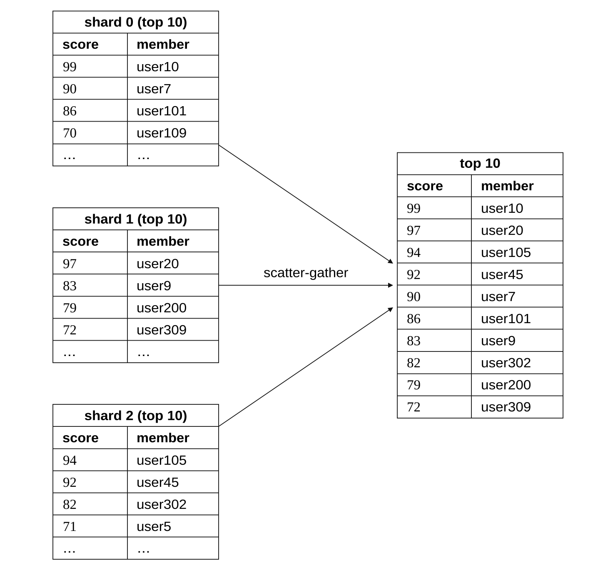
</div>

There are some limitations with the hash partitioning:
- If we need to fetch the top K users where K is high, latency can increase, as we'll need to fetch a lot of data from all the shards.
- Latency increases as the number of partitions grows.
- There is no straightforward approach to determine a user's rank.

Due to all this, the author leans towards using fixed partitions for this problem.

#### **Sizing a Redis node**

There are multiple things to consider when sizing your Redis nodes [[14]](#ref-14):
- Write-heavy applications may need up to twice the normal memory during snapshotting or AOF rewrites because concurrent writes cause copy-on-write memory overhead.
- We can use a tool called `redis-benchmark` to track the performance of a Redis setup and make data-driven decisions.

### **Alternative solution: NoSQL**

An alternative solution to consider is using an appropriate NoSQL database optimized for:
- heavy writes.
- effectively sorting items within the same partition by score.

DynamoDB [[16]](#ref-16), Cassandra, or MongoDB are all good fits.

In this chapter, the author has decided to use DynamoDB. It is a fully managed NoSQL database that offers reliable performance and great scalability.
It also enables usage of global secondary indexes when we need to query fields not part of the primary key.

<div style="margin-left:3rem">
    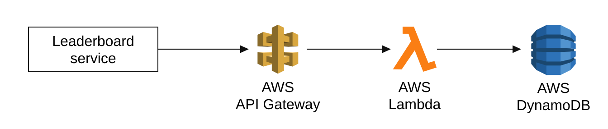
</div>

Let's start from a table for storing a leaderboard for a chess game:

<div style="margin-left:3rem">
    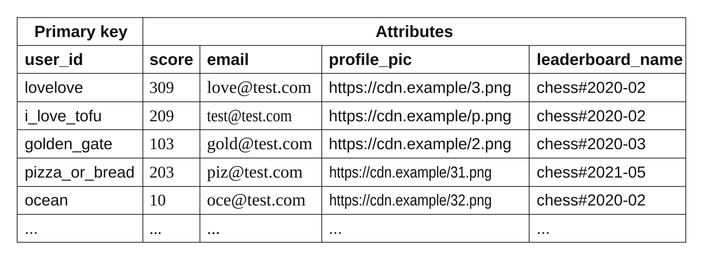
</div>

This works well, but doesn't scale well if we need to query by score. Hence, we can use the score as the sort key of a global secondary index. This index is eventually consistent, so leaderboard reads can briefly lag behind updates:

<div style="margin-left:3rem">
    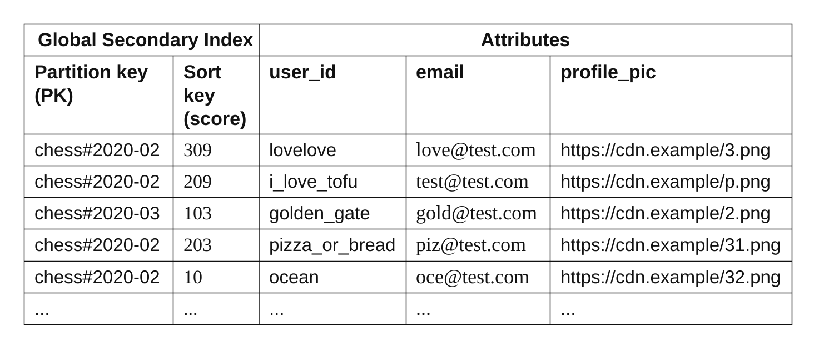
</div>

Another problem with this design is that we're partitioning by month. This can create a hot partition key because the latest month receives most of the traffic.

We could use a technique called **write sharding**, where we append a partition number to each key, calculated via `hash(user_id) % num_partitions`:

<div style="margin-left:3rem">
    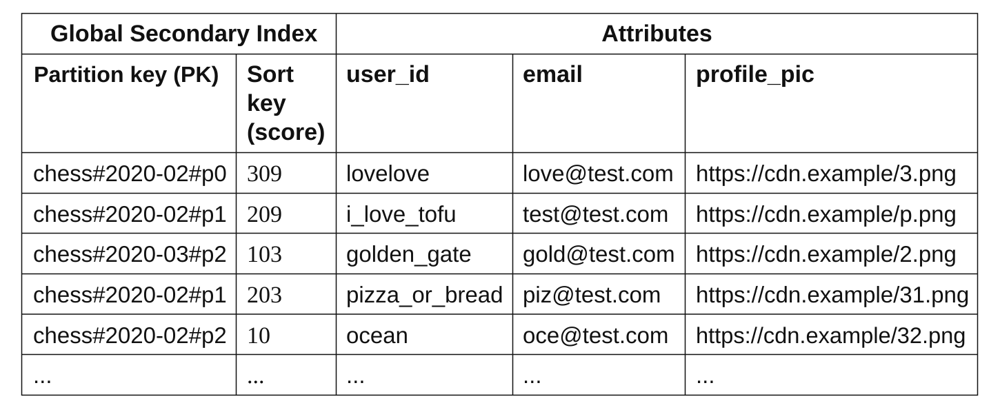
</div>

An important trade-off to consider is how many partitions we should use:
- The more partitions there are, the higher the write scalability
- However, read scalability suffers as we need to query more partitions to collect aggregate results

Using this approach requires that we use the "scatter-gather" technique we saw earlier, which grows in time complexity as we add more partitions:

<div style="margin-left:3rem">
    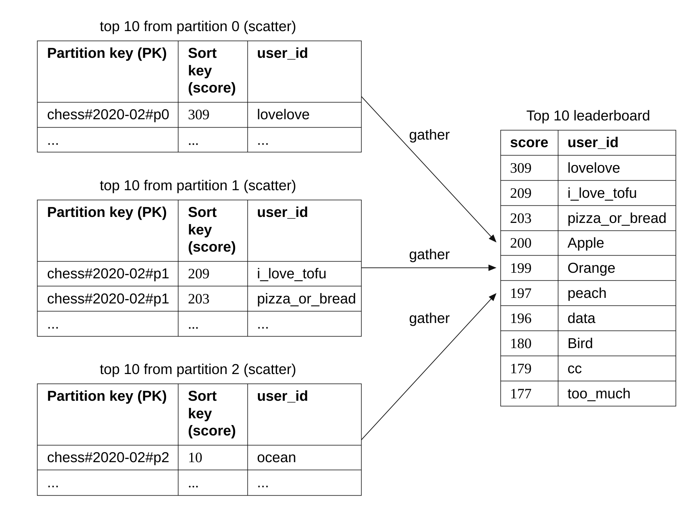
</div>

To make a good estimate of the number of partitions, we'd need to do some benchmarking.

This NoSQL approach still has one major downside - it is hard to calculate the specific rank of a user.

If we have sufficient scale to require us to shard, we could then perhaps tell users what "percentile" of scores they're in.

A cron job can periodically run to analyze score distributions, based on which a user's percentile is determined, for example:

```text
10th-percentile score cutoff = 100
20th-percentile score cutoff = 500
...
90th-percentile score cutoff = 6500
```

## Step 4: Wrap Up

Other things to discuss if time permits:
- **Faster retrieval** - We can cache the user object via a Redis hash with mapping `user_id -> user object`. This enables faster retrieval vs. querying the database.
- **Breaking ties** - When two players have the same score, we can break the tie by sorting them based on the time of their last played game.
- **System failure recovery** - In the event of a large-scale Redis outage, we can recreate the leaderboard by replaying the stored game-win records from MySQL with an ad hoc script.

# Sources

1. <a id="ref-1"></a>[Man-in-the-middle attack](https://en.wikipedia.org/wiki/Man-in-the-middle_attack)
2. <a id="ref-2"></a>[Redis Sorted Set source code](https://github.com/redis/redis/blob/unstable/src/t_zset.c)
3. <a id="ref-3"></a>[Geekbang](https://static001.geekbang.org/resource/image/46/a9/46d283cd82c987153b3fe0c76dfba8a9.jpg)
4. <a id="ref-4"></a>[Building real-time Leaderboard with Redis](https://medium.com/@sandeep4.verma/building-real-time-leaderboard-with-redis-82c98aa47b9f)
5. <a id="ref-5"></a>[Build a real-time gaming leaderboard with Amazon ElastiCache for Redis](https://aws.amazon.com/blogs/database/building-a-real-time-gaming-leaderboard-with-amazon-elasticache-for-redis)
6. <a id="ref-6"></a>[How we created a real-time Leaderboard for a million Users](https://levelup.gitconnected.com/how-we-created-a-real-time-leaderboard-for-a-million-users-555aaa3ccf7b)
7. <a id="ref-7"></a>[Build a real-time leaderboard with Redis](https://redis.io/tutorials/howtos/leaderboard/)
8. <a id="ref-8"></a>[Lambda](https://aws.amazon.com/lambda/)
9. <a id="ref-9"></a>[Google Cloud Functions](https://cloud.google.com/functions)
10. <a id="ref-10"></a>[Azure Functions](https://azure.microsoft.com/en-us/services/functions/)
11. <a id="ref-11"></a>[Info command](https://redis.io/commands/INFO)
12. <a id="ref-12"></a>[Why redis cluster only have 16384 slots](https://stackoverflow.com/questions/36203532/why-redis-cluster-only-have-16384-slots)
13. <a id="ref-13"></a>[Cyclic redundancy check](https://en.wikipedia.org/wiki/Cyclic_redundancy_check)
14. <a id="ref-14"></a>[Choosing your node size](https://docs.aws.amazon.com/AmazonElastiCache/latest/red-ug/nodes-select-size.html)
15. <a id="ref-15"></a>[How fast is Redis?](https://redis.io/topics/benchmarks)
16. <a id="ref-16"></a>[Using Global Secondary Indexes in DynamoDB](https://docs.aws.amazon.com/amazondynamodb/latest/developerguide/GSI.html)
17. <a id="ref-17"></a>[Leaderboard & Write Sharding](https://www.dynamodbguide.com/leaderboard-write-sharding/)
18. <a id="ref-18"></a>[Redis sorted sets](https://redis.io/docs/latest/develop/data-types/sorted-sets/)
19. <a id="ref-19"></a>[ZREVRANK command](https://redis.io/docs/latest/commands/zrevrank/)
20. <a id="ref-20"></a>[ZCOUNT command](https://redis.io/docs/latest/commands/zcount/)
21. <a id="ref-21"></a>[ZCARD command](https://redis.io/docs/latest/commands/zcard/)
22. <a id="ref-22"></a>[Redis Cluster specification](https://redis.io/docs/latest/operate/oss_and_stack/reference/cluster-spec/)
23. <a id="ref-23"></a>[Redis persistence](https://redis.io/docs/latest/operate/oss_and_stack/management/persistence/)
24. <a id="ref-24"></a>[MySQL window function descriptions](https://dev.mysql.com/doc/refman/8.4/en/window-function-descriptions.html)
25. <a id="ref-25"></a>[MySQL ORDER BY optimization](https://dev.mysql.com/doc/refman/8.4/en/order-by-optimization.html)
26. <a id="ref-26"></a>[DynamoDB write sharding](https://docs.aws.amazon.com/amazondynamodb/latest/developerguide/bp-partition-key-sharding.html)
