# Chapter 27: Digital Wallet
<sub>[Back to System Design](../Readme.md#content)</sub>

## Introduction

**Payment platforms** usually have a **wallet service**, where they allow clients to store funds within the application, which they can withdraw later.

You can also use it to pay for goods & services or transfer money to other users who use the **digital wallet** service. That can be faster and cheaper than doing it via normal payment rails.

<div style="margin-left:1rem">
    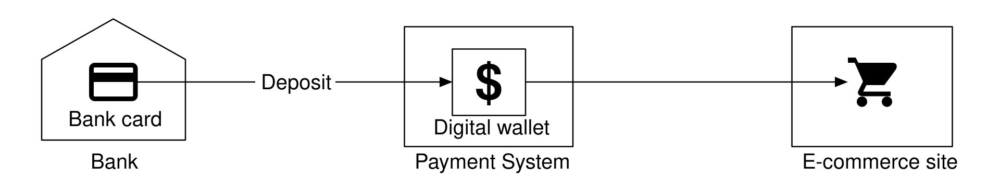
</div>

## Step 1: Understand the Problem and Establish Design Scope

* C: Should we only focus on transfers between digital wallets? Should we support any other operations?
* I: Let's focus on transfers between digital wallets for now.
* C: How many transactions per second does the system need to support?
* I: Let's assume 1 million TPS
* C: A digital wallet has strict correctness requirements. Can we assume transactional guarantees are sufficient?
* I: Sounds good
* C: Do we need to prove correctness?
* I: We can do that via reconciliation, but that only detects discrepancies vs. showing us the root cause for them. Instead, we want to be able to replay data from the beginning to reconstruct the history.
* C: Can we assume the availability requirement is 99.99%?
* I: Yes
* C: Do we need to take foreign exchange into consideration?
* I: No, it's out of scope

Here's what we have to support in summary:
* Support balance transfers between two accounts
* Support 1 million TPS
* Reliability is 99.99%
* Support transactions
* Support reproducibility

### **Back-of-the-envelope estimation**

A traditional relational database provisioned in the cloud can support ~1000 TPS.

In order to reach 1 million TPS, we'd need 1,000 database nodes. But if each transfer has two legs, then we actually need to support 2 million TPS.

One of our design goals would be to increase the TPS a single node can handle so that we can have fewer database nodes.

| Per-node TPS | Node Number |
|--------------|-------------|
| 100          | 20,000      |
| 1,000        | 2,000       |
| 10,000       | 200         |

## Step 2: Propose High-Level Design and Get Buy-In

### **API Design**

We only need to support one endpoint for this interview:
```http
POST /v1/wallet/balance_transfer - transfers balance from one wallet to another
```

Request parameters:
* `from_account`
* `to_account`
* `amount` - a string to avoid losing precision.
* `currency`
* `transaction_id` - ID used for deduplication.

Sample response:
```json
{
    "status": "success",
    "transaction_id": "01589980-2664-11ec-9621-0242ac130002"
}
```

### **In-memory sharding solution**

Our wallet application maintains account balances for every user account.

One good data structure to represent this is a `map<user_id, balance>`, which can be implemented using an in-memory Redis store.

Since one Redis node cannot withstand 1 million TPS, we need to partition our Redis cluster across multiple nodes.

Example partitioning algorithm:
```java
String accountID = "A";
int partitionNumber = 7;
int myPartition = accountID.hashCode() % partitionNumber;
```

ZooKeeper can be used to store the number of partitions and addresses of Redis nodes, as it's a highly available configuration store.

Finally, a wallet service is a stateless service responsible for carrying out transfer operations. It can easily scale horizontally:

<div style="margin-left:1rem">
    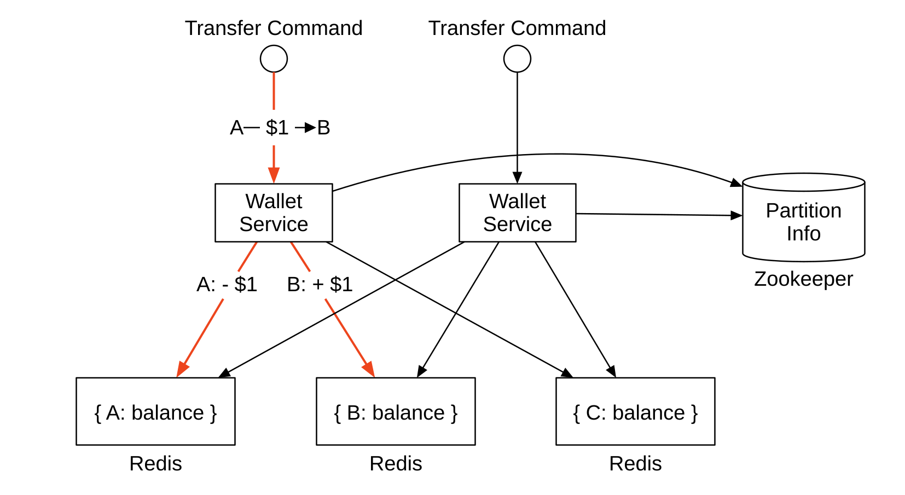
</div>

Although this solution addresses scalability concerns, it doesn't allow us to execute balance transfers atomically.

### **Distributed transactions**

One approach for handling transactions is to use the two-phase commit protocol on top of standard, sharded relational databases:

<div style="margin-left:1rem">
    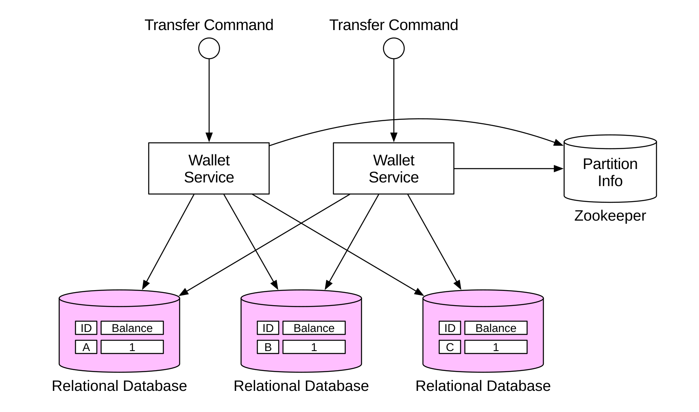
</div>

Here's how the **two-phase commit (2PC)** protocol works:

<div style="margin-left:1rem">
    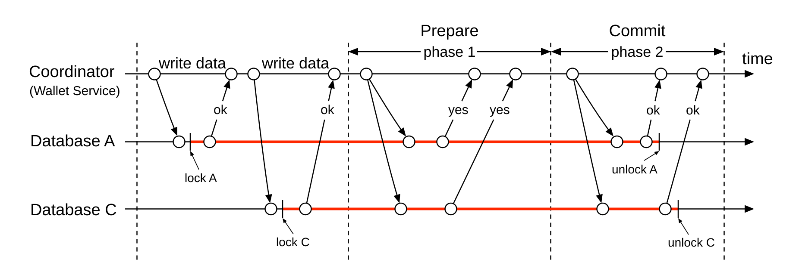
</div>

1. The coordinator (wallet service) performs read and write operations on multiple databases as normal. As shown in the image above, both databases A and C are locked.
2. When the application is ready to commit the transaction, the coordinator asks all databases to prepare the transaction.
3. In the second phase, the coordinator collects replies from all databases and does the following:
    - a. If all databases reply with a "yes", the coordinator asks all databases to commit the transaction it has received.
    - b. If any database replies with a "no", the coordinator asks all databases to abort the transaction.

Downsides to the 2PC approach:
* Not performant due to lock contention.
* The coordinator is a single point of failure.

<div style="margin-left:1rem">
    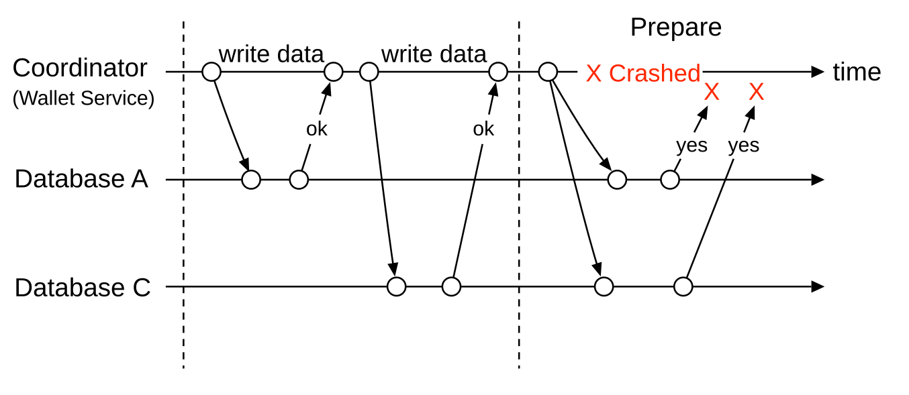
</div>

### **Distributed transaction: Try-Confirm/Cancel (TC/C)**

TC/C is a type of compensating transaction [[7]](#ref-7) that has two steps:
1. In the first phase, the coordinator asks all databases to reserve resources for the transaction.
2. In the second phase, the coordinator collects replies from DBs:
    - a. If all databases reply with "yes", the coordinator asks all databases to confirm the operation, which is the Try-Confirm process.
    - b. If any database replies with "no", the coordinator asks all databases to cancel the operation, which is the Try-Cancel process.

One important difference between TC/C and 2PC is that 2PC performs a single transaction, whereas in TC/C, there are two independent transactions.

Here's how TC/C works in phases:

| Phase | Operation | A                   | C                   |
|-------|-----------|---------------------|---------------------|
| 1     | Try       | Balance change: -$1 | Do nothing          |
| 2     | Confirm   | Do nothing          | Balance change: +$1 |
|       | Cancel    | Balance change: +$1 | Do Nothing          |

#### **Phase 1 - Try:**

<div style="margin-left:1rem">
    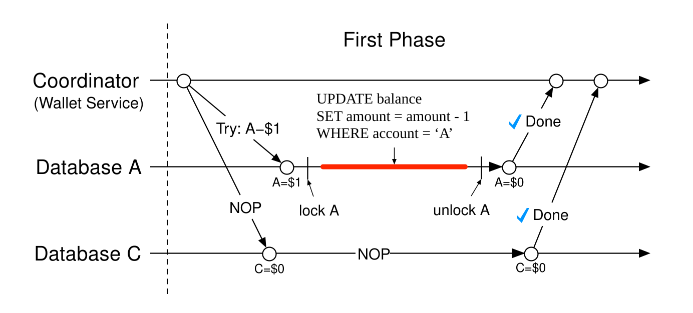
</div>

1. For the database that contains account A, the coordinator starts a local transaction that reduces the balance of A by $1.
2. For the database that contains account C, the coordinator gives it a `NOP` (no operation). The database does nothing for `NOP` commands and always replies to the coordinator with a success message.

#### **Phase 2a - Confirm:**

<div style="margin-left:1rem">
    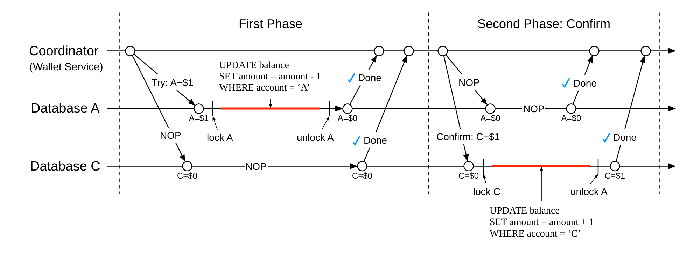
</div>

* If both DBs reply with "yes," the confirm phase starts.
* A's DB receives NOP, whereas C's DB is instructed to increase C's balance by $1 (a local transaction).

#### **Phase 2b - Cancel:**

<div style="margin-left:1rem">
    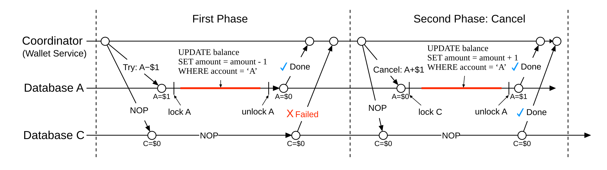
</div>

* If any of the operations in phase 1 fails, the cancel phase starts.
* A's DB is instructed to increase A's balance by $1, and C's DB receives NOP.

#### **Here's a comparison between 2PC and TC/C:**

|      | First Phase                                            | Second Phase: success              | Second Phase: fail                        |
|------|--------------------------------------------------------|------------------------------------|-------------------------------------------|
| 2PC  | Local transactions are not done yet                          | Commit all local transactions     | Cancel all transactions                   |
| TC/C | All transactions are completed - committed or canceled | Execute new transactions if needed | Reverse the already committed transaction |

TC/C is also referred to as a distributed transaction by compensation. The high-level operation is handled in the business logic.

Other properties of TC/C:
* Database-agnostic, as long as the database supports transactions
* Details and complexity of distributed transactions need to be handled in the business logic

### **TC/C Failure modes**

If the coordinator dies mid-flight, it needs to recover its intermediate state.

The solution is simple. We can store the progress of a TC/C as phase status in a transactional database. The phase status includes at least the following information:
* ID and content of the distributed transaction.
* status of the try phase - not sent, has been sent, response received.
* second phase name - confirm or cancel.
* status of the second phase.
* out-of-order flag (explained later).

Phase tables are usually stored in the database that contains the wallet account from which money is deducted.

<div style="margin-left:1rem">
    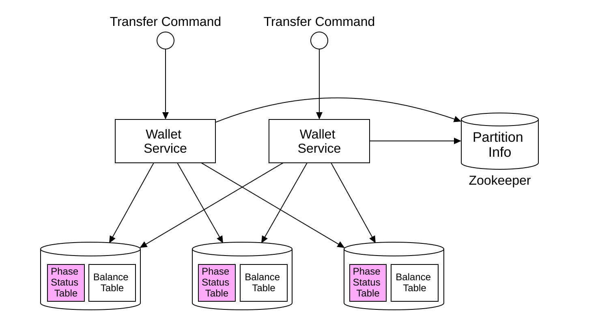
</div>

#### **Unbalanced balance**

One caveat when using TC/C is that there is a brief moment when the account states are inconsistent with each other while a distributed transaction is in flight:

<div style="margin-left:1rem">
    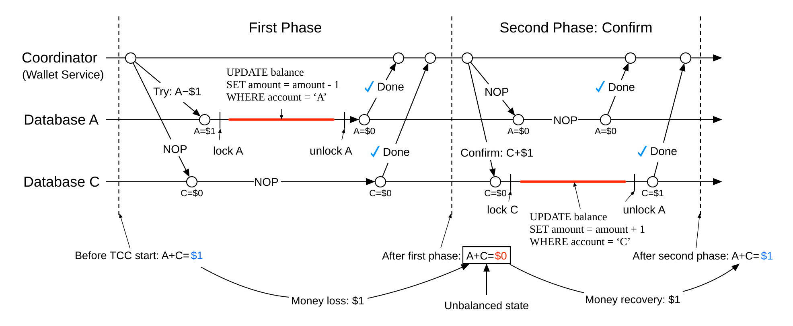
</div>

This is fine as long as we always recover from this state and users cannot use the intermediate state to, e.g., spend the money.

#### **The valid operation order**

This is guaranteed by always executing deductions prior to additions.

| Try phase choices  | Account A | Account C |
|--------------------|-----------|-----------|
| Choice 1           | -$1       | NOP       |
| Choice 2 (invalid) | NOP       | +$1       |
| Choice 3 (invalid) | -$1       | +$1       |

> Note: Choice 2 from the table above is invalid because someone else may jump in and reserve or spend this dollar.

> Note: Choice 3 from the table above is invalid because we cannot guarantee atomic execution of transactions across different databases without relying on 2PC.

#### **Out-of-order execution**

One edge case to address is out-of-order execution:

<div style="margin-left:1rem">
    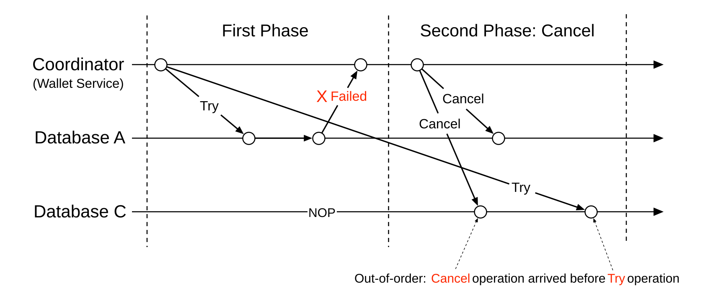
</div>

It is possible that a database receives a cancel operation before receiving a try. This edge case can be handled by adding an out-of-order flag to our phase-status table.

When we receive a try operation, we first check whether the out-of-order flag is set; if so, a failure is returned.

### **Distributed transaction: Saga**

Another popular approach is using Saga [[8]](#ref-8) - a standard for implementing distributed transactions with microservice architectures.

Here's how it works:
1. All operations are ordered in a sequence. Each operation is an independent transaction on its own database.
2. Operations are executed from the first to the last. When one operation has finished, the next operation is triggered.
3. When an operation has failed, the entire process starts to roll back from the current operation to the first operation in reverse order, using compensating transactions. So for each operation in a distributed transaction, we need to prepare one operation for the normal case and another for the compensating transaction during rollback.

<div style="margin-left:1rem">
    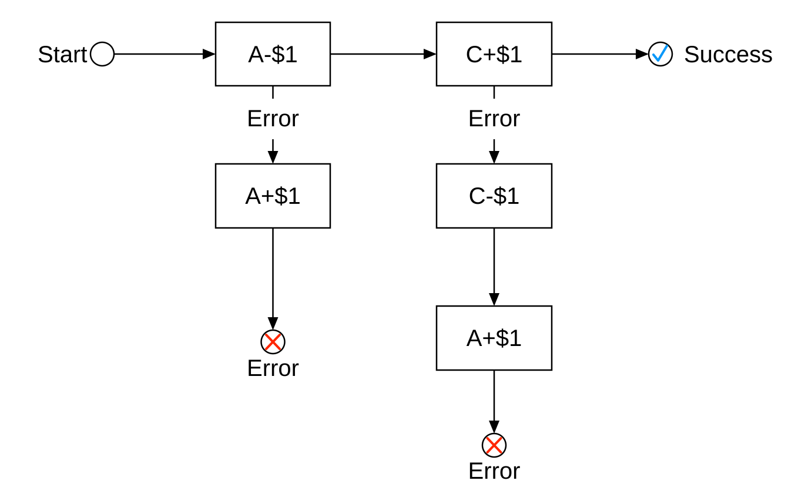
</div>

How do we coordinate the workflow? There are two approaches we can take:
1. Choreography - all services involved in a saga subscribe to the related events and do their part in the saga.
2. Orchestration - a single coordinator instructs all services to do their jobs in the correct order.

The challenge of using choreography is that business logic is split across multiple services, which communicate asynchronously.

The orchestration approach handles complexity well, so it is typically the preferred approach in a digital wallet system.

#### **Comparison between TC/C and Saga**

|                                           | TC/C            | Saga                     |
|-------------------------------------------|-----------------|--------------------------|
| Compensating action                       | In Cancel phase | In rollback phase        |
| Central coordination                      | Yes             | Yes (orchestration mode) |
| Operation execution order                 | any             | linear                   |
| Parallel execution possibility            | Yes             | No (linear execution)    |
| Could see the partial inconsistent status | Yes             | Yes                      |
| Application or database logic             | Application     | Application              |

The main difference is that TC/C is parallelizable, so our decision is based on the latency requirement - if we need to achieve low latency, we should go for the TC/C approach.

Regardless of the approach we take, we still need to support auditing and replaying history to recover from failed states.

### **Event sourcing**

In real life, a digital wallet application might be audited and we have to answer certain questions:
1. Do we know the account balance at any given time?
2. How do we know the historical and current balances are correct?
3. How do we prove the system logic is correct after a code change?

**Event sourcing** is a technique developed in **Domain-Driven Design (DDD)** [[9]](#ref-9) which helps us answer these questions.

It consists of four concepts:
* **command** - intended action from the real world, e.g., transfer $1 from account A to B. Commands need to have a global order, so they're put into a FIFO queue.
    * commands, unlike events, can fail and have some randomness due to, e.g., I/O or an invalid state.
    * commands can produce zero or more events
    * event generation can contain randomness such as external I/O.
* **event** - historical facts about events that occurred in the system, e.g., "transferred $1 from A to B."
    * unlike commands, events are facts that have happened within our system
    * similar to commands, they need to be ordered; hence, they're enqueued in a FIFO queue
* **state** - what has changed as a result of an event. E.g., a key-value store mapping accounts to their balances.
* **state machine** - drives the event sourcing process. It mainly validates commands and applies events to update the system state.
    * the state machine should be deterministic; hence, it shouldn't read external I/O or rely on randomness.

<div style="margin-left:1rem">
    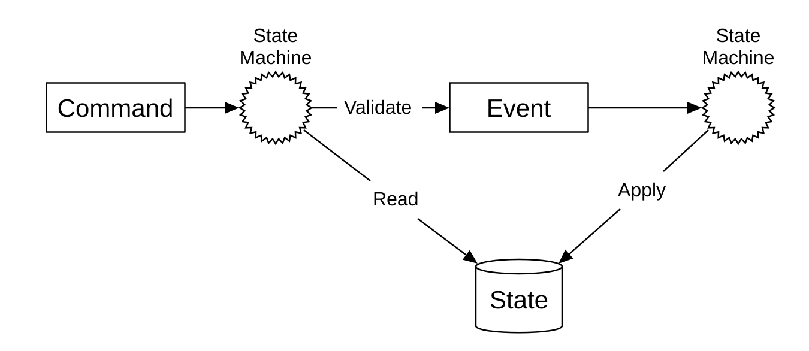
</div>

Here's a dynamic view of event sourcing:

<div style="margin-left:1rem">
    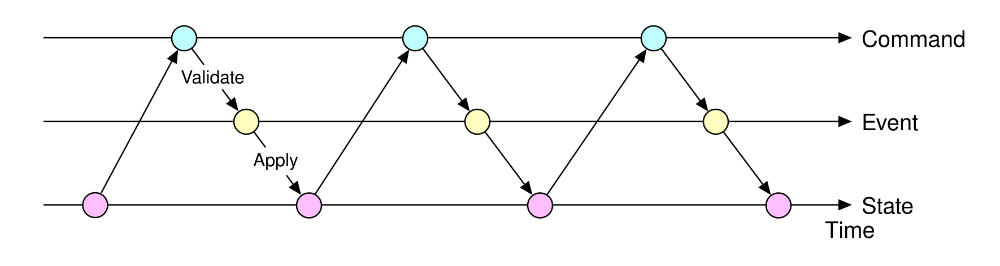
</div>

#### **Wallet service example**

For our wallet service, the commands are balance transfer requests. We can put them in a FIFO queue, such as Kafka:

<div style="margin-left:1rem">
    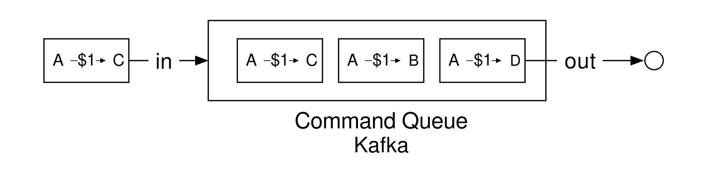
</div>

Here's the full picture:

<div style="margin-left:1rem">
    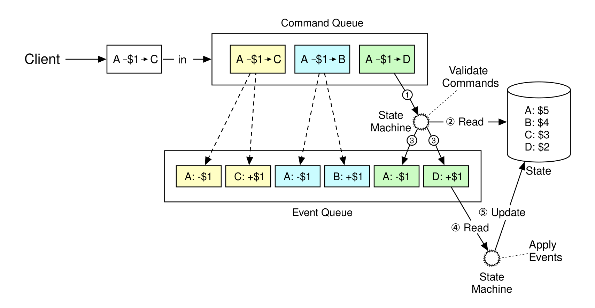
</div>

1. Read a Command from the Command queue.
2. Read the balance State from the database.
3. Validate the Command. If it is valid, generate two events for each of the accounts.
4. Read the next Event.
5. Apply the Event by updating the balance in the database.

### **Reproducibility**

The main advantage of using event sourcing is its **reproducibility**. In this design, all state update operations are saved as an immutable history of all balance changes.

Historical balances can always be reconstructed by replaying events from the beginning.

Because the event list is immutable and the state machine is deterministic, we are guaranteed to succeed in replaying any of the intermediate states.

<div style="margin-left:1rem">
    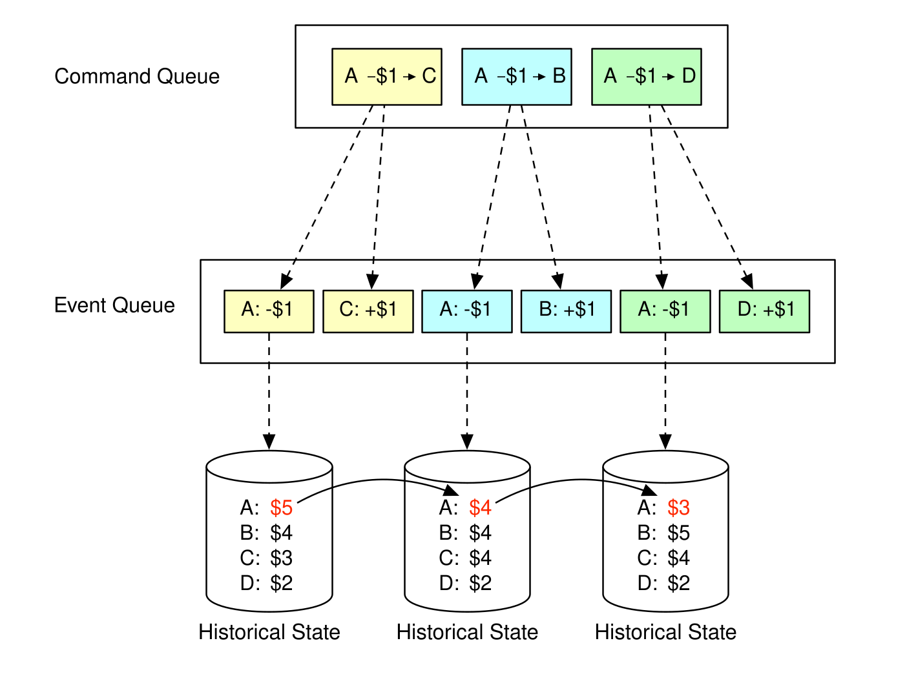
</div>

All audit-related questions asked in the beginning of the section can be addressed by relying on event sourcing:
1. Do we know the account balance at any given time? - events can be replayed from the start until the point which we are interested in.
2. How do we know the historical and current balances are correct? - correctness can be verified by recalculating all events from the start.
3. How do we prove the system logic is correct after a code change? - we can run different versions of the code against the events and verify their results are identical.

### **Command-query responsibility segregation (CQRS)**

Answering client queries about their balance can be addressed using the CQRS architecture - there can be multiple read-only State Machines which are responsible for querying the historical state, based on the immutable events list.

The read-only State Machines lag behind to some extent, but will always catch up. The architecture design is **eventually consistent**.

<div style="margin-left:1rem">
    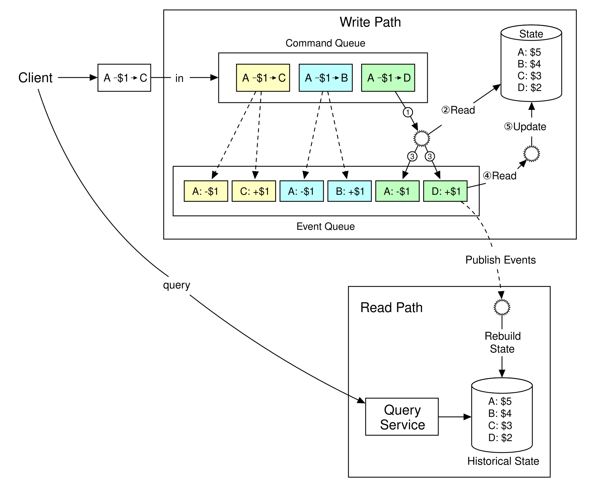
</div>

## Step 3: Design Deep Dive

In this section, we'll explore some performance optimizations, as we're still required to scale to 1 million TPS.

### **High-performance event sourcing**

In the earlier example, we used Kafka as the Command and Event store, and the database as a State store. We could optimize it further.

#### **File-based Command and Event list**

The first optimization is to save Commands and Events to a local disk, rather than to a remote store like Kafka. This avoids transit time across the network.

The second optimization is to cache recent Commands and Events in memory.

A technique called **mmap** [[13]](#ref-13) is great for implementing the optimizations mentioned previously. Mmap can write to a local disk and cache recent content in memory at the same time.

<div style="margin-left:1rem">
    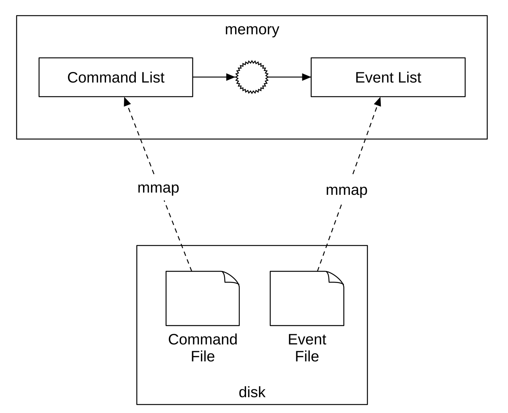
</div>

#### **File-based State**

In the previous design, State (balance information) is stored in a relational database. A DB is accessed through networks; that means State information can be saved to the local disk, as well.

SQLite [[14]](#ref-14) is a file-based local relational database. Alternatively, use RocksDB [[15]](#ref-15), which is a local file-based key-value store.

RocksDB is chosen because it uses a **log-structured merge-tree** (LSM), which is optimized for write operations. To improve read performance, the most recent data is cached.

<div style="margin-left:1rem">
    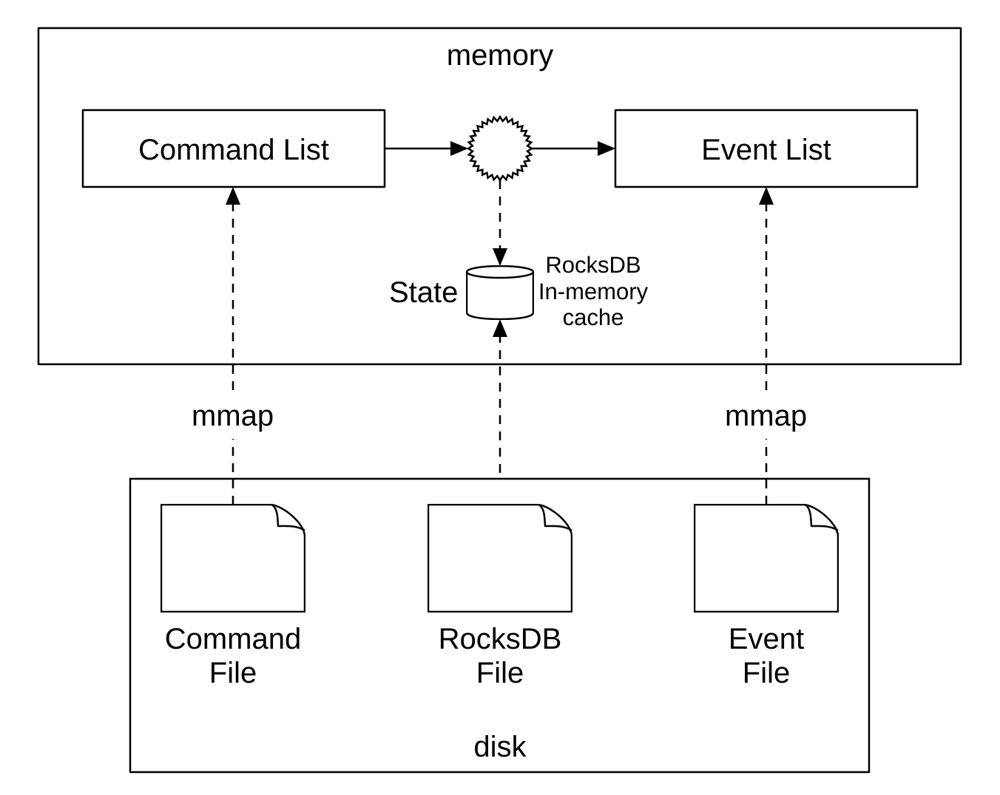
</div>

#### **Snapshot**

Once everything is file-based, let us consider how to accelerate the reproducibility process. When we first introduced reproducibility, the State Machine had to process Events from the very beginning, every time. What we could optimize is to periodically stop the State Machine and save the current State into a file. This is called a **snapshot**.

A snapshot is an immutable view of a historical State. Snapshots could be saved on a disk each day so all transactions could be verified. A snapshot is a giant binary file and a common solution is to save it in an object storage solution, such as HDFS [[16]](#ref-16).

<div style="margin-left:1rem">
    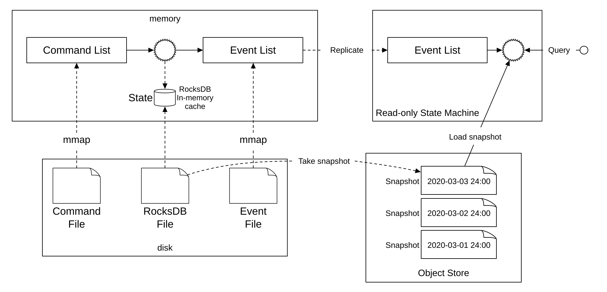
</div>

### **Reliable high-performance event sourcing**

All the optimizations done so far are great, but they make our service stateful. We need to introduce some form of replication for reliability purposes.

Before we do that, we should analyze what kind of data needs high reliability in our system:
* the state and snapshot can always be regenerated by reproducing them from the events list. Hence, we only need to guarantee the event list reliability.
* one might think we can always regenerate the events list from the command list, but that is not true, since commands are non-deterministic.
* the conclusion is that we need to ensure high reliability for the events list only

In order to achieve high reliability for events, we need to replicate the list across multiple nodes. We need to guarantee:
* that there is no data loss
* the relative order of data within a log file remains the same across replicas.

#### **Consensus**

To achieve this, we can employ a consensus algorithm, such as **Raft**.

The Raft algorithm guarantees that as long as more than half of the nodes are online, the append-only lists on them have the same data. For example, if we have 5 nodes and use the Raft algorithm to synchronize their data, as long as at least 3 (more than half) of the nodes are up, the system can still work properly as a whole.

<div style="margin-left:1rem">
    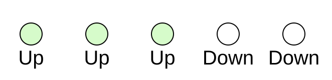
</div>

A node can have three different roles in the Raft algorithm.
1. Leader
2. Candidate
3. Follower

We can find the implementation of the Raft algorithm in the Raft paper. We will only cover the basics here and not go into detail. In Raft, at most one node is the leader of the cluster and the remaining nodes are followers. The leader is responsible for receiving external commands and replicating data reliably across nodes in the cluster.

With the Raft algorithm, the system is reliable as long as the majority of the nodes are operational.

#### **Reliable solution**

With replication, there won't be a single point of failure in our file-based Event Sourcing architecture.

For example, if there are 3 nodes in the cluster, it could tolerate the failure of 1 node, and if there are 5 nodes, it can tolerate the failure of 2 nodes.

<div style="margin-left:1rem">
    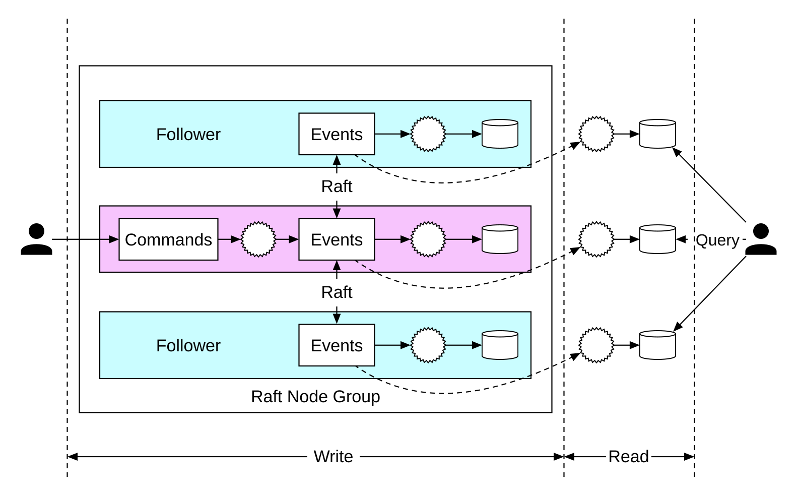
</div>

With this approach, all nodes update the state, based on the events list. Raft ensures the leader and followers have the same events list.

### **Distributed event sourcing**

So far, we've managed to design a system which has high single-node performance and is reliable.

Some limitations we have to tackle:
* The capacity of a single Raft group is limited. At some point, we need to shard the data and implement distributed transactions.
* In the CQRS architecture, the request/response flow is slow. A client would need to periodically poll the system to learn when their wallet has been updated.

#### **Pull vs push**

In the pull model, an external user periodically pulls execution status from the read-only State Machine. This model is not real-time and may overload the wallet service if the pulling frequency is set too high.

<div style="margin-left:1rem">
    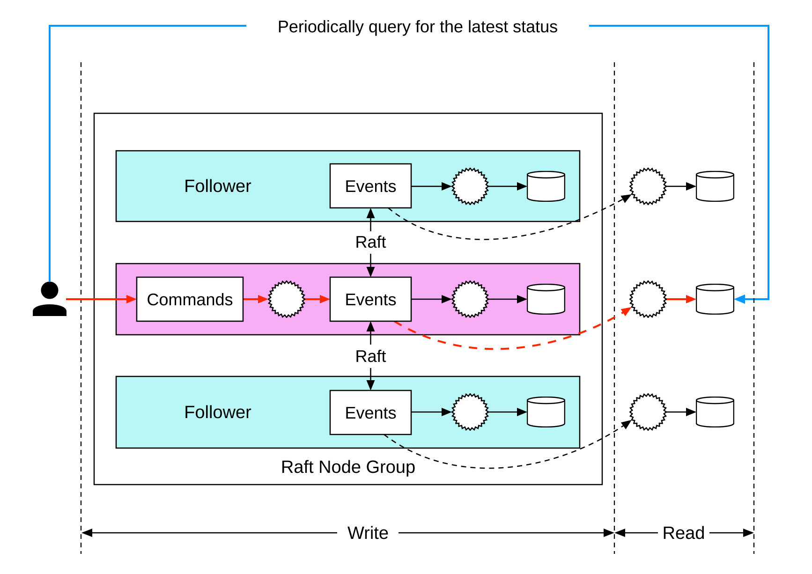
</div>

The naive pull model can be improved by adding a **reverse proxy** [[18]](#ref-18) between the external user and the Event Sourcing node.

In this design, the external user sends a Command to the reverse proxy, which forwards the Command to Event Sourcing nodes and periodically pulls the execution status. This design simplifies the client logic, but the communication is still not real-time.

<div style="margin-left:1rem">
    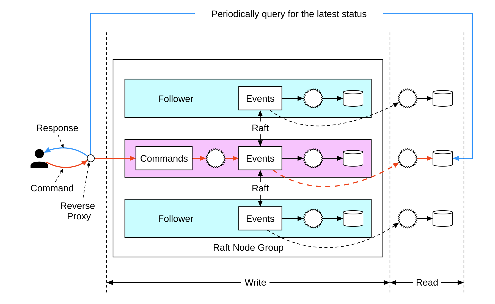
</div>

This alleviates the system load as we could fetch data for multiple users using a single request, but it still doesn't solve the real-time receipt requirement.

One final change we could make is to have the read-only state machines push responses back to the reverse proxy once they're available. This can give the user the sense that updates happen in real time.

<div style="margin-left:1rem">
    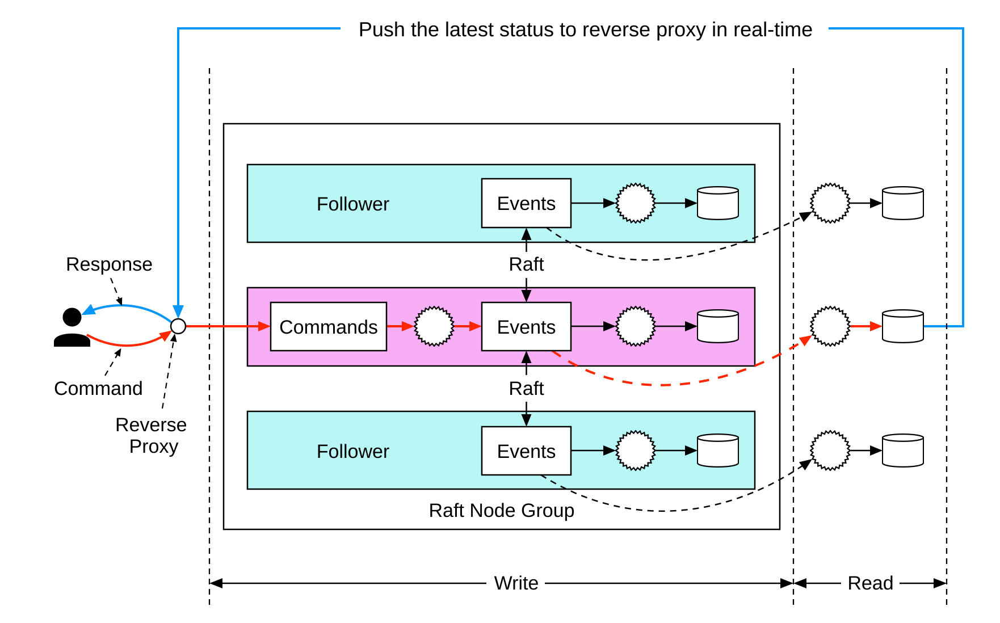
</div>

#### **Distributed transaction**

Once synchronous execution is adopted for every Event Sourcing node group, we can reuse the distributed transaction solution, TC/C or Saga. Assume we partition the data by dividing the hash value of the key by 2.

<div style="margin-left:1rem">
    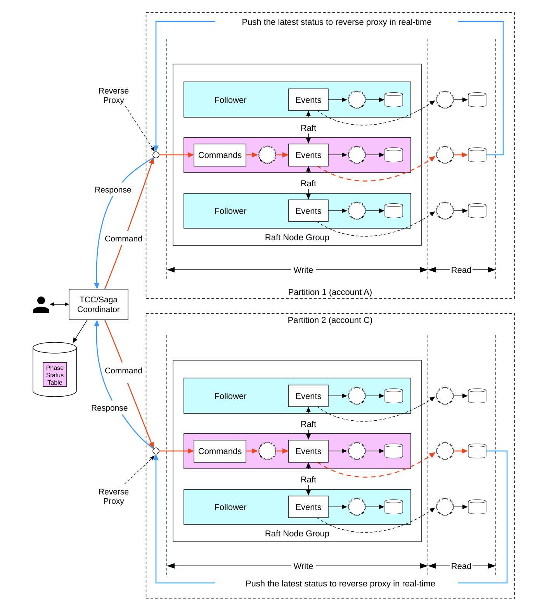
</div>

Here's an example lifecycle of a balance transfer request in our final system:
1. User A sends a distributed transaction to the Saga coordinator. It contains two operations: `A-$1` and `C+$1`.
2. The Saga coordinator creates a record in the Phase Status Table to trace the status of a transaction.
3. The Saga coordinator examines the order of operations and determines that it needs to handle `A-$1` first. The coordinator sends `A-$1` as a Command to Partition 1, which contains account A’s information.
4. Partition 1’s Raft leader receives the `A-$1` command and stores it in the command list. It then validates the command. If it is valid, it is converted into an Event. The Raft consensus algorithm is used to synchronize data across different nodes. The Event (deducting $1 from A’s account balance) is executed after synchronization is complete.
5. After the Event is synchronized, the Event Sourcing framework of Partition 1 synchronizes the data to the read path using CQRS. The read path reconstructs the state and the status of execution.
6. The read path of Partition 1 pushes the status back to the caller of the Event Sourcing framework, which is the Saga coordinator.
7. The Saga coordinator receives the success status from Partition 1.
8. The Saga coordinator creates a record, indicating the operation in Partition 1 is successful, in the Phase Status table.
9. Because the first operation succeeds, the Saga coordinator executes the second operation, which is `C+$1`. The coordinator sends `C+$1` as a Command to Partition 2, which contains account C’s information.
10. Partition 2’s Raft leader receives the `C+$1` command and saves it to the command list. If it is valid, it is converted into an Event. The Raft consensus algorithm is used to synchronize data across different nodes. The Event (adding $1 to C’s account) is executed after synchronization is complete.
11. After the Event is synchronized, the Event Sourcing framework of Partition 2 synchronizes the data to the read path using CQRS. The read path will reconstruct the state and the status of execution.
12. The read path of Partition 2 pushes the status back to the caller of the Event Sourcing framework, which is the Saga coordinator.
13. The Saga coordinator receives the success status from Partition 2.
14. The Saga coordinator creates a record in the Phase Status table indicating that the operation in Partition 2 is successful.
15. At this time, all operations succeed and the distributed transaction is completed. The Saga coordinator responds to its caller with the result.

## Step 4: Wrap Up

Here's the evolution of our design:
* We started from a solution using an in-memory Redis store. The problem with this approach is that it is not durable storage.
* We moved on to using relational databases, on top of which we execute distributed transactions using 2PC, TC/C or distributed saga.
* Next, we introduced event sourcing in order to make all the operations auditable.
* We started by storing the data in external storage using an external database and queue, but that's not performant.
* We proceeded to store data in local file storage, leveraging the performance of append-only operations. We also used caching to optimize the read path.
* The previous approach, although performant, wasn't durable. Hence, we introduced Raft consensus with replication to avoid single points of failure.
* We also adopted CQRS with a reverse proxy to manage a transaction's lifecycle on behalf of our users.
* Finally, we partitioned our data across multiple Raft groups, which are orchestrated using a distributed transaction mechanism - TC/C or distributed saga.

## Reference materials

1. <a id="ref-1"></a>[Transactional guarantees](https://docs.oracle.com/cd/E17275_01/html/programmer_reference/rep_trans.html)
2. <a id="ref-2"></a>[TPC-E Top Price/Performance Results](http://tpc.org/tpce/results/tpce_price_perf_results5.asp?resulttype=all)
3. <a id="ref-3"></a>[ISO 4217 CURRENCY CODES](https://en.wikipedia.org/wiki/ISO_4217)
4. <a id="ref-4"></a>[Apache ZooKeeper](https://zookeeper.apache.org/)
5. <a id="ref-5"></a>[Martin Kleppmann (2017). Designing Data-Intensive Applications. O'Reilly Media.](https://www.oreilly.com/library/view/designing-data-intensive-applications/9781491903063/)
6. <a id="ref-6"></a>[X/Open XA](https://en.wikipedia.org/wiki/X/Open_XA)
7. <a id="ref-7"></a>[Compensating transaction](https://en.wikipedia.org/wiki/Compensating_transaction)
8. <a id="ref-8"></a>[SAGAS, Hector Garcia-Molina](https://www.cs.cornell.edu/andru/cs711/2002fa/reading/sagas.pdf)
9. <a id="ref-9"></a>[Evans, E. (2003). Domain-Driven Design: Tackling Complexity in the Heart of Software. Addison-Wesley Professional.](https://www.pearson.com/en-gb/subject-catalog/p/domain-driven-design-tackling-complexity-in-the-heart-of-software/P200000009375)
10. <a id="ref-10"></a>[Apache Kafka](https://kafka.apache.org/)
11. <a id="ref-11"></a>[CQRS](https://martinfowler.com/bliki/CQRS.html)
12. <a id="ref-12"></a>[Comparing Random and Sequential Access in Disk and Memory](https://deliveryimages.acm.org/10.1145/1570000/1563874/jacobs3.jpg)
13. <a id="ref-13"></a>[mmap](https://man7.org/linux/man-pages/man2/mmap.2.html)
14. <a id="ref-14"></a>[SQLite](https://www.sqlite.org/index.html)
15. <a id="ref-15"></a>[RocksDB](https://rocksdb.org/)
16. <a id="ref-16"></a>[Apache Hadoop](https://hadoop.apache.org/)
17. <a id="ref-17"></a>[Raft](https://raft.github.io/)
18. <a id="ref-18"></a>[Reverse proxy](https://en.wikipedia.org/wiki/Reverse_proxy)
